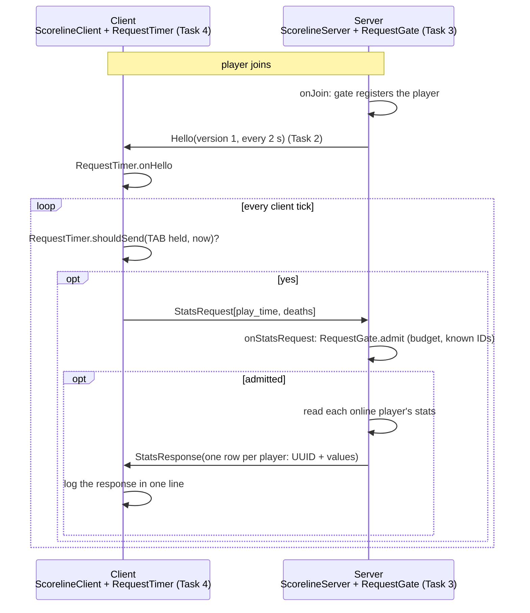
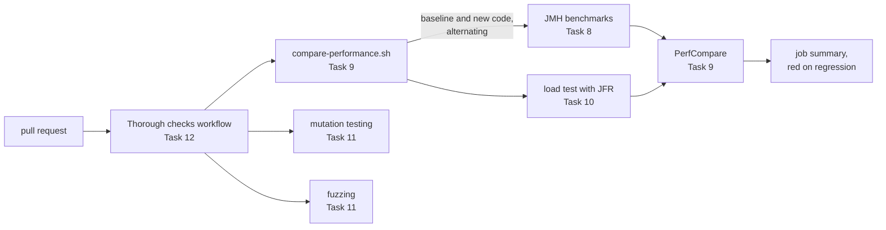
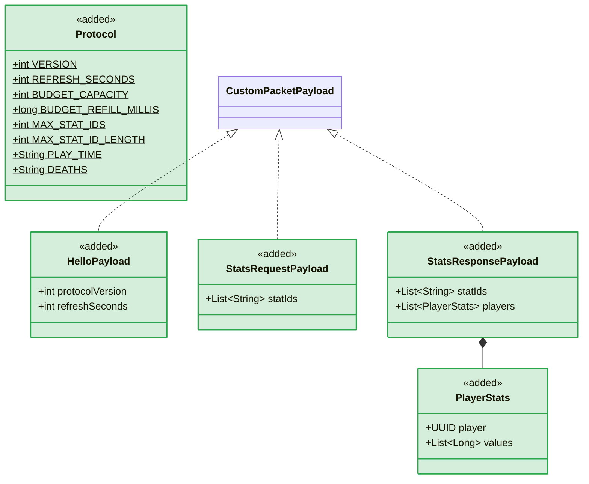
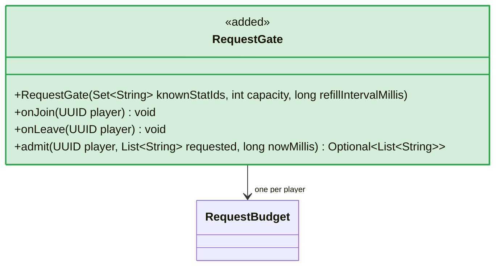
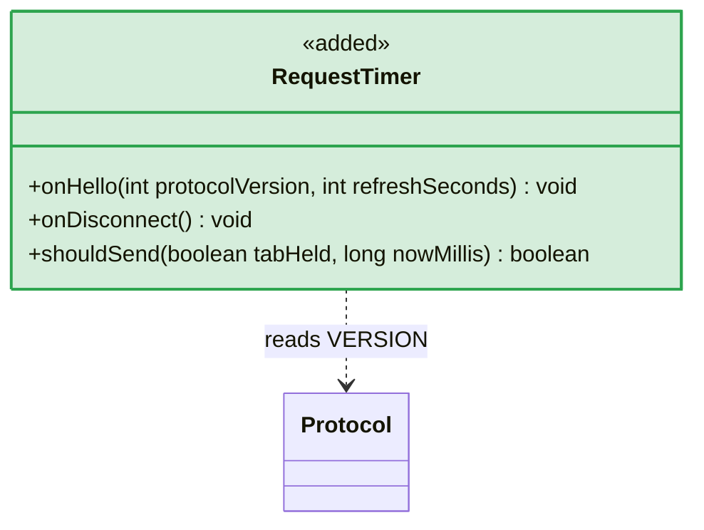
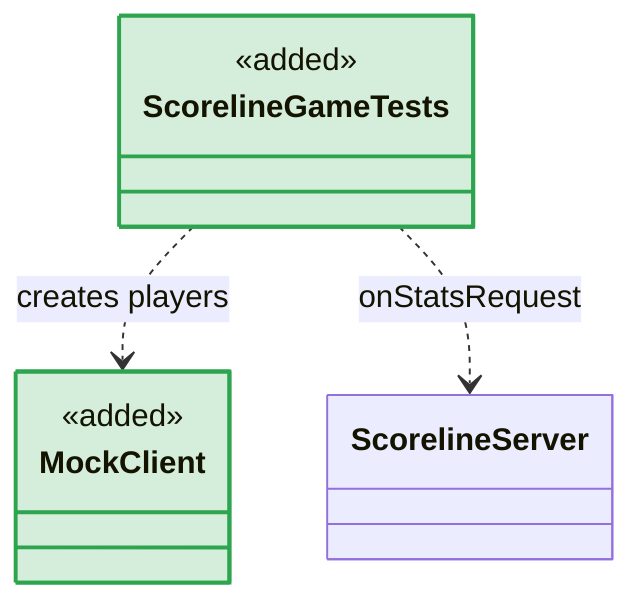
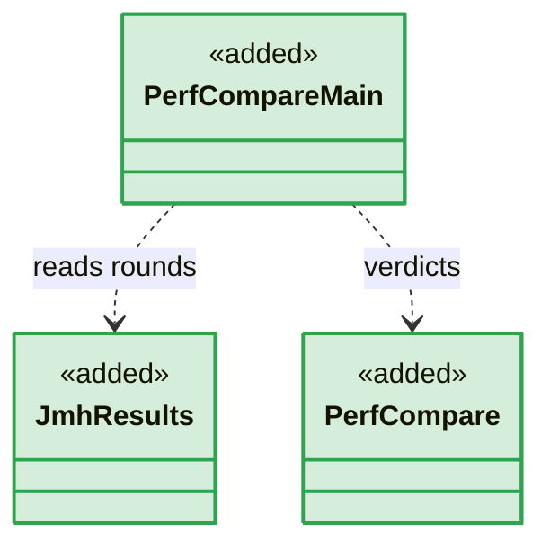
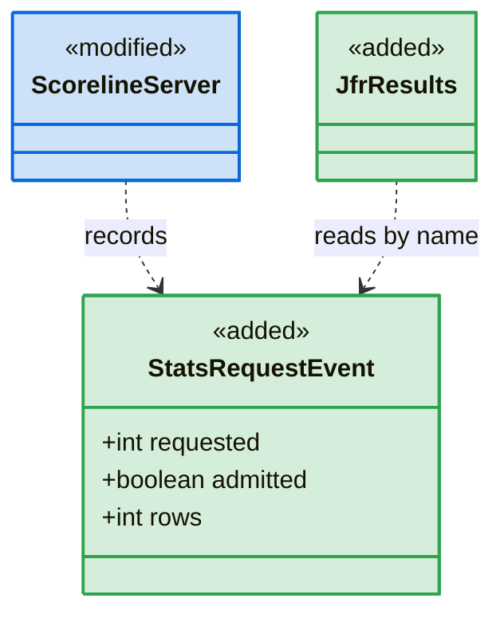

# Scoreline v0.2 Protocol – Implementation Plan

Nov 14, 2026

**Goal:** a modded client on a modded server receives a hello on join and, while TAB is held, gets playtime and deaths for every online player every 2 seconds. Game tests on a headless server prove that the answers are right and that the request budget holds; stored example messages pin the wire format of protocol version 1. Every pull request from here on also compares the performance of the new code with the old (microbenchmarks with allocation, and a load test measured with JFR), runs mutation testing and fuzzes the payload decoders. spark is available in local runs without becoming a dependency of the mod.

**Non-goals:**

- Drawing anything: the client only logs what it receives. The TAB columns arrive in v0.3, together with the client-side store they read from.
- The client startup check (v0.3), the refresh interval from a config file (v0.4), stats chosen by the player (v0.5).
- Answering from a shared snapshot (v0.7); v0.2 reads values on the main thread, as the spec allows until then.
- Stat modes and the game test "hidden stats are not sent" (v0.8).
- Splitting large responses by a byte budget (v0.11, with the tile protocol).
- Cost against server size beyond the spec's target (counts above 50, a scaling curve, the load test at several counts): the benchmarks measure 1, 10 and 50 players and the load test 50. Larger counts come with the work on larger servers.
- Storage figures in the comparison (v0.10, when there is storage).
- CodeQL and OpenSSF Scorecard: considered and left out.

## How it works

1. **Join.** The server registers the player in its `RequestGate` (Task 3) and sends a hello (Task 2) if the client has Scoreline. The hello tells the client "this server speaks protocol 1, ask every 2 seconds".
2. **Ask.** Every client tick, `RequestTimer` (Task 4) decides from "hello received?", "TAB held?" and the time whether to send a request now.
3. **Answer.** The server's `RequestGate` decides whether to answer (budget left?) and with which stats (only known IDs). The server then reads the values and sends one row per online player.
4. **Show.** In v0.2 the client only logs the rows; v0.3 draws them.

A vanilla client gets no hello, because it lacks the channel, and a client that got no hello never asks. So vanilla and modded peers mix without errors. Tasks 2 to 4 are plain logic with unit tests; Task 5 connects them to NeoForge; Task 6 tests the connected whole inside a real server.

Tasks 7 to 12 add the tools that watch this code from now on:

5. **Compare.** On every pull request, `scripts/compare-performance.sh` (Task 9) builds the baseline (the pull request's base, or a tag) next to the new code and runs both several times, alternating: the JMH benchmarks (Task 8) and the load test (Task 10). `PerfCompare` (Task 9) compares the medians and fails on a clear regression.
6. **Check the tests.** In the same workflow (Task 12), PIT changes the code in small ways and checks that a test notices; Jazzer feeds random bytes to the payload decoders (Task 11).
7. **Look by hand.** spark (Task 7) is loaded in local runs only, for profiling in the game; JFR recordings from the load test open in Java Mission Control.

**Spec changes:** made in the commits before this plan: a release without a `v*` tag is an error (Task 1), and the stat ID example uses vanilla's stat name (see "Decided here"). Later commit: the performance comparison, the profiling tools and the thorough checks join v0.2, and slow checks run on pull requests instead of nightly (Tasks 7 to 12).

**New in this version:** NeoForge's payload registration (`RegisterPayloadHandlersEvent`) and its game-test framework. From Task 7 on: spark through CurseMaven (local runs only), JMH with the Gradle plugin `me.champeau.jmh`, JFR events, PIT with `info.solidsoft.pitest`, Jazzer, and a plain Java Gradle module `tools` for the comparison.

**Decided here** (the spec leaves them open):

| Item | Value | Reason |
| --- | --- | --- |
| Protocol version | `1` | First version |
| Stat ID format | Vanilla's stat name (`Stat.getName()`), for example `minecraft.custom:minecraft.play_time` | It is Minecraft's own unique name for a stat, the one scoreboard objectives use. `minecraft:play_time` alone is only the value inside the stat type `minecraft:custom` and is not unique: `minecraft:stone` exists under mined, crafted, used and more. `ObjectiveCriteria.byName` turns the name back into the stat, so v0.5 needs no own parser. API stats (v0.6) keep IDs such as `questmod:quests_completed`, which never resolve as a vanilla stat |
| Request budget | 5 tokens, one back per 1,000 ms | The client asks every 2,000 ms; a burst of 5 covers re-pressing TAB a few times |
| Request limits | at most 16 stat IDs of at most 256 characters | Bounds what a client can make the server decode; v0.5 needs only 4 |
| Time limit | a median more than 1.5 × the baseline's is a regression | Side by side on one machine the noise is a few percent; 1.5 catches real slowdowns without false alarms. Tightened once the A/A run (T-103) shows the real noise |
| Allocation limit | more than 1.10 × the baseline's bytes per operation **and** more than 32 bytes more | Allocation varies far less than time; the 32 bytes keep tiny values (0 → 24 bytes) from failing on a ratio |
| Improvement | a median below the baseline's ÷ 1.5 (time) is marked "improved" | Reported only, never fails |
| Rounds | 3 rounds, each running the baseline and then the new code | Medians of 3 per version; alternating spreads drift over both |
| JMH settings | per round: 1 fork, 3 warm-up iterations and 5 measurement iterations of 1 s each | About 8 s per benchmark, player count and version per round |
| Player counts in benchmarks | 1, 10 and 50, only where the input depends on them | One player, a small server and the spec's target; larger counts come with the work on larger servers |
| Load test | 50 mock players, each asking for `[PLAY_TIME, DEATHS]` every 40 ticks, for 600 ticks | The spec's 50-player target and the client's 2 s interval; 30 s per run keeps the job near 10 minutes |
| Fuzzing time | 120 s per fuzz target on pull requests | Three targets, about 6 minutes |
| Mutation gate | the score measured in Task 11, rounded down to the next 5% | A gate the current code meets; surviving mutants are reviewed once, not hidden by a low number |
| spark | CurseForge project `361579`, property `spark_curseforge_file_id` | Empty means no spark; CI always runs with it empty |

## Tasks

1. Release script: no tag is an error
2. Payloads and stored example messages
3. `RequestGate`: which request the server answers
4. `RequestTimer`: when the client asks
5. Wiring on NeoForge and trying it in the game
6. Game tests
7. spark in local runs only
8. JMH benchmarks with allocation
9. Comparing two versions: `PerfCompare` and the script
10. JFR events and the load test
11. Mutation testing and fuzzing
12. The thorough-checks workflow

## Task 1: Release script: no tag is an error

**Why:** `scripts/next-version.sh` treats "no `v*` tag" as the first release. That case is over: v0.1.0 is tagged. Now a missing tag means the workflow checked out without tags, and the script should say so instead of producing a wrong version or a misleading message. This is small and independent of the protocol, so it goes first.

**Design:** with no tag matching `vX.Y.Z`, the script prints `No release tag found; check out with all tags (fetch-depth: 0)` to stderr and exits 1. Everything else stays as in v0.1 (v0.1 plan, Task 8). The header comment of the script and the `bump` input description in `.github/workflows/release.yml` (drop "ignored for the first release") are updated to match; the spec already says so. `version=0.1.0` stays in `gradle.properties`.

**Tests** (run by hand with throwaway tags, as in v0.1; to hide the real tags, run in a fresh clone with `git tag -d v0.1.0`)

| ID | Case → expected | Bug it catches |
| --- | --- | --- |
| T-24 | no `v*` tag, `minor` → stderr `No release tag found; check out with all tags (fetch-depth: 0)`, nothing on stdout, exit 1 | the old fallback still prints the version from `gradle.properties` |
| T-25 | only the tags `v0.2.0-rc1` and `vnext` → same as T-24 | the `vX.Y.Z` filter dropped, so a malformed tag is parsed and the arithmetic fails or yields garbage |
| T-26 | the rows of the v0.1 table with a tag (`v0.1.0` → patch `0.1.1`, minor `0.2.0`, major `1.0.0`; `v0.9.0` and `v0.10.0` → minor `0.11.0`; existing release branch → exit 1; `big` → usage, exit 1) still hold | the change broke the existing paths |

**Done when**

- [x] T-24 to T-26 give the expected output and exit codes
- [x] the script's header comment and the `bump` input description no longer mention a first release without a tag

The workflow runs from `master`, so the end-to-end check comes with the v0.2 release: its dry run with `bump: minor` must show `0.2.0`.

## Task 2: Payloads and stored example messages

**Why:** the three messages of the protocol are what client and server agree on. They are defined once in `common` as vanilla `CustomPacketPayload` records with a `StreamCodec`, so only their registration differs per loader. Their bytes are stored as example messages (golden files): later versions must still read them, which is how the spec's promise "later versions extend the protocol without breaking older clients" is tested.

**Background**

- **Payload.** Minecraft sends data between client and server as packets. A mod's own data travels in *custom payloads*: each has a type, named by an identifier such as `scoreline:hello`, so the receiver knows which handler gets it. In code a payload is a class (here a Java record) that implements vanilla's `CustomPacketPayload` and returns its type.
- **StreamCodec.** The object that turns a payload into bytes and back: an encoder that writes the fields in a fixed order and a decoder that reads them in the same order. Vanilla ships codecs for common types (`ByteBufCodecs.VAR_INT`, `ByteBufCodecs.STRING_UTF8`, …) that can be combined. Writing `encode`/`decode` by hand is also fine, and Hello needs it to skip unknown bytes.
- **FriendlyByteBuf.** Minecraft's byte buffer (a wrapper around Netty's `ByteBuf`) with methods such as `writeVarInt`, `writeUtf` and `writeUUID`. The codecs read and write through it.
- **VarInt / VarLong.** A variable-length integer: 7 bits per byte, the top bit says "another byte follows". Small numbers take one byte (`2` is `02`), large ones up to 5 (int) or 10 (long) bytes. Minecraft uses it for most counts and IDs.
- **Golden file.** A stored copy of the exact bytes of a message. A test compares the encoder's output with it and decodes it again. If someone changes the format by accident, the test fails, because the file never changes.

Further reading: NeoForge docs, "Networking" → "Payloads" (docs.neoforged.net).

**Design:** all in `io.github.foursource.scoreline.net` and `…net.payload` (measured by the coverage gate; until Task 5 through the `logicPackages` entry `net/**`, from Task 5 on because nothing in them is excluded).

- `Protocol`: the constants of the table "Decided here" (`VERSION`, `REFRESH_SECONDS = 2`, `BUDGET_CAPACITY`, `BUDGET_REFILL_MILLIS`, `MAX_STAT_IDS`, `MAX_STAT_ID_LENGTH`) and the two stat IDs `PLAY_TIME = "minecraft.custom:minecraft.play_time"` and `DEATHS = "minecraft.custom:minecraft.deaths"` as strings. No Minecraft classes.
- `HelloPayload(int protocolVersion, int refreshSeconds)`, type `scoreline:hello`, server → client. The decoder reads the two fields it knows and then **skips every remaining byte**: a newer server may append fields, and an older client must not fail on them.
- `StatsRequestPayload(List<String> statIds)`, type `scoreline:stats_request`, client → server. Decoding fails (an exception, which makes the server drop the connection, as for any malformed packet) for more than `MAX_STAT_IDS` IDs or an ID longer than `MAX_STAT_ID_LENGTH`. The constructor rejects duplicate IDs (`IllegalArgumentException`); the decoder calls it, so duplicates on the wire fail decoding too. The type stays a `List`: the order matters (the response's values follow it), and a `Set`'s `equals` would ignore it.
- `StatsResponsePayload(List<String> statIds, List<PlayerStats> players)` with `PlayerStats(UUID player, List<Long> values)`, type `scoreline:stats_response`, server → that client. Each entry's values are in the order of `statIds`. The constructor rejects an entry whose value count differs from the number of IDs (`IllegalArgumentException`), so a misaligned response can never be encoded. It also rejects duplicate IDs, because the client could not tell which column a value belongs to. The lists are copied with `List.copyOf`, so the records are immutable and compare by value.

**Wire format of protocol version 1** (the golden files depend on it):

| Message | Bytes in order |
| --- | --- |
| Hello | VarInt protocol version, VarInt refresh seconds |
| Request | VarInt count, then each ID as UTF-8 string (VarInt byte length, bytes) |
| Response | the ID list as in the request, VarInt player count, then per player: UUID (two longs, most significant first), VarInt value count (equal to the ID count), one VarLong per ID |

**Files:** golden files under `common/src/test/resources/protocol/v1/` (`hello.bin`, `stats_request.bin`, `stats_response.bin`). They are written once from the encoder's output by `scripts/generate-goldens.sh`, checked by hand against the table above, and never changed afterwards; a new protocol version adds a `v2` folder next to them.

**Tests** (unit, `common`)

| ID | Case → expected | Bug it catches |
| --- | --- | --- |
| T-27 | `Hello(1, 2)` encodes to exactly the bytes of `v1/hello.bin` (`01 02`), and the file decodes to `Hello(1, 2)`; its type is `scoreline:hello` | field order or width differs from the documented format; a type ID that matches neither the handler nor the golden file's name |
| T-28 | `v1/hello.bin` followed by `07 08 09` → decodes to `Hello(1, 2)` with no bytes left unread | a newer server's longer hello makes older clients fail |
| T-29 | request `[PLAY_TIME, DEATHS]` round-trips and matches `v1/stats_request.bin`; its type is `scoreline:stats_request` | IDs lost or reordered; a type ID that matches neither the handler nor the golden file's name |
| T-30 | request with `MAX_STAT_IDS` IDs → decodes; with `MAX_STAT_IDS + 1` → decoding throws a `DecoderException` whose message contains `MAX_STAT_IDS + 1` | unbounded list lets one packet make the server allocate without limit; off-by-one in the limit |
| T-31 | request with one ID of `MAX_STAT_ID_LENGTH` characters → decodes; `MAX_STAT_ID_LENGTH + 1` → a `DecoderException` whose message contains `MAX_STAT_ID_LENGTH + 1` | unbounded string length; off-by-one |
| T-32 | response `[PLAY_TIME, DEATHS]` with rows (UUID `A`, `72_000`, `3`) and (UUID `B`, `4_000_000_000L`, `0`) round-trips in row order and matches `v1/stats_response.bin`; its type is `scoreline:stats_response` | values written as `int` (the second row's playtime exceeds `Integer.MAX_VALUE`); rows reordered; UUID halves swapped; a type ID that matches neither the handler nor the golden file's name |
| T-33 | `PlayerStats` of player `A` with 1 value in a response with 2 IDs → `IllegalArgumentException` naming `A` | misaligned entries encoded silently, so the client reads the next player's UUID as a value |
| T-52 | `HelloPayload.current()` equals `Hello(Protocol.VERSION, Protocol.REFRESH_SECONDS)` | the server's hello swaps or drops the protocol constants |
| T-53 | `PlayerStats` of player `A` with 3 values in a response with 2 IDs → `IllegalArgumentException` naming `A` | the check compares with `<` instead of `!=`, so surplus values are encoded |
| T-54 | response with 2 IDs: first row (player `A`) 2 values, second row (player `B`) 1 value → `IllegalArgumentException` naming `B` | only the first row is checked; the error names the wrong row |
| T-55 | bytes in the response format with 2 IDs and one row of player `A` holding 1 VarLong → decoding throws an `IllegalArgumentException` naming `A` | the decoder bypasses the constructor check, so the client shows values under the wrong columns |
| T-56 | `PlayerStats` built from an `ArrayList`; the list is changed afterwards → `values()` unchanged | `List.copyOf` dropped, so the record is not immutable |
| T-57 | `StatsRequestPayload` built from an `ArrayList`; the list is changed afterwards → `statIds()` unchanged | the same for the request |
| T-58 | `StatsResponsePayload` built from two `ArrayList`s; both are changed afterwards → `statIds()` and `players()` unchanged | the same for the response |
| T-59 | `Hello(300, 200)` encodes to `AC 02 C8 01` (300 = `0x2C \| 0x80`, `0x02`; 200 = `0x48 \| 0x80`, `0x01`) and decodes back | the hand-written codec writes one byte per field; T-27's `01 02` reads the same as a byte or a VarInt |
| T-60 | response with `MAX_STAT_IDS` IDs and no rows → decodes; with `MAX_STAT_IDS + 1` → decoding throws a `DecoderException` whose message contains `MAX_STAT_IDS + 1` | the response's own ID codec drifts from the request's and loses its count limit; off-by-one |
| T-61 | response with one ID of `MAX_STAT_ID_LENGTH` characters and no rows → decodes; `MAX_STAT_ID_LENGTH + 1` → a `DecoderException` whose message contains `MAX_STAT_ID_LENGTH + 1` | the response's ID codec loses its length limit; off-by-one |
| T-62 | `PlayerStats` with a `null` player → `NullPointerException`; with a `null` value in the list → `NullPointerException` | a `null` reaches the encoder and fails on the network thread when sending, far from the code that built it |
| T-63 | `StatsRequestPayload([DEATHS, DEATHS])` → `IllegalArgumentException` naming `DEATHS`; the bytes of the list `[DEATHS, DEATHS]` → decoding throws the same | a client makes the server read and send the same stat twice |
| T-64 | `StatsResponsePayload([DEATHS, DEATHS], [])` → `IllegalArgumentException` naming `DEATHS` | the client cannot tell which column a value belongs to |

T-52 was added during Task 2, after a review found that comparing `current()` with the v1 literal `Hello(1, 2)` inside T-27 would make a v1 test fail when `Protocol.VERSION` is raised. It checks the current version, so it compares with the constants instead.

T-53 to T-62 were added after Task 2, when a review found cases that full coverage did not show: every branch ran, but these bugs would still pass. T-33 moves to `StatsResponsePayloadTest`, because it tests the response's constructor; T-33, T-53 and T-54 share one parametrized test. T-60 and T-61 test the response separately from T-30 and T-31, because both payloads define their own codec. T-29 no longer claims to catch a wrong charset: stat IDs are ASCII identifiers, whose bytes are the same in every common charset.

T-63 and T-64 were added while reading Task 3: requesting a stat twice makes no sense, so both payloads reject duplicate IDs. The gate keeps its own duplicate filter (T-36), because the list it gets may come from another source later.

Tests that expect an exception also check a fragment of its message: the player or ID it names, or for Minecraft's limits the number that broke the limit. The type alone is not enough once several checks throw the same type, because a test could pass on the wrong check. A fragment instead of the whole message keeps the tests independent of the wording. T-62 checks the type only: each of its cases holds a single `null`, so only one check can throw.

⚠ T-27 to T-32 use Minecraft's `FriendlyByteBuf` in a plain unit test. Step 1 confirms that this works without starting Minecraft.

**Steps**

1. **Check first.** Confirm that a JUnit test in `common` can encode and decode with `FriendlyByteBuf` over `Unpooled.buffer()` and create a `CustomPacketPayload.Type` from an `Identifier` without `Bootstrap.bootStrap()`. If a class needs the bootstrap, note which, and call it once in a JUnit extension. Found: ModDevGradle puts Minecraft and its libraries (Netty included) on the `main` source set only, so `common/build.gradle` calls `neoForge { addModdingDependenciesTo(sourceSets.test) }` to give the tests the same classpath.
2. Write `GoldenWriter` (test sources, a `void main` taking an output folder): it builds its messages from the current protocol (`HelloPayload.current()`, `PLAY_TIME`, `DEATHS`) plus fixed example data (the UUIDs and values of T-32), encodes each with its `STREAM_CODEC` and writes the readable bytes to `<out>/v<Protocol.VERSION>/<TYPE.id().getPath()>.bin`. So the same writer produces the next version's folder once `Protocol.VERSION` is raised. The tests keep their own literals from the Tests table, because a version's tests must keep checking that version's files. Register it in `common/build.gradle` as the `JavaExec` task `generateGoldens` with the test runtime classpath, writing to `build/goldens/`.
3. Write `scripts/generate-goldens.sh` (bash): it runs `./gradlew :common:generateGoldens`, then copies each file from `common/build/goldens/` to `common/src/test/resources/protocol/`. Nothing is added or changed without a confirmation: for a version folder that does not exist yet (a new protocol version) it shows the new files' bytes and asks once before saving them; within an existing version it shows the bytes of a missing file and asks before adding it, leaves an identical file alone, and for a file whose bytes differ shows the `xxd` diff and asks before overwriting. Answers are read from `/dev/tty`; without a terminal the answer is no. If any generated file was not saved, the script exits non-zero.
4. Run the script, then read each golden file with a hex viewer (`xxd` in Git Bash) and compare it with the wire format table before committing it.

**Done when**

- [x] `./gradlew :common:check` passes, T-27 to T-33 and T-52 to T-64 included, and the coverage gate still holds with the new classes
- [x] the three golden files are committed and their bytes match the wire format table

## Task 3: `RequestGate`: which request the server answers

**Why:** the server must decide, for each incoming request, whether to answer and with which stats: unknown IDs are ignored and each player has a request budget (spec, Networking, Server rules). Keeping that decision in a plain class makes it unit-testable; the Minecraft part (Task 5) only reads the values and sends.

**Design:** `RequestGate` in `…net`, plain Java, one per server, used on the main thread only.

- `RequestGate(Set<String> knownStatIds, int capacity, long refillIntervalMillis)`: in v0.2 the known IDs are `PLAY_TIME` and `DEATHS`. The set is copied (`Set.copyOf`), so a later change to the caller's set does not change the filter. A capacity or interval below 1 throws `IllegalArgumentException` here, naming the parameter as `RequestBudget` does, instead of at the first join.
- `void onJoin(UUID player)`: gives the player a full `RequestBudget`. A player who is already joined keeps the budget they have, so a join reported twice cannot refill it.
- `void onLeave(UUID player)`: forgets the player's budget, so the map does not grow with every session. A reconnect therefore starts with a full budget. This is accepted: it gains at most `capacity` requests, and a login costs the server far more than that. Keeping the budget past a leave would need the time on join and leave and a clean-up of old entries.
- `Optional<List<String>> admit(UUID player, List<String> requested, long nowMillis)`: "answer this request, and with which stats?" Empty means refused: the player is not joined, or the budget is used up. Otherwise it returns the requested IDs that are known, in request order, without duplicates. The budget is checked first, so a request with only unknown IDs still uses a token and returns an empty list; the caller then sends nothing.

**Tests** (unit; `CAP` = 3, `T` = 500 ms; players `P` and `Q`; unless a row says otherwise, the gate knows `{PLAY_TIME, DEATHS}` and `P` has joined)

`CAP` and `T` differ from `Protocol.BUDGET_CAPACITY` and `BUDGET_REFILL_MILLIS` on purpose: a gate that uses the constants instead of its constructor arguments must fail.

| ID | Case → expected | Bug it catches |
| --- | --- | --- |
| T-34 | `P` joined, `[PLAY_TIME, DEATHS]` at 0 → `[PLAY_TIME, DEATHS]` | starter |
| T-35 | `[DEATHS, "minecraft.custom:minecraft.jump", PLAY_TIME]` → `[DEATHS, PLAY_TIME]` | a real vanilla stat that v0.2 does not offer is passed on, because the gate checks the format instead of the known set; order lost |
| T-36 | `[DEATHS, PLAY_TIME, DEATHS]` → `[DEATHS, PLAY_TIME]` | duplicates double the response; the last occurrence is kept instead of the first; kept although `StatsRequestPayload` already rejects duplicates (T-63), because the gate's input may come from another source later |
| T-37 | `P` never joined → empty; `P` joined, then left → empty; joined again → admitted | budget kept after logout (map grows); request answered without a join |
| T-38 | `CAP` requests by `P` at 0 → admitted, the next refused; `Q` at 0 → admitted | gate ignores the budget; budgets shared between players |
| T-39 | `CAP` requests `["questmod:quests_completed"]` at 0 → each an empty list; then `[DEATHS]` at 0 → refused | unknown-only requests bypass the budget, so a client can spam the server for free |
| T-65 | `CAP` requests by `P` at 0; `[DEATHS]` at `T - 1` → refused; at `T` → `[DEATHS]` | the gate does not pass `nowMillis` to the budget (passes 0, or builds a new budget per call), so the budget never refills |
| T-66 | gate knows `{DEATHS}`; `[PLAY_TIME, DEATHS]` → `[DEATHS]` | the gate filters against `Protocol`'s IDs instead of its `knownStatIds` |
| T-67 | `P` and `Q` joined; `P` leaves; `Q` at 0 → admitted | `onLeave` clears every player's budget |
| T-68 | `CAP` requests `[]` at 0 → each an empty list; then `[DEATHS]` at 0 → refused | an early return for an empty request skips the budget, so a client can spam the server for free |
| T-69 | gate with capacity 0 → `IllegalArgumentException` naming `capacity`; with interval 0 → naming `refillIntervalMillis` | invalid values fail only at the first join, inside the join event, far from where the gate was built (assumed) |
| T-70 | gate built from a `HashSet` `{PLAY_TIME, DEATHS}`; `DEATHS` removed from that set afterwards; `[DEATHS]` → `[DEATHS]` | `Set.copyOf` dropped, so the filter changes when the caller's set changes |
| T-71 | `CAP` requests by `P` at 0; `onJoin(P)` again; `[DEATHS]` at 0 → refused | a second join replaces the budget with a full one, so a repeated join refills it and lets the player flood the server |

T-65 to T-71 were added before Task 3, when a review found that the first six tests run everything at time 0 and with exactly `Protocol`'s IDs and budget, so a gate that ignores the time or its constructor arguments would still pass. T-36 now checks that the first occurrence keeps its place. T-39 and T-68 share one parametrized test.

**Done when**

- [x] `./gradlew :common:check` passes, T-34 to T-39 and T-65 to T-71 included

## Task 4: `RequestTimer`: when the client asks

**Why:** the client asks only while TAB is held, repeats at the interval the server announced, and sends nothing at all to a server that sent no hello (spec, Networking, Compatibility). This state is easy to get subtly wrong (a request every tick, or requests to a vanilla server after leaving a modded one), so it is a plain class with unit tests; the client glue in Task 5 only feeds it the TAB key state and the time. It is polled each tick rather than driven by a key event: the repeats while TAB is held need a clock anyway, vanilla polls `keyPlayerList.isDown()` the same way to show the list, and polling cannot miss a release (window focus lost, a screen open, a rebound key).

**Design:** `RequestTimer` in `…net`, plain Java, one per client, used on the client thread only.

- `void onHello(int protocolVersion, int refreshSeconds)`: the server has the mod. A protocol version below 1 is ignored (no hello). A refresh interval below 1 second counts as 1 second (assumed, so a broken server cannot make the client send every tick). A version above `Protocol.VERSION` is accepted: a newer server sends nothing unasked except the hello, and the client asks only for what its own version knows (spec, Networking, Mixed mod versions). With version 1 the only one, the client needs no other use of the server's version yet.
- `void onDisconnect()`: back to "no hello", so leaving a modded server and joining a vanilla one sends nothing.
- `boolean shouldSend(boolean tabHeld, long nowMillis)`: called every client tick. True when a hello was received, TAB is held, and either TAB was just pressed or a full interval has passed since the last send. Releasing TAB resets, so the next press sends at once (assumed: fresh data is worth one extra request, and the server budget limits abuse).

**Tests** (unit; hello `(1, 2)` gives `R` = 2,000 ms)

| ID | Case → expected | Bug it catches |
| --- | --- | --- |
| T-40 | hello, TAB held at 0 → true | starter |
| T-41 | no hello; TAB held at 0, `R`, `10 * R` → false each time | client sends to a server without the mod |
| T-42 | hello; held at 0 → true; held at 50 → false; at `R - 1` → false; at `R` → true | a request every tick; off-by-one at the interval |
| T-43 | hello; held at 0 → true; released at 500; held at 600 → true (assumed) | a new press waits for the old interval, so the list shows stale data |
| T-44 | hello, then disconnect; held at 0 → false; hello again; held at `R` → true | hello state survives the disconnect, so the client sends to the next, vanilla server |
| T-45 | hello `(1, 0)`; held at 0 → true; at 999 → false; at 1,000 → true (assumed) | interval 0 makes the client send every tick |
| T-46 | hello `(0, 2)`; held at 0 → false | an unsupported protocol version is treated as a valid hello |
| T-72 | hello `(1, 5)`; held at 0 → true; at 4,999 → false; at 5,000 → true | the timer uses `Protocol.REFRESH_SECONDS` instead of the hello's interval, or the smaller of the two |
| T-73 | hello `(1, 1)`; held at 0 → true; at 999 → false; at 1,000 → true | the timer uses the larger of the hello's interval and `Protocol.REFRESH_SECONDS` |
| T-74 | hello; held throughout: at 0 → true; at `R + 30` → true; at `2R` → false; at `2R + 30` → true; at `2R + 31` → false | the last send time is not updated on a repeat, so after the first interval the client sends every tick; the interval is counted from the press instead of the last send |
| T-75 | hello; held at 0 → true; released at `R` → false | TAB is ignored once the interval has passed |
| T-76 | hello `(2, 2)`; held at 0 → true | the check is `!= Protocol.VERSION`, so a newer server is treated as one without the mod |
| T-77 | no hello; held at 0 → false; hello; still held at 50 → true (assumed) | the press state is tracked without a hello, so a player who holds TAB while joining gets nothing until they release it |
| T-78 | hello; held at 0 → true; disconnect; hello; still held at 50 → true (assumed) | the last send or press state survives the disconnect, so the first request to the next server is delayed |
| T-79 | hello `(1, -5)` → as T-45; hello `(1, Integer.MAX_VALUE)`; held at 0 → true; at `Integer.MAX_VALUE * 1000L - 1` → false; at `Integer.MAX_VALUE * 1000L` → true | the clamp checks `== 0` instead of `< 1`; `refreshSeconds * 1000` overflows as `int` and the client sends every tick |
| T-80 | hello `(-1, 2)`; held at 0 → false | the version check is `== 0` instead of `< 1` |
| T-81 | no hello; disconnect twice → no exception; hello; held at 0 → true | a disconnect without a hello fails or breaks the timer; this is what happens each time the player leaves a vanilla server |
| T-82 | hello `(1, 2)`, then hello `(0, 2)`; held at 0 → true (assumed) | an ignored hello clears the valid one |
| T-83 | hello `(1, 5)`; disconnect; hello `(1, 2)`; held at 0 → true; at `R - 1` → false; at `R` → true | the clamp compares with the previous interval instead of 1 second, so a server's longer interval sticks to every later server |
| T-84 | hello `(1, 2)`, then hello `(0, 5)`; held at 0 → true; at `R - 1` → false; at `R` → true | an ignored hello still sets its interval |
| T-85 | hello `(1, 2)`; held at 0 → true; hello `(1, 5)` without disconnect; still held at `R` → false; at 4,999 → false; at 5,000 → true | a later hello is ignored, so the old interval stays; or it counts as a TAB press and sends at once |

T-72 to T-82 were added before Task 4, when a review found that hello `(1, 2)` equals `Protocol`'s values, so a timer that ignores the hello's interval would pass, and that the tests stop right after the first repeat. T-72 and T-73 check both directions, so neither the larger nor the smaller of the two intervals passes. The interval is a server setting (spec, Settings), so the client uses the hello's value as it is; a client setting in a later version would make it the larger of the two and change T-73. T-79 shares a parametrized test with T-45, T-80 with T-46.

T-83 and T-84 were added during Task 4, after a review found that every interval test starts from a fresh timer, so an interval left over from an earlier hello, or set by an ignored one, went unnoticed. T-85 was added with the spec's rule that a later hello replaces the earlier one (Networking, Mixed mod versions); hellos repeat from v0.4, when a config reload may send a new interval.

**Done when**

- [x] `./gradlew :common:check` passes, T-40 to T-46 and T-72 to T-85 included

## Task 5: Wiring on NeoForge and trying it in the game

**Why:** the pieces from Tasks 2 to 4 must be connected to the game: the payloads registered, the hello sent on join, the TAB key watched, the values read and sent. This is the first time Scoreline talks over the network, and the first Minecraft code beyond logging, so the NeoForge-specific parts are checked against current docs first.

**Background**

- **Events.** NeoForge tells mods about things that happen (a player logged in, a client tick passed) by posting *events*. A mod subscribes a method to an event type, and NeoForge calls it each time. Some events go to the mod's own event bus (setup, such as registering payloads); game events go to `NeoForge.EVENT_BUS`. The entry class `ScorelineNeoForge` gets the mod bus in its constructor.
- **Payload registration and channels.** Each payload type must be registered on both sides, in the `RegisterPayloadHandlersEvent`, together with its codec, its direction (to client, to server) and its handler. Each registered type is a *channel*. When a player connects, client and server first pass through a *configuration phase* where they compare their channels, then enter the *play phase* where the game runs. A channel registered as **optional** lets a peer without it connect anyway. The sender must then check that the other side has the channel before sending on it.
- **Two sides, several threads.** The client and the server are separate programs, even in singleplayer, where the client starts an *integrated server* inside the same process. Packets arrive on a network thread, but game state (players, stats) may only be touched on the server's main thread. Step 1 confirms which thread NeoForge runs handlers on.
- **Stats.** Every player has a stats counter on the server (`ServerPlayer.getStats()`) that maps a `Stat` to a number. Playtime counts in ticks (20 per second); deaths counts deaths.

Further reading: NeoForge docs, "Concepts" → "Events" and "Networking" (docs.neoforged.net).

**Design:** Minecraft-dependent code sits in two new packages in `common`, `client` and `server`. The NeoForge module only registers. These are the first classes in `common` that unit tests cannot run, so the coverage gate changes here from "include the listed packages" to "include everything, exclude the listed files".

- `server.ScorelineServer` (common) owns the `RequestGate`, one per running server.
  - `onJoin(ServerPlayer)`: registers the player with the gate and sends a hello if the client has the hello channel.
  - `onLeave(ServerPlayer)`: lets the gate forget the player.
  - `Optional<StatsResponsePayload> onStatsRequest(ServerPlayer requester, List<String> ids, long nowMillis)`: "what does this player get back?" Logs the request (`Scoreline stats_request: requester=<UUID> now=<ms>ms statIDs=[…]`), asks the gate, then reads each online player's value for each admitted ID and builds the response. Empty means send nothing. It returns the payload instead of sending it, so the game tests in Task 6 can check it; the handler sends it in one line.
  - An ID becomes a `Stat` through `ObjectiveCriteria.byName`, which is how vanilla reads stat names for scoreboards. The gate has already made sure only known IDs arrive.
- `client.ScorelineClient` (common) owns the `RequestTimer`.
  - `onHello(HelloPayload hello)` logs the hello (`Scoreline hello: version=<version> refresh=<seconds>s`) and informs the timer; `onDisconnect()` informs the timer.
  - `onTick(long nowMillis)`, called each client tick, reads whether the player-list key is held (`Minecraft.getInstance().options.keyPlayerList.isDown()`, which is vanilla), asks the timer, and sends a request for `[PLAY_TIME, DEATHS]` when told to and the server has the request channel.
  - `onStatsResponse(StatsResponsePayload response)` logs the whole response in one line, with the full stat IDs: `Scoreline stats_response: uuid=<UUID> <stat ID>=<value> … uuid=<UUID> …`.
  - All three protocol log lines (hello, request, response) are INFO in a development environment (`Services.PLATFORM.isDevelopmentEnvironment()`) and DEBUG otherwise.
- `platform.services.INetworkHelper` (common) is the loader's network access. `common` compiles against vanilla Minecraft, so it can neither check a channel (`hasChannel` is added by NeoForge's patches) nor send (`PacketDistributor` is NeoForge API). `Services` loads it like `IPlatformHelper`; it is a separate service because networking is its own concern.
  - `boolean hasChannel(ServerPlayer player, CustomPacketPayload.Type<?> type)`: whether that player's client can receive the payload.
  - `void sendToPlayer(ServerPlayer player, CustomPacketPayload payload)`.
  - `boolean serverHasChannel(CustomPacketPayload.Type<?> type)`: whether the server the client is connected to can receive the payload.
  - `void sendToServer(CustomPacketPayload payload)`.
- `neoforge` only registers and forwards; it has two entry classes, because client classes such as `Minecraft` do not exist on a dedicated server:
  - `ScorelineNeoForge` (`@Mod`, both sides) registers the three payloads as optional under a fixed channel version `"1"`. NeoForge disconnects on a channel version mismatch even for optional channels, so this never follows `Protocol.VERSION`; protocol versions are negotiated through the hello (spec, Mixed mod versions). It registers the request handler; the two client-bound payloads are registered without a handler. It holds the `ScorelineServer` of the running server: created on `ServerStartingEvent`, dropped on `ServerStoppedEvent` (in singleplayer every world opened starts a new integrated server). It forwards player logged in and out to it, and sends the result of `onStatsRequest` back with `context.reply(…)`.
  - `ScorelineNeoForgeClient` (`@Mod(dist = Dist.CLIENT)`, created on the client only) holds the `ScorelineClient`. It adds the handlers for hello and response in `RegisterClientPayloadHandlersEvent`, and forwards `ClientTickEvent.Post` and `ClientPlayerNetworkEvent.LoggingOut`.
  - Both read the time with `Util.getMillis()` and pass it in. Handlers run on the main thread, NeoForge's default.
- `neoforge` implements `INetworkHelper` with `player.connection.hasChannel(…)`, `PacketDistributor.sendToPlayer(…)`, the client connection's `hasChannel(…)` and `ClientPacketDistributor.sendToServer(…)`, and registers the implementation in `META-INF/services/`. Fabric API has the same four operations (`ServerPlayNetworking.canSend`/`send`, `ClientPlayNetworking.canSend`/`send`), so a later Fabric port only adds its own implementation.
- **Coverage gate, include by default.** Until now the gate measured only the packages in `logicPackages`, so a new class was unmeasured unless someone added it, and a forgotten one dropped out silently. From here on, `common/build.gradle` measures every class of `common`'s main code except the files in a list `coverageExcludes`. A new class is measured unless someone decides otherwise, and each exclusion shows in the diff with its reason.
  - Exclusions name single files, never packages or wildcards over names, so a new file next to an excluded one is still measured. Each file gets two patterns: `<path>/<Name>.class` and `<path>/<Name>$*.class`, the second for its nested and anonymous classes (lambdas make no class files).
  - Each entry has a comment saying why unit tests cannot run it. The first list:

    | File | Why it is excluded |
    | --- | --- |
    | `client/ScorelineClient` | Needs a running client (`Minecraft`, the connection) |
    | `server/ScorelineServer` | Needs a running server; Task 6's game tests cover it, but they run in the game process, which JaCoCo does not measure |
    | `platform/Services` | Loads the loader's implementations through `ServiceLoader` when the class loads; `common`'s tests have none |
    | `platform/services/IPlatformHelper` | Its `default` method `getEnvironmentName` counts as code; it only formats a loader answer |
    | `ScorelineCommon` | Start-up and logging only |

    `Constants` and `INetworkHelper` need no entry: compile-time constants, a private empty constructor and abstract interface methods produce no measured code.
  - The limits (95% of lines, 90% of branches) apply twice: to the measured code as a whole, as before, and to each class on its own. With the total alone, a small untested class hides behind well-tested ones (a test with one untested class of five lines left the total at 95.9%).
  - Two guards fail the check: no class is measured at all (kept from `checkLogicPackages`), or an exclusion matches no class file (a renamed or deleted class, so stale entries cannot pile up).
  - The spec's rule (Testing: the gate covers the logic code) does not change, only its mechanism. `CLAUDE.md` (Rules from the spec) is updated in the same commit, because it names `logicPackages`.

**Steps**

1. **Check first.** In the NeoForge documentation for 26.3 (docs.neoforged.net, "Networking" → "Registering payloads"), confirm: how `RegisterPayloadHandlersEvent` and its registrar register a payload as optional, on which thread a handler runs by default (the values must be read on the main thread), how the server checks whether a client has a channel, and whether the hello can be sent at player login (channels are negotiated in the configuration phase before it). Also look up the payload size limits NeoForge applies to registered payloads, and update the spec's open point on payload size with the answer.
2. **Check first.** Confirm the client tick event and the client disconnect event on NeoForge 26.3, and that `Minecraft.getInstance().options.keyPlayerList.isDown()` reports a held TAB key.
3. Start `./gradlew :neoforge:runClient`, open a singleplayer world (it runs an integrated server, so both sides of the protocol run), hold TAB for about five seconds and read the log.
4. Compatibility by hand: start `./gradlew :neoforge:runServer` (set `online-mode=false` in `neoforge/runs/server/server.properties`) and join it with a vanilla 26.3 client from the official launcher. Then join a vanilla 26.3 server (the official server jar, also offline mode) with `runClient`.
5. Turn the coverage gate around in `common/build.gradle`: replace `logicPackages` with `coverageExcludes` (the table in Design), filter the class files with `exclude` instead of `include`, add a second rule with `element = 'CLASS'` and the same limits, and add the guard for exclusions that match nothing next to the existing one. The existing empty-measurement guard (v0.1, T-10) stays; its message no longer names `logicPackages`. Update `CLAUDE.md`. Then check that the gate works: add an untested class with one branch to `common`'s main code, run `./gradlew :common:check` and see it fail on coverage; remove the class again. Rename one excluded class in `coverageExcludes` to a name that does not exist and see the stale-entry guard fail; undo it.

**Done when**

- [x] in singleplayer, the log shows the hello on join and, while TAB is held, one `Scoreline stats_response:` line about every 2 seconds, with playtime rising; none when TAB is released
- [x] a vanilla client joins the modded server and plays normally
- [x] the modded client joins a vanilla server, plays normally and logs no requests
- [x] the modded client joins a modded server that a vanilla client has also joined, and its log shows the stats of both players
- [x] the spec's open point on payload size limits is answered and ticked
- [x] `./gradlew build` passes
- [x] the coverage gate measures all of `common`'s main classes except the files in `coverageExcludes`, each with its reason
- [x] a new untested class fails `./gradlew :common:check`, and so does an exclusion that matches no class
- [x] `./gradlew build` still passes after the coverage change

## Task 6: Game tests

**Why:** unit tests cannot see whether the server reads the right stat for the right player. Game tests run inside a real headless server with mock players. They also pin down the vanilla behavior Scoreline relies on (a death raises the deaths stat by one), so a Minecraft update that changes it fails the build (spec, Testing). The smoke run already starts the game-test server, so these tests run in the build workflow without a new step.

**Background**

- **Game test.** A test that runs inside a real Minecraft server. Each test gets its own small area of the world, built from a *structure template* (a saved block layout, possibly empty), and a `GameTestHelper` to place blocks, spawn entities and assert results. A test passes when it calls `succeed()` and fails on an assertion or a timeout, counted in ticks.
- **Registration.** Since Minecraft 1.21.5 there are no test annotations. A test has four parts, each with an ID in a registry:
  - the *test function*, a `Consumer<GameTestHelper>` in the registry `BuiltInRegistries.TEST_FUNCTION`, registered with a `DeferredRegister` like any other registry entry;
  - a *structure template* (`minecraft:empty`, one block of air, is built in);
  - an *environment*, settings such as time of day (`minecraft:default` has none);
  - a *test instance* (`FunctionGameTestInstance`) that ties them together and sets `max_ticks`, `required` and so on (`TestData`). It can be a JSON file under `data/scoreline/test_instance/`, or registered from code through NeoForge's `RegisterGameTestsEvent` (mod bus): `registerTest(Identifier, GameTestInstance)`.
- **Game-test server.** `./gradlew :neoforge:runGameTestServer` starts a headless server that runs the registered tests, then exits with the number of *required* tests that failed as its exit code (0 = all passed). Without a filter it runs every test, Minecraft's own `minecraft:always_pass` included. The program argument `--tests <selector>` limits the run to matching IDs, with `*` as a wildcard. A selector that matches nothing makes the server exit with -1.
- **Mock player.** A server player with no real client behind it. Minecraft's `GameTestHelper` offers three, and none fits: `makeMockPlayer` is not a `ServerPlayer`; `makeMockServerPlayer` is not in the player list and has no connection; `makeMockServerPlayerInLevel` joins the player list and fires the login event, but is deprecated for removal and its connection has not negotiated any channels, so NeoForge sends no Scoreline payload to it and disconnects it if it sends one.
- **Embedded channel.** Netty's `EmbeddedChannel` is a network channel kept in memory, without a socket. A `Connection` wrapped in one works like a real one, but what the server sends stays in the channel's outbound queue, where a test can read it (`outboundMessages()`), as Java objects, not bytes.
- **Mock connection.** NeoForge's `NetworkRegistry.configureMockConnection(Connection)` (marked `@VisibleForTesting`, meant for game tests) marks a connection as a NeoForge client that has every registered channel, as if the configuration phase had run. NeoForge's own `testframework` builds its mock players this way (`ExtendedGameTestHelper.makeTickingMockServerPlayerInLevel`, on GitHub `neoforged/NeoForge`); our helper is a small version of it.

Further reading: NeoForge docs, "Miscellaneous" → "Game Tests" (docs.neoforged.net; the 26.1 page, which matches 26.3).

**Design:**

- `gametest/ScorelineGameTests` (neoforge): the test functions, registered under the `scoreline` namespace, each with structure `minecraft:empty` and environment `minecraft:default`. The test instances are registered from code through `RegisterGameTestsEvent`, so there are no JSON files. A test's ID names what it checks (for example `scoreline:deaths_rise_by_one`).
- `gametest/MockClient` (neoforge): creates a logged-in mock player whose client "has Scoreline". In this order: a `Connection` in an `EmbeddedChannel`, then `configureMockConnection`, then `PlayerList.placeNewPlayer`. The order matters: `placeNewPlayer` fires the login event, and our listener calls `ScorelineServer.onJoin`, which only sends the hello if the channel is already set up. Tests therefore do not call `onJoin` themselves. It can also log in a *vanilla* client: then, instead of `configureMockConnection`, it marks the connection the way NeoForge marks a real vanilla client (`NetworkRegistry.initializeOtherConnection`): an empty channel setup (`ChannelAttributes.setPayloadSetup(connection, NetworkPayloadSetup.empty())`) and `ChannelAttributes.setConnectionType(connection, ConnectionType.OTHER)`. A modded client whose Scoreline channel version does not match ends up the same way, so this mode covers it too. It also offers:
  - sending a payload *to* the server: hands it to the player's `connection.handleCustomPayload`, the same entry NeoForge uses for a real packet after decoding;
  - reading the payloads the server sent *to* this player, from the channel's outbound queue;
  - disconnecting the player when its test ends (a `GameTestListener`), so mock players of finished tests do not appear in later tests' responses.
- `neoforge/build.gradle`: the `gameTestServer` run gets `--tests scoreline:*`, so it runs our tests only. The line setting `neoforge.enabledGameTestNamespaces` is removed: neither Minecraft nor NeoForge 26.3 reads it any more.

The test functions and `MockClient` use NeoForge classes, so they live in `neoforge`. They are not needed in the released jar; Step 2 decides where they go.

**Tests** (game tests)

| ID | Case → expected | Bug it catches |
| --- | --- | --- |
| T-47 | mock player killed once → its deaths stat rises by exactly 1 | Minecraft changed where deaths are counted (pins vanilla behavior) |
| T-48 | mock player with play_time `1234` and deaths `2` (set through its stats counter); `onStatsRequest(player, [PLAY_TIME, DEATHS], 0)` → its row holds its UUID, `1234`, `2` | stat mapping swapped or wrong stat read; wrong UUID |
| T-49 | two mock players with different values; one asks → the response has a row for each, each with its own values | answers only the requester, or copies the requester's values to everyone |
| T-50 | `BUDGET_CAPACITY + 1` calls to `onStatsRequest` at the same time → `BUDGET_CAPACITY` responses, then empty | the glue bypasses the gate |
| T-51 | one game test is changed to fail on purpose → `scripts/smoke.sh` exits 1 (then restore it) | failing game tests do not fail the run, so the workflow stays green |
| T-121 | a mock client logs in → exactly one hello in its outbound payloads, with protocol 1 | the login listener is not registered, or `onJoin` checks the channel before it exists, so no client ever gets a hello |
| T-122 | a mock client sends `StatsRequestPayload([PLAY_TIME, DEATHS])` → one `StatsResponsePayload` in its outbound payloads, with its own row | the payload handler is registered for the wrong direction or does not send the response; only seen with a channel, so T-48 cannot catch it |
| T-123 | a vanilla mock client logs in → no Scoreline payload in its outbound payloads, and it is still connected | the `hasChannel` check in `onJoin` removed or bypassed: NeoForge throws on sending to a client without the channel, so vanilla players fail to join |
| T-124 | a modded and a vanilla mock client are online; the modded one asks → the response has a row for each, with each one's own values | vanilla players left out of the list (automates Task 5's manual check "stats of both players") |
| T-125 | a vanilla mock client sends a `StatsRequestPayload` anyway (a modified client) → it is disconnected; the gate is unchanged (a modded client's next request is admitted) and the server keeps running | pins NeoForge's behaviour: a request from a client that did not negotiate the channel must not reach our handler |

⚠ T-49: game tests may run in parallel, so other tests' mock players can be online too. Assert the rows of this test's players, not the number of rows.

⚠ T-121: if `MockClient` sets up the channel after `placeNewPlayer`, the test fails although the mod is right. A failing T-121 is first checked against the order in Design.

**Steps**

1. **Check first.** The game-test framework changed in Minecraft 1.21.5 (test instances, environments, structure templates). Read the NeoForge 26.3 documentation on game tests: how a test function is registered, whether an empty structure template is needed, how a mock server player is created and whether it joins the player list, and whether a failing test makes `runGameTestServer` exit with a non-zero code. Found (in the 26.1 docs and the 26.3 sources of Minecraft and NeoForge): see Background. `neoforge.enabledGameTestNamespaces` is gone; none of the helper's mock players can exchange payloads, hence `MockClient`.
2. **Check first.** Where the game-test code goes so the released jar does not carry it. Either a separate Gradle source set that only the game-test runs load (see how ModDevGradle adds a source set to a mod), or the `main` source set with registration only when `GameTestHooks.isGametestEnabled()` is true. Prefer the source set if ModDevGradle supports it without much setup; note the choice here.
3. **Check first.** On which tick our request handler runs when `MockClient` hands it a payload: NeoForge may queue the handler to the main thread, so the response may only be in the outbound queue on a later tick. T-122 then waits with `succeedWhen`.
4. **Check first.** That `--tests` reaches the game-test server through the run's `programArguments` (the log line "Will run tests matching scoreline:*" shows it).
5. If the smoke script's failure message no longer fits (a failing game test is not "Scoreline did not load"), make it say which check failed.

**Done when**

- [ ] `./gradlew :neoforge:runGameTestServer` runs T-47 to T-50 and T-121 to T-125 and passes
- [ ] T-51 seen: a failing game test makes `scripts/smoke.sh` exit 1
- [ ] the jar from `./gradlew build` registers no game tests: either no `gametest` classes in it, or a production server's log shows none
- [ ] the pull request's `build` check runs the game tests and is green

## Task 7: spark in local runs only

**Why:** spark shows, inside a running game, which code costs tick time, and server admins send their reports as spark links. It should be there whenever Minecraft is started from this project, but never become something players or admins have to install. This task is independent of the others.

**Background**

- **Gradle configuration.** A named list of dependencies with a purpose: `implementation` is compiled against and shipped, `compileOnly` is only compiled against, and so on. Where a dependency is declared decides where it ends up.
- **`localRuntime`.** A configuration added by ModDevGradle: its jars are on the classpath of this project's runs (`runClient`, `runServer`, `runGameTestServer`), but they are not written into the mod's published metadata and not packed into the jar. Other projects that depend on Scoreline never see them.
- **CurseMaven.** CurseForge has no Maven repository of its own. CurseMaven (cursemaven.com) serves CurseForge files as Maven artifacts under `curse.maven:<slug>-<project ID>:<file ID>`. The file ID names one exact upload, so a build is repeatable.
- **`exclusiveContent`.** A Gradle repository filter: Gradle then asks CurseMaven only for the group `curse.maven`, and asks no other repository for that group. Without it, every dependency lookup would also try CurseMaven, which is slower and lets a third-party repository answer for names it should not serve.
- **Gradle property from the command line or the environment.** `-Pname=value`, or the environment variable `ORG_GRADLE_PROJECT_name`, overrides the value in `gradle.properties`. The workflows use this to run without spark.

**Design:**

- `gradle.properties` gets `spark_curseforge_file_id`, with a comment: the file must be the spark build for `minecraft_version`; an empty value starts the runs without spark; raise it together with `minecraft_version`. Until the version check exists (v0.9), this comment is the reminder the spec asks for. The property is not a placeholder in any resource file, so it does not go into `expandProps`.
- `neoforge/build.gradle` adds CurseMaven with `exclusiveContent` for the group `curse.maven`, and adds `localRuntime "curse.maven:spark-361579:${spark_curseforge_file_id}"` only when the property is not empty.
- `build.yml` sets `ORG_GRADLE_PROJECT_spark_curseforge_file_id` to an empty string for the whole workflow, so CI never depends on CurseMaven being reachable and the smoke run measures Scoreline without spark.

**Tests** (by hand)

| ID | Case → expected | Bug it catches |
| --- | --- | --- |
| T-86 | `runClient` with the file ID set, open a world, run `/spark tps` → spark answers | the dependency is declared in a configuration the runs do not use |
| T-87 | `./gradlew build`, then look in the jar: no spark classes, and `META-INF/neoforge.mods.toml` names no spark dependency; the published metadata (`neoforge/build/publications/`) names no `curse.maven` artifact | spark declared with `implementation` or `jarJar`, so players would need it or get it bundled |
| T-88 | `./gradlew :neoforge:runClient -Pspark_curseforge_file_id=` → the game starts and the log has no spark line | an empty ID fails the build with an unresolvable artifact, so a Minecraft update is blocked by spark |
| T-89 | `scripts/smoke.sh` with `ORG_GRADLE_PROJECT_spark_curseforge_file_id=` set → passes, no spark line in the log | the workflow override does not reach Gradle, so CI downloads spark |

**Steps**

1. **Check first.** spark's CurseForge project ID (`361579` is assumed), the file ID of its build for NeoForge 26.3, and that CurseMaven still serves it. If there is no 26.3 build yet, leave the property empty and note it in the pull request.
2. **Check first.** In the ModDevGradle docs for our version, confirm that `localRuntime` behaves as described in Background.

**Done when**

- [ ] T-86 to T-89 seen
- [ ] the comment next to `spark_curseforge_file_id` says to update it with `minecraft_version`

## Task 8: JMH benchmarks with allocation

**Why:** the spec wants every pull request to compare the performance of the new code with the old (Testing). That needs benchmarks that measure the logic code reliably. v0.2 has the first code worth measuring: the payload codecs and `RequestGate`, both of which run for every request. Later versions add their benchmarks here (snapshot in v0.7, storage in v0.10).

**Background**

- **Why simple timing lies on the JVM.** The JIT compiler compiles a method only after it has run many times, so early runs are slow (warm-up). It also removes code whose result is never used (dead-code elimination) and computes constant inputs ahead of time, so a naive loop can measure nothing at all.
- **JMH** (Java Microbenchmark Harness, from the OpenJDK project) handles this. A benchmark is a method marked `@Benchmark` that returns its result (or hands it to a `Blackhole`), so the JIT cannot drop it. `@State` classes hold the input, built in a `@Setup` method outside the measured time. `@Param` gives a field several values, and each value is measured separately. JMH runs each benchmark in a fresh JVM (a *fork*), first some warm-up iterations, then the measured iterations.
- **Allocation profiler.** `-prof gc` adds the metric `gc.alloc.rate.norm`: bytes allocated per call of the benchmark. Unlike time, it hardly changes between runs, so it can carry a tight limit.
- **`me.champeau.jmh`.** The Gradle plugin for JMH. It adds a source set `jmh` (`common/src/jmh/java`) and a task `jmh` that builds a benchmark jar and runs it; its results can be written as JSON.

Further reading: the JMH samples (github.com/openjdk/jmh, `jmh-samples`), and the plugin's README.

**Design:** benchmarks in `common/src/jmh/java/io/github/foursource/scoreline/…`, one class per measured class. Where the input depends on the player count, a benchmark has `@Param({"1", "10", "50"}) int players`: a single player, a small server and the spec's target, each compared on its own. Later work on larger servers adds values instead of new benchmarks. Benchmarks whose input does not depend on the player count have no such parameter, so they do not run three times for nothing.

- `ProtocolBenchmark`: encode and decode a `StatsResponsePayload` with `players` rows of `[PLAY_TIME, DEATHS]`; decode a `StatsRequestPayload` with both IDs (no player count). Decoding the request is what every client can make the server do.
- `RequestGateBenchmark`: `admit` for one of `players` joined players with `[PLAY_TIME, DEATHS]`, at a time that always leaves budget, so the measured path is the admitted one.
- The `jmh` source set gets the same Minecraft classpath as the tests (`addModdingDependenciesTo`), because the codecs need `FriendlyByteBuf`.
- The plugin is configured with the settings of "Decided here", `-prof gc`, and JSON output to `common/build/results/jmh/results.json`. The command line can override the settings for a quick local run.

**Tests**

| ID | Case → expected | Bug it catches |
| --- | --- | --- |
| T-90 | `./gradlew :common:jmh` → `results.json` holds every benchmark of both classes, the response benchmarks once each for `players` = `1`, `10` and `50`, each with a time score and a `gc.alloc.rate.norm` secondary score | the profiler or the JSON output is not configured, so Task 9 has nothing to compare; the parameter is missing, so only one player count is measured |
| T-120 | in `results.json`, the response's allocation for 50 players is larger than for 10, and that for 10 larger than for 1 | the `@Setup` builds the payload without using `players`, so all three measure the same input (added with the 1/10/50 parameter) |
| T-91 | each benchmark's time score is at least 10 × that of an empty benchmark (checked once by hand with a temporary empty `@Benchmark`) | dead-code elimination: the result is not used, so the benchmark measures nothing |

⚠ T-91 is the classic JMH mistake and no later check catches it: a benchmark that measures nothing compares fine against another that measures nothing.

**Steps**

1. **Check first.** The current version of `me.champeau.jmh`, that it works with our Gradle version and Java 25, and that a `jmh` source set can get the Minecraft classpath through ModDevGradle's `addModdingDependenciesTo`.
2. Add the plugin to `common/build.gradle`, configure it, and write the two benchmark classes.
3. Run it and read the JSON once, to know its shape for Task 9.

**Done when**

- [ ] T-90, T-91 and T-120 seen
- [ ] `./gradlew build` does not run the benchmarks (they belong to the comparison, not to every build)
- [ ] the benchmark sources are not measured by the coverage gate and not packed into the mod jar

## Task 9: Comparing two versions: `PerfCompare` and the script

**Why:** benchmark numbers alone say little, because shared build machines vary a lot between runs (spec, Testing → Gates). What holds up is the old and the new version run on the same machine, alternating, and compared by their medians. The comparison decides whether a pull request fails, so it is plain Java with unit tests. The script around it builds the baseline and runs both versions.

**Background**

- **git worktree.** A second working folder of the same repository, checked out at another commit (`git worktree add <folder> <ref>`). The script builds the baseline there, without touching the current checkout.
- **A/A test.** Comparing a version with itself. Every difference it reports is noise, so it shows how often the limits would raise a false alarm.

**Design:** a new Gradle module `tools`, plain Java (`java` plugin, no Minecraft, no ModDevGradle), included in `settings.gradle`. It is a development tool and never packed into the mod. Its input is a small JSON format of our own, so the JMH results (Task 8) and the load test (Task 10) are compared by the same code: a list of metrics, each with a name, a kind (`TIME` or `ALLOCATION`), a unit and one sample per round.

- `JmhResults`: turns the JMH `results.json` of each round into metrics. A benchmark with parameters gets them in its name (`ProtocolBenchmark.encodeResponse[players=50]`), so two parameter values never mix. Time comes from the primary score, allocation from `gc.alloc.rate.norm`.
- `PerfCompare`: compares the baseline's metrics with the new code's, metric by metric, by the median of the samples and with the limits of "Decided here". Each metric gets one verdict: `OK`, `REGRESSION`, `IMPROVED`, `NEW` (no baseline) or `REMOVED` (only in the baseline).
- `PerfCompareMain`: reads the files, prints a Markdown table (metric, baseline median, new median, ratio, verdict) and exits 1 if any metric is a `REGRESSION`, 2 on unreadable input, else 0. When the baseline folder is empty, it prints "no baseline: nothing compared" and exits 0. The v0.2 pull request is that case, because `master` has no benchmarks yet.
- `scripts/compare-performance.sh <baseline ref>` (bash): creates a worktree of the baseline under `build/perf/baseline-src`, then for each round runs the benchmarks there and here, copies each round's results into `build/perf/{baseline,new}/round-<n>/`, and finally runs `PerfCompareMain` through Gradle. A baseline without the `jmh` task gives an empty baseline folder, not an error. It removes the worktree at the end, also on failure.
- The `tools` module gets JUnit and Gson (for the JSON). `common`'s coverage gate does not apply to it (my call: it is a development tool; moving the gate into a convention plugin for all modules is later work). Its tests carry plan IDs like any other.

**Tests** (unit in `tools`, except T-103 and T-104; `B` = baseline, `N` = new; time in ns, allocation in bytes per operation)

| ID | Case → expected | Bug it catches |
| --- | --- | --- |
| T-92 | time `B` [100, 100, 100], `N` [100, 100, 100] → `OK`, ratio 1.0 | starter |
| T-93 | time `B` [100, 100, 100]; `N` median 100 × 1.5 → `OK`; `N` median 100 × 1.5 + 1 → `REGRESSION` | off-by-one at the limit; the limit read as a percentage |
| T-94 | time `B` [100, 100, 100], `N` [100, 100, 1000] → `OK` | the mean instead of the median, so one noisy round fails the pull request |
| T-95 | time `B` [100, 200], `N` [150, 150] → `OK`, both medians 150 | the median of an even count picks one sample instead of the middle of two |
| T-96 | allocation `B` [1000]; `N` [1000 × 1.10] → `OK`; `N` [1000 × 1.10 + 1] → `REGRESSION` | the time limit used for allocation, so a 40% allocation increase passes |
| T-97 | allocation `B` [0]; `N` [32] → `OK`; `N` [33] → `REGRESSION` | a ratio against 0 divides by zero or flags every byte |
| T-98 | time `B` [300, 300, 300], `N` [199, 199, 199] → `IMPROVED`, exit 0 | an improvement counted as a change that fails |
| T-99 | a metric only in `N` → `NEW`; one only in `B` → `REMOVED`; exit 0 for both | a new benchmark fails the pull request that adds it |
| T-100 | `encodeResponse[players=50]` and `encodeResponse[players=200]` in both, only the second slower → only the second is `REGRESSION` | metrics keyed by benchmark name without parameters, so values of different player counts mix |
| T-101 | three metrics, one `REGRESSION` → exit 1, and the table lists all three | the first regression stops the report; or the exit code ignores it |
| T-102 | a JMH file that is not valid JSON → exit 2, message names the file | broken input read as "no results", so the job is green |
| T-103 | `compare-performance.sh HEAD` (A/A) → every metric `OK`; note the largest time ratio seen | the limits are tighter than the noise, so pull requests fail at random |
| T-104 | a throwaway commit that adds a 1 KB allocation to `StatsRequestPayload`'s decoder, compared with `HEAD~1` → that benchmark's allocation is `REGRESSION`, exit 1 | the chain (worktree, rounds, conversion) loses the signal |

⚠ T-103: if the largest ratio of the A/A run is above 1.25, the time limit of 1.5 is too close to the noise; raise it in "Decided here" before going on. If it is far below, note it: the limit can be tightened later.

**Steps**

1. Create the `tools` module: listed in `settings.gradle`, with its own `build.gradle` using only the `java` plugin and the Java toolchain. It must not use the `multiloader-*` convention plugins, which would treat it as part of the mod.
2. Write the script. The baseline worktree is a separate Gradle project with its own build outputs; run Gradle there with `-p <folder>`, so the two builds never share outputs.

**Done when**

- [ ] `./gradlew :tools:test` passes, T-92 to T-102 included
- [ ] T-103 and T-104 seen, and the largest A/A ratio is noted in the pull request
- [ ] the mod jar contains nothing from `tools`

## Task 10: JFR events and the load test

**Why:** microbenchmarks measure single methods. Whether Scoreline costs tick time on a server with 50 players asking every 2 seconds is only seen in a running server. Measuring the whole tick there would drown Scoreline's share in vanilla's noise, so Scoreline marks its own work with JFR events and the load test records them. The same events help on real servers later: an admin can record with JFR without installing anything.

**Background**

- **Java Flight Recorder (JFR).** A recorder built into the JDK. It writes *events* (garbage collections, file reads, method samples, and events defined by applications) into a `.jfr` file. It is started with the JVM option `-XX:StartFlightRecording=filename=<file>,settings=profile`. Java Mission Control (JMC) opens the file and shows call trees, allocations and the events.
- **Custom event.** A class that extends `jdk.jfr.Event`, with `@Name`, `@Label` and fields for what it records. Code calls `begin()` before the work and `commit()` after; the event then holds the duration and the fields. When no recording runs, `commit()` does almost nothing, so the events stay in released code.
- **Reading a recording.** `jdk.jfr.consumer.RecordingFile` reads a `.jfr` file event by event, in plain Java. A test can also record itself: `new Recording()`, `start()`, emit events, `stop()`, `dump(path)`.

Further reading: the Javadoc of the `jdk.jfr` and `jdk.jfr.consumer` packages.

**Design:**

- `perf.StatsRequestEvent` (common; uses only `jdk.jfr`, so it counts as plain Java): name `scoreline.StatsRequest`, fields `requested` (ID count), `admitted` and `rows` (players in the response). `ScorelineServer.onStatsRequest` wraps its work in it. Event names are what the load test reads, so they are fixed like the payload type IDs.
- `LoadTest` (a game test, next to Task 6's): logs in 50 players through Task 6's `MockClient` (the login event joins them), then each sends a `StatsRequestPayload` every 40 ticks for 600 ticks, so every request goes through NeoForge's dispatch and our handler like a real one. It passes when every request was admitted. `MockClient` passes payloads as Java objects, so encoding and decoding are not measured here; Task 8's benchmarks cover them. It empties the players' outbound queues every round, or 750 responses of 50 rows each pile up in memory and the recording measures garbage collection.
- The load test runs only in its own run, not in the smoke run: a new run `loadTestServer` in `neoforge/build.gradle` of type `gameTestServer`, with a system property that registers `LoadTest`, the program argument `--tests scoreline:load` and the JFR option writing to `neoforge/build/perf/load.jfr`. The smoke run's `--tests scoreline:*` cannot leave one test out, hence the property.
- `tools`: `JfrResults` turns a recording into Task 9's metrics: the median and the 99th percentile duration of `scoreline.StatsRequest` (`TIME`), one sample per round. A recording without any `scoreline.StatsRequest` event is an error, because then the load test measured nothing.
- `compare-performance.sh` also runs the load test in each round, for the baseline (if it has the run) and the new code.

**Tests**

| ID | Case → expected | Bug it catches |
| --- | --- | --- |
| T-105 | `tools` unit test: record 3 `scoreline.StatsRequest` events lasting at least 1, 2 and 3 ms → median ≥ 2 ms and ≤ the 99th percentile | `JfrResults` reads the wrong field or the wrong event |
| T-106 | `tools` unit test: a recording with only other events → error naming `scoreline.StatsRequest` | an empty recording becomes "0 ns, much faster", so a broken load test looks like an improvement |
| T-107 | `common` unit test: `StatsRequestEvent` with `requested` 2, `admitted` true, `rows` 50, recorded and read back → the same three values | fields swapped or not set, so the recording is wrong in JMC too |
| T-108 | `./gradlew :neoforge:runLoadTestServer` → passes; the recording holds 50 × (600 ÷ 40) `scoreline.StatsRequest` events, all admitted | requests refused by the budget (the game's time is not passed in), so the load test measures the refused path |
| T-109 | `scripts/smoke.sh` → the load test does not run | the load test registered for every game-test run, so each build takes 30 s longer |

⚠ T-108: if other game tests run in the same server, their requests are recorded too. The load run therefore registers only `LoadTest`.

**Steps**

1. **Check first.** How a game test is registered only when a system property is set (for example, `RegisterGameTestsEvent` registers `LoadTest` only if `Boolean.getBoolean(...)`). Whether mock players can send payloads was answered in Task 6: they can, through `MockClient`.
2. **Check first.** How a ModDevGradle run passes a JVM option (`jvmArgument`), so the JFR option reaches the game-test server.
3. Open one `load.jfr` in Java Mission Control (from adoptium.net or jdk.java.net/jmc) and find the `scoreline.StatsRequest` events, to get to know the tool.

**Done when**

- [ ] `./gradlew :common:check` and `./gradlew :tools:test` pass, T-105 to T-107 included
- [ ] T-108 and T-109 seen
- [ ] `compare-performance.sh HEAD` shows the load test's metrics next to the benchmarks

## Task 11: Mutation testing and fuzzing

**Why:** the coverage gate proves that lines ran, not that a test checked their result; this plan has twice found tests that ran every branch and would still pass a bug (Tasks 2 and 3). Mutation testing finds these automatically. Fuzzing covers another gap: the property tests check that what is encoded decodes again, but nothing checks what random bytes from a client do to the server's decoder.

**Background**

- **Mutation testing.** PIT makes many small copies of the code, each with one change (a *mutant*): `<` becomes `<=`, a condition becomes `true`, a call is removed, a return value becomes 0. It runs the tests against each. A mutant that makes a test fail is *killed*; one that passes every test *survives* and shows a missing check. The *mutation score* is the share killed. Some mutants cannot be killed because they do not change behaviour (*equivalent mutants*), so 100% is not the aim.
- **`info.solidsoft.pitest`.** The Gradle plugin for PIT, used with PIT's JUnit 5 plugin. With *history* enabled, PIT stores its results and on the next run tests only mutants in changed code.
- **Fuzzing.** A fuzzer calls a function with generated input, watches which branches the input reaches, and changes the input to reach new ones. It reports inputs that throw an exception the test does not allow, run out of memory or take too long.
- **Jazzer.** A fuzzer for Java with JUnit 5 support: a method marked `@FuzzTest` takes the generated bytes. In a normal test run it runs only the inputs saved so far (in the test resources), so it is fast and repeatable. With the environment variable `JAZZER_FUZZ=1` it generates new input for a set time.

Further reading: pitest.org ("Quickstart"), github.com/CodeIntelligenceTesting/jazzer ("JUnit integration").

**Design:**

- **PIT** in `common/build.gradle`: target classes `io.github.foursource.scoreline.*`, excluding the files of `coverageExcludes` (the same list, so the two never disagree), the JUnit 5 plugin, a history file under `common/build/pitest/`, HTML and XML reports. The task is `./gradlew :common:pitest`; it is not part of `check`, because it runs in its own job. The mutation gate (`mutationThreshold`) is set from the first run as "Decided here" says.
- **Fuzz tests** in `common`'s tests, one `@FuzzTest` per decoder: `StatsRequestPayload` (what a client sends the server, the main target), `StatsResponsePayload` and `HelloPayload` (what a server sends a client). Each feeds the bytes to the decoder and allows only a decoded payload or the exceptions Minecraft's decoder turns into a clean disconnect (Step 2 confirms which). A decoded payload must encode and decode again to an equal payload.
- Before fuzzing, one plain unit test pins the case the fuzzer would look for first (T-110).

**Tests**

| ID | Case → expected | Bug it catches |
| --- | --- | --- |
| T-110 | request bytes with the ID count `Integer.MAX_VALUE` (VarInt `FF FF FF FF 07`) → `DecoderException` whose message contains the count, no `OutOfMemoryError`, within 100 ms | the decoder allocates a list of the announced size before checking the limit, so one packet takes the server's memory |
| T-111 | fuzz `StatsRequestPayload`'s decoder → only allowed outcomes; a decoded request re-encodes and decodes to an equal one | an unexpected exception, a hang or unbounded allocation for some input |
| T-112 | fuzz `StatsResponsePayload`'s decoder → as T-111 | the same on the client, from a broken or hostile server |
| T-113 | fuzz `HelloPayload`'s decoder → as T-111 | the "skip remaining bytes" rule (T-28) fails for some lengths |
| T-114 | `./gradlew :common:pitest` twice in a row → the second run reports that it used the history and takes clearly less time | history not kept, so every pull request pays for a full run |
| T-115 | each surviving mutant of the first run → either a new test case (next free ID, in the task that owns the class) or a note in this task that it is equivalent | the score becomes the gate and the gaps it found are forgotten |

⚠ T-110 matters most for the server, and T-30 does not cover it: T-30's count is only one above the limit, which a list allocated up front survives.

**Steps**

1. **Check first.** The current versions of `info.solidsoft.pitest`, PIT's JUnit 5 plugin and Jazzer, that they work with Java 25, and that PIT and Jazzer run with the Minecraft classes on `common`'s test classpath (the spec's open point).
2. **Check first.** Which exceptions from a payload decoder end in a clean disconnect in Minecraft 26.3 (`DecoderException`, `IllegalArgumentException` and `IndexOutOfBoundsException` are assumed), so the fuzz tests allow exactly those.
3. Run PIT once and go through the surviving mutants (T-115) before setting the gate.
4. Fuzz each target locally for a few minutes (`JAZZER_FUZZ=1`) before the workflow does it.

**Done when**

- [ ] `./gradlew :common:check` passes, T-110 included, and runs the saved fuzz inputs of T-111 to T-113
- [ ] `./gradlew :common:pitest` passes with the gate set, and T-114 seen
- [ ] every surviving mutant of the first run is killed by a new test or noted as equivalent (T-115)

## Task 12: The thorough-checks workflow

**Why:** the checks of Tasks 9 to 11 take minutes, so they run in their own workflow on each pull request, beside the build, and on demand (spec, GitHub setup). They must be required checks, or a red result would not stop a merge.

**Background**

- **Jobs run in parallel.** A workflow's jobs run on separate machines at the same time unless one `needs` another. Three jobs (performance, mutation, fuzzing) therefore finish in the time of the slowest.
- **`workflow_dispatch` input.** A manual button can ask for values; here the baseline ref. On `pull_request` there is no input, so the workflow uses the pull request's base commit.
- **Job summary.** Text written to the file named by `$GITHUB_STEP_SUMMARY` appears on the run's page, so the comparison table is readable without downloading anything.
- **`actions/cache`.** Saves files between runs under a key. PIT's history uses it, so the next pull request tests only changed code.
- **Required check.** A branch protection setting on GitHub: the pull request cannot merge until the named checks are green. This is done on GitHub, not in the repository.

**Design:** `.github/workflows/thorough-checks.yml`, on `pull_request` and `workflow_dispatch` (input `baseline`, empty means the default branch), with read-only permissions and `ORG_GRADLE_PROJECT_spark_curseforge_file_id` empty, as in `build.yml`.

- **performance:** full-history checkout (the baseline must exist locally), runs `compare-performance.sh` with the baseline, writes its table to the job summary, uploads `build/perf/` (JMH results and JFR recordings) as an artifact. Red when the script exits non-zero.
- **mutation:** restores the PIT history from the cache, runs `./gradlew :common:pitest`, saves the history, uploads the report.
- **fuzzing:** runs the fuzz tests with `JAZZER_FUZZ=1` and the fuzzing time of "Decided here" per target; on a finding it uploads the crashing input, so it can be added to the saved inputs with the fix.
- The release pull request is opened with the App token, so these checks run on it too, and the release waits for them like for the build (spec, Release details).

**Tests** (on GitHub)

| ID | Case → expected | Bug it catches |
| --- | --- | --- |
| T-116 | the v0.2 pull request → all three jobs green; the performance summary says "no baseline: nothing compared" | the missing baseline on `master` fails the job |
| T-117 | manual run with `baseline` = the pull request's head commit (A/A) → performance green, every metric `OK` | the input is ignored; or the A/A noise on GitHub's machines exceeds the limits |
| T-118 | a throwaway commit with T-104's allocation, pushed to the pull request → performance red, the summary names that benchmark; then dropped again | the job's exit code is lost (for example behind a pipe), so a regression stays green |
| T-119 | a second push to the pull request → the mutation job's log shows the restored history | the cache key changes on every run |

**Steps**

1. After the workflow exists, mark `performance`, `mutation` and `fuzzing` as required checks for `master` in the repository settings (Settings → Branches → the rule for `master`), next to `build`. The tick for this goes into a small `docs:` commit, as `CLAUDE.md` says.

**Done when**

- [ ] T-116 to T-119 seen on the pull request
- [ ] the three checks are required for `master`
- [ ] the `CLAUDE.md` command table lists `compare-performance.sh`, `:common:jmh`, `:common:pitest` and `:neoforge:runLoadTestServer`
