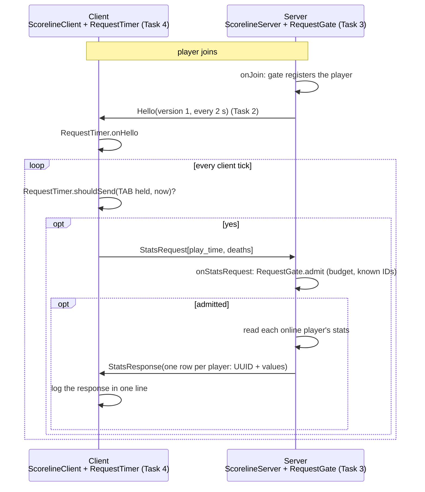
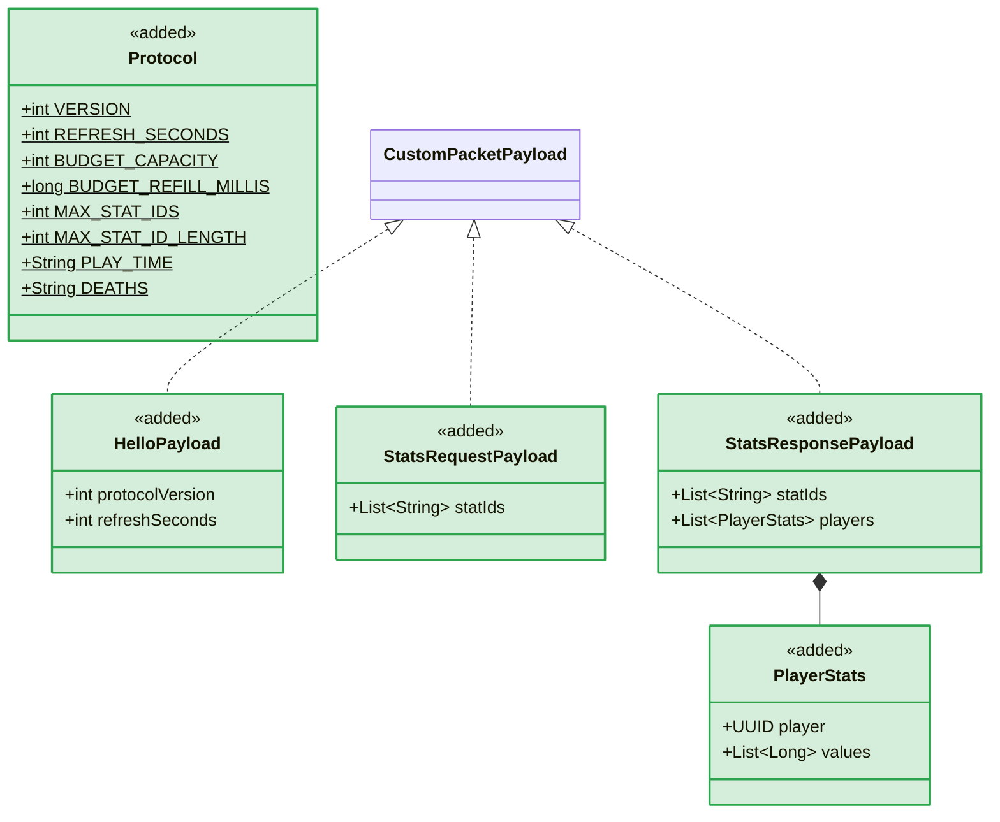
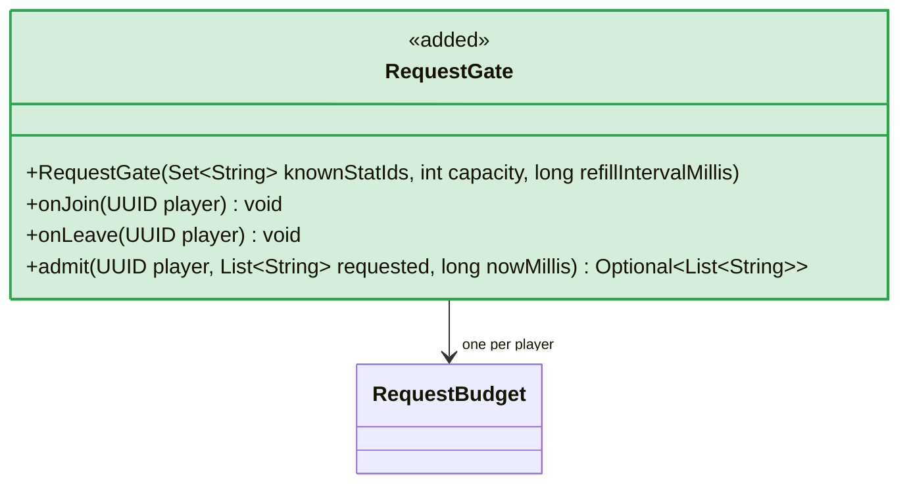
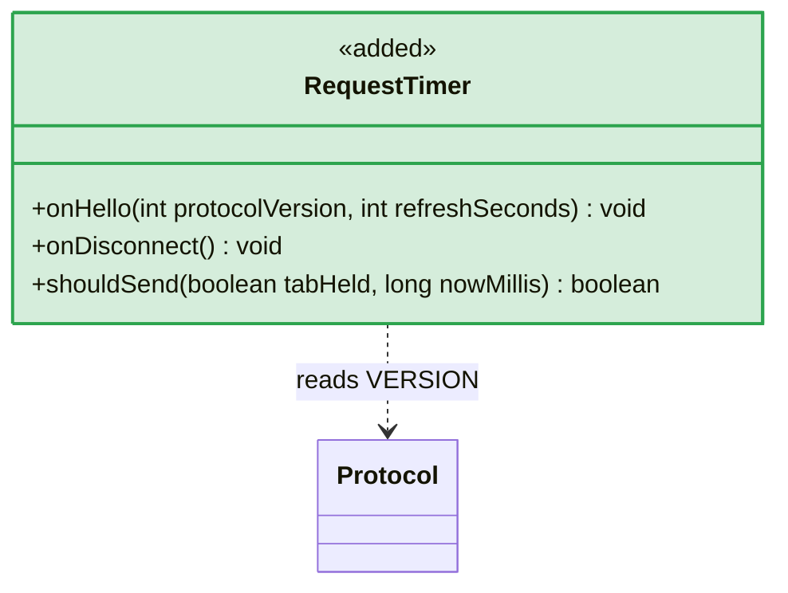
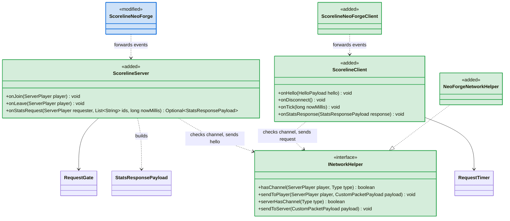

# Scoreline v0.2 Protocol – Implementation Plan

Nov 14, 2026

**Goal:** a modded client on a modded server receives a hello on join and, while TAB is held, gets playtime and deaths for every online player every 2 seconds. Game tests on a headless server prove that the answers are right and that the request budget holds; stored example messages pin the wire format of protocol version 1.

**Non-goals:**

- Drawing anything: the client only logs what it receives. The TAB columns arrive in v0.3, together with the client-side store they read from.
- The client startup check (v0.3), the refresh interval from a config file (v0.4), stats chosen by the player (v0.5).
- Answering from a shared snapshot (v0.7); v0.2 reads values on the main thread, as the spec allows until then.
- Stat modes and the game test "hidden stats are not sent" (v0.8).
- Splitting large responses by a byte budget (v0.11, with the tile protocol).

## How it works

1. **Join.** The server registers the player in its `RequestGate` (Task 3) and sends a hello (Task 2) if the client has Scoreline. The hello tells the client "this server speaks protocol 1, ask every 2 seconds".
2. **Ask.** Every client tick, `RequestTimer` (Task 4) decides from "hello received?", "TAB held?" and the time whether to send a request now.
3. **Answer.** The server's `RequestGate` decides whether to answer (budget left?) and with which stats (only known IDs). The server then reads the values and sends one row per online player.
4. **Show.** In v0.2 the client only logs the rows; v0.3 draws them.

A vanilla client gets no hello, because it lacks the channel, and a client that got no hello never asks. So vanilla and modded peers mix without errors. Tasks 2 to 4 are plain logic with unit tests; Task 5 connects them to NeoForge; Task 6 tests the connected whole inside a real server.

**Spec changes:** made in the commit before this plan: a release without a `v*` tag is an error (Task 1), and the stat ID example uses vanilla's stat name (see "Decided here").

**New in this version:** NeoForge's payload registration (`RegisterPayloadHandlersEvent`) and its game-test framework. No new dependencies.

**Decided here** (the spec leaves them open):

| Item | Value | Reason |
| --- | --- | --- |
| Protocol version | `1` | First version |
| Stat ID format | Vanilla's stat name (`Stat.getName()`), for example `minecraft.custom:minecraft.play_time` | It is Minecraft's own unique name for a stat, the one scoreboard objectives use. `minecraft:play_time` alone is only the value inside the stat type `minecraft:custom` and is not unique: `minecraft:stone` exists under mined, crafted, used and more. `ObjectiveCriteria.byName` turns the name back into the stat, so v0.5 needs no own parser. API stats (v0.6) keep IDs such as `questmod:quests_completed`, which never resolve as a vanilla stat |
| Request budget | 5 tokens, one back per 1,000 ms | The client asks every 2,000 ms; a burst of 5 covers re-pressing TAB a few times |
| Request limits | at most 16 stat IDs of at most 256 characters | Bounds what a client can make the server decode; v0.5 needs only 4 |

## Tasks

1. Release script: no tag is an error
2. Payloads and stored example messages
3. `RequestGate`: which request the server answers
4. `RequestTimer`: when the client asks
5. Wiring on NeoForge and trying it in the game
6. Game tests

## Task 1: Release script: no tag is an error

**Why:** `scripts/next-version.sh` treats "no `v*` tag" as the first release. That case is over: v0.1.0 is tagged. Now a missing tag means the workflow checked out without tags, and the script should say so instead of producing a wrong version or a misleading message. This is small and independent of the protocol, so it goes first.

**Design:** with no tag matching `vX.Y.Z`, the script prints `No release tag found; check out with all tags (fetch-depth: 0)` to stderr and exits 1. Everything else stays as in v0.1 (v0.1 plan, Task 8). The header comment of the script and the `bump` input description in `.github/workflows/release.yml` (drop "ignored for the first release") are updated to match; the spec already says so. `version=0.1.0` stays in `gradle.properties`.

**Tests** (run by hand with throwaway tags, as in v0.1; to hide the real tags, run in a fresh clone with `git tag -d v0.1.0`)

| ID | Case → expected | Bug it catches |
| --- | --- | --- |
| T-24 | no `v*` tag, `minor` → stderr `No release tag found; check out with all tags (fetch-depth: 0)`, nothing on stdout, exit 1 | the old fallback still prints the version from `gradle.properties` |
| T-25 | only the tags `v0.2.0-rc1` and `vnext` → same as T-24 | the `vX.Y.Z` filter dropped, so a malformed tag is parsed and the arithmetic fails or yields garbage |
| T-26 | the rows of the v0.1 table with a tag (`v0.1.0` → patch `0.1.1`, minor `0.2.0`, major `1.0.0`; `v0.9.0` and `v0.10.0` → minor `0.11.0`; existing release branch → exit 1; `big` → usage, exit 1) still hold | the change broke the existing paths |

**Done when**

- [x] T-24 to T-26 give the expected output and exit codes
- [x] the script's header comment and the `bump` input description no longer mention a first release without a tag

The workflow runs from `master`, so the end-to-end check comes with the v0.2 release: its dry run with `bump: minor` must show `0.2.0`.

## Task 2: Payloads and stored example messages

**Why:** the three messages of the protocol are what client and server agree on. They are defined once in `common` as vanilla `CustomPacketPayload` records with a `StreamCodec`, so only their registration differs per loader. Their bytes are stored as example messages (golden files): later versions must still read them, which is how the spec's promise "later versions extend the protocol without breaking older clients" is tested.

**Background**

- **Payload.** Minecraft sends data between client and server as packets. A mod's own data travels in *custom payloads*: each has a type, named by an identifier such as `scoreline:hello`, so the receiver knows which handler gets it. In code a payload is a class (here a Java record) that implements vanilla's `CustomPacketPayload` and returns its type.
- **StreamCodec.** The object that turns a payload into bytes and back: an encoder that writes the fields in a fixed order and a decoder that reads them in the same order. Vanilla ships codecs for common types (`ByteBufCodecs.VAR_INT`, `ByteBufCodecs.STRING_UTF8`, …) that can be combined. Writing `encode`/`decode` by hand is also fine, and Hello needs it to skip unknown bytes.
- **FriendlyByteBuf.** Minecraft's byte buffer (a wrapper around Netty's `ByteBuf`) with methods such as `writeVarInt`, `writeUtf` and `writeUUID`. The codecs read and write through it.
- **VarInt / VarLong.** A variable-length integer: 7 bits per byte, the top bit says "another byte follows". Small numbers take one byte (`2` is `02`), large ones up to 5 (int) or 10 (long) bytes. Minecraft uses it for most counts and IDs.
- **Golden file.** A stored copy of the exact bytes of a message. A test compares the encoder's output with it and decodes it again. If someone changes the format by accident, the test fails, because the file never changes.

Further reading: NeoForge docs, "Networking" → "Payloads" (docs.neoforged.net).

**Design:** all in `io.github.foursource.scoreline.net` and `…net.payload` (measured by the coverage gate; until Task 5 through the `logicPackages` entry `net/**`, from Task 5 on because nothing in them is excluded).

- `Protocol`: the constants of the table "Decided here" (`VERSION`, `REFRESH_SECONDS = 2`, `BUDGET_CAPACITY`, `BUDGET_REFILL_MILLIS`, `MAX_STAT_IDS`, `MAX_STAT_ID_LENGTH`) and the two stat IDs `PLAY_TIME = "minecraft.custom:minecraft.play_time"` and `DEATHS = "minecraft.custom:minecraft.deaths"` as strings. No Minecraft classes.
- `HelloPayload(int protocolVersion, int refreshSeconds)`, type `scoreline:hello`, server → client. The decoder reads the two fields it knows and then **skips every remaining byte**: a newer server may append fields, and an older client must not fail on them.
- `StatsRequestPayload(List<String> statIds)`, type `scoreline:stats_request`, client → server. Decoding fails (an exception, which makes the server drop the connection, as for any malformed packet) for more than `MAX_STAT_IDS` IDs or an ID longer than `MAX_STAT_ID_LENGTH`.
- `StatsResponsePayload(List<String> statIds, List<PlayerStats> players)` with `PlayerStats(UUID player, List<Long> values)`, type `scoreline:stats_response`, server → that client. Each entry's values are in the order of `statIds`. The constructor rejects an entry whose value count differs from the number of IDs (`IllegalArgumentException`), so a misaligned response can never be encoded. The lists are copied with `List.copyOf`, so the records are immutable and compare by value.

**Wire format of protocol version 1** (the golden files depend on it):

| Message | Bytes in order |
| --- | --- |
| Hello | VarInt protocol version, VarInt refresh seconds |
| Request | VarInt count, then each ID as UTF-8 string (VarInt byte length, bytes) |
| Response | the ID list as in the request, VarInt player count, then per player: UUID (two longs, most significant first), one VarLong per ID |

**Files:** golden files under `common/src/test/resources/protocol/v1/` (`hello.bin`, `request.bin`, `response.bin`). They are written once from the encoder's output, checked by hand against the table above, and never changed afterwards; a new protocol version adds a `v2` folder next to them.

**Tests** (unit, `common`)

| ID | Case → expected | Bug it catches |
| --- | --- | --- |
| T-27 | `Hello(1, 2)` encodes to exactly the bytes of `v1/hello.bin` (`01 02`), and the file decodes to `Hello(1, 2)` | field order or width differs from the documented format |
| T-28 | `v1/hello.bin` followed by `07 08 09` → decodes to `Hello(1, 2)` with no bytes left unread | a newer server's longer hello makes older clients fail |
| T-29 | request `[PLAY_TIME, DEATHS]` round-trips and matches `v1/request.bin` | IDs lost, reordered or encoded in another charset |
| T-30 | request with `MAX_STAT_IDS` IDs → decodes; with `MAX_STAT_IDS + 1` → decoding throws | unbounded list lets one packet make the server allocate without limit; off-by-one in the limit |
| T-31 | request with one ID of `MAX_STAT_ID_LENGTH` characters → decodes; `MAX_STAT_ID_LENGTH + 1` → throws | unbounded string length; off-by-one |
| T-32 | response `[PLAY_TIME, DEATHS]` with rows (UUID `A`, `72_000`, `3`) and (UUID `B`, `4_000_000_000L`, `0`) round-trips in row order and matches `v1/response.bin` | values written as `int` (the second row's playtime exceeds `Integer.MAX_VALUE`); rows reordered; UUID halves swapped |
| T-33 | `PlayerStats` with 1 value in a response with 2 IDs → `IllegalArgumentException` | misaligned entries encoded silently, so the client reads the next player's UUID as a value |

⚠ T-27 to T-32 use Minecraft's `FriendlyByteBuf` in a plain unit test. Step 1 confirms that this works without starting Minecraft.

**Steps**

1. **Check first.** Confirm that a JUnit test in `common` can encode and decode with `FriendlyByteBuf` over `Unpooled.buffer()` and create a `CustomPacketPayload.Type` from an `Identifier` without `Bootstrap.bootStrap()`. If a class needs the bootstrap, note which, and call it once in a JUnit extension.
2. Write a golden file by encoding the message in a test and writing the bytes to the resources folder once, then read it with a hex viewer (`xxd` in Git Bash) and compare with the wire format table before committing it.

**Done when**

- [ ] `./gradlew :common:check` passes, T-27 to T-33 included, and the coverage gate still holds with the new classes
- [ ] the three golden files are committed and their bytes match the wire format table

## Task 3: `RequestGate`: which request the server answers

**Why:** the server must decide, for each incoming request, whether to answer and with which stats: unknown IDs are ignored and each player has a request budget (spec, Networking, Server rules). Keeping that decision in a plain class makes it unit-testable; the Minecraft part (Task 5) only reads the values and sends.

**Design:** `RequestGate` in `…net`, plain Java, one per server, used on the main thread only.

- `RequestGate(Set<String> knownStatIds, int capacity, long refillIntervalMillis)`: in v0.2 the known IDs are `PLAY_TIME` and `DEATHS`.
- `void onJoin(UUID player)`: gives the player a full `RequestBudget`.
- `void onLeave(UUID player)`: forgets the player's budget, so the map does not grow with every session.
- `Optional<List<String>> admit(UUID player, List<String> requested, long nowMillis)`: "answer this request, and with which stats?" Empty means refused: the player is not joined, or the budget is used up. Otherwise it returns the requested IDs that are known, in request order, without duplicates. The budget is checked first, so a request with only unknown IDs still uses a token and returns an empty list; the caller then sends nothing.

**Tests** (unit; `CAP` = 5, `T` = 1,000 ms; players `P` and `Q`)

| ID | Case → expected | Bug it catches |
| --- | --- | --- |
| T-34 | `P` joined, `[PLAY_TIME, DEATHS]` at 0 → `[PLAY_TIME, DEATHS]` | starter |
| T-35 | `[DEATHS, "minecraft.custom:minecraft.jump", PLAY_TIME]` → `[DEATHS, PLAY_TIME]` | a real vanilla stat that v0.2 does not offer is passed on, because the gate checks the format instead of the known set; order lost |
| T-36 | `[DEATHS, DEATHS]` → `[DEATHS]` | duplicates double the response |
| T-37 | `P` never joined → empty; `P` joined, then left → empty; joined again → admitted | budget kept after logout (map grows); request answered without a join |
| T-38 | `CAP` requests by `P` at 0 → admitted, the next refused; `Q` at 0 → admitted | gate ignores the budget; budgets shared between players |
| T-39 | `CAP` requests `["questmod:quests_completed"]` at 0 → each an empty list; then `[DEATHS]` at 0 → refused | unknown-only requests bypass the budget, so a client can spam the server for free |

**Done when**

- [ ] `./gradlew :common:check` passes, T-34 to T-39 included

## Task 4: `RequestTimer`: when the client asks

**Why:** the client asks only while TAB is held, repeats at the interval the server announced, and sends nothing at all to a server that sent no hello (spec, Networking, Compatibility). This state is easy to get subtly wrong (a request every tick, or requests to a vanilla server after leaving a modded one), so it is a plain class with unit tests; the client glue in Task 5 only feeds it the TAB key state and the time. It is polled each tick rather than driven by a key event: the repeats while TAB is held need a clock anyway, vanilla polls `keyPlayerList.isDown()` the same way to show the list, and polling cannot miss a release (window focus lost, a screen open, a rebound key).

**Design:** `RequestTimer` in `…net`, plain Java, one per client, used on the client thread only.

- `void onHello(int protocolVersion, int refreshSeconds)`: the server has the mod. A protocol version below 1 is ignored (no hello). A refresh interval below 1 second counts as 1 second (assumed, so a broken server cannot make the client send every tick). A version above `Protocol.VERSION` is accepted: newer servers stay compatible by design.
- `void onDisconnect()`: back to "no hello", so leaving a modded server and joining a vanilla one sends nothing.
- `boolean shouldSend(boolean tabHeld, long nowMillis)`: called every client tick. True when a hello was received, TAB is held, and either TAB was just pressed or a full interval has passed since the last send. Releasing TAB resets, so the next press sends at once (assumed: fresh data is worth one extra request, and the server budget limits abuse).

**Tests** (unit; hello `(1, 2)` gives `R` = 2,000 ms)

| ID | Case → expected | Bug it catches |
| --- | --- | --- |
| T-40 | hello, TAB held at 0 → true | starter |
| T-41 | no hello; TAB held at 0, `R`, `10 * R` → false each time | client sends to a server without the mod |
| T-42 | hello; held at 0 → true; held at 50 → false; at `R - 1` → false; at `R` → true | a request every tick; off-by-one at the interval |
| T-43 | hello; held at 0 → true; released at 500; held at 600 → true (assumed) | a new press waits for the old interval, so the list shows stale data |
| T-44 | hello, then disconnect; held at 0 → false; hello again; held at `R` → true | hello state survives the disconnect, so the client sends to the next, vanilla server |
| T-45 | hello `(1, 0)`; held at 0 → true; at 999 → false; at 1,000 → true (assumed) | interval 0 makes the client send every tick |
| T-46 | hello `(0, 2)`; held at 0 → false | an unsupported protocol version is treated as a valid hello |

**Done when**

- [ ] `./gradlew :common:check` passes, T-40 to T-46 included

## Task 5: Wiring on NeoForge and trying it in the game

**Why:** the pieces from Tasks 2 to 4 must be connected to the game: the payloads registered, the hello sent on join, the TAB key watched, the values read and sent. This is the first time Scoreline talks over the network, and the first Minecraft code beyond logging, so the NeoForge-specific parts are checked against current docs first.

**Background**

- **Events.** NeoForge tells mods about things that happen (a player logged in, a client tick passed) by posting *events*. A mod subscribes a method to an event type, and NeoForge calls it each time. Some events go to the mod's own event bus (setup, such as registering payloads); game events go to `NeoForge.EVENT_BUS`. The entry class `ScorelineNeoForge` gets the mod bus in its constructor.
- **Payload registration and channels.** Each payload type must be registered on both sides, in the `RegisterPayloadHandlersEvent`, together with its codec, its direction (to client, to server) and its handler. Each registered type is a *channel*. When a player connects, client and server first pass through a *configuration phase* where they compare their channels, then enter the *play phase* where the game runs. A channel registered as **optional** lets a peer without it connect anyway. The sender must then check that the other side has the channel before sending on it.
- **Two sides, several threads.** The client and the server are separate programs, even in singleplayer, where the client starts an *integrated server* inside the same process. Packets arrive on a network thread, but game state (players, stats) may only be touched on the server's main thread. Step 1 confirms which thread NeoForge runs handlers on.
- **Stats.** Every player has a stats counter on the server (`ServerPlayer.getStats()`) that maps a `Stat` to a number. Playtime counts in ticks (20 per second); deaths counts deaths.

Further reading: NeoForge docs, "Concepts" → "Events" and "Networking" (docs.neoforged.net).

**Design:** Minecraft-dependent code sits in two new packages in `common`, `client` and `server`. The NeoForge module only registers. These are the first classes in `common` that unit tests cannot run, so the coverage gate changes here from "include the listed packages" to "include everything, exclude the listed files".

- `server.ScorelineServer` (common) owns the `RequestGate`, one per running server.
  - `onJoin(ServerPlayer)`: registers the player with the gate and sends a hello if the client has the hello channel.
  - `onLeave(ServerPlayer)`: lets the gate forget the player.
  - `Optional<StatsResponsePayload> onStatsRequest(ServerPlayer requester, List<String> ids, long nowMillis)`: "what does this player get back?" Logs the request (`Scoreline stats_request: requester=<UUID> now=<ms>ms statIDs=[…]`), asks the gate, then reads each online player's value for each admitted ID and builds the response. Empty means send nothing. It returns the payload instead of sending it, so the game tests in Task 6 can check it; the handler sends it in one line.
  - An ID becomes a `Stat` through `ObjectiveCriteria.byName`, which is how vanilla reads stat names for scoreboards. The gate has already made sure only known IDs arrive.
- `client.ScorelineClient` (common) owns the `RequestTimer`.
  - `onHello(HelloPayload hello)` logs the hello (`Scoreline hello: version=<version> refresh=<seconds>s`) and informs the timer; `onDisconnect()` informs the timer.
  - `onTick(long nowMillis)`, called each client tick, reads whether the player-list key is held (`Minecraft.getInstance().options.keyPlayerList.isDown()`, which is vanilla), asks the timer, and sends a request for `[PLAY_TIME, DEATHS]` when told to and the server has the request channel.
  - `onStatsResponse(StatsResponsePayload response)` logs the whole response in one line, with the full stat IDs: `Scoreline stats_response: uuid=<UUID> <stat ID>=<value> … uuid=<UUID> …`.
  - All three protocol log lines (hello, request, response) are INFO in a development environment (`Services.PLATFORM.isDevelopmentEnvironment()`) and DEBUG otherwise.
- `platform.services.INetworkHelper` (common) is the loader's network access. `common` compiles against vanilla Minecraft, so it can neither check a channel (`hasChannel` is added by NeoForge's patches) nor send (`PacketDistributor` is NeoForge API). `Services` loads it like `IPlatformHelper`; it is a separate service because networking is its own concern.
  - `boolean hasChannel(ServerPlayer player, CustomPacketPayload.Type<?> type)`: whether that player's client can receive the payload.
  - `void sendToPlayer(ServerPlayer player, CustomPacketPayload payload)`.
  - `boolean serverHasChannel(CustomPacketPayload.Type<?> type)`: whether the server the client is connected to can receive the payload.
  - `void sendToServer(CustomPacketPayload payload)`.
- `neoforge` only registers and forwards; it has two entry classes, because client classes such as `Minecraft` do not exist on a dedicated server:
  - `ScorelineNeoForge` (`@Mod`, both sides) registers the three payloads as optional under a fixed channel version `"1"`. NeoForge disconnects on a channel version mismatch even for optional channels, so this never follows `Protocol.VERSION`; protocol versions are negotiated through the hello (spec, Mixed mod versions). It registers the request handler; the two client-bound payloads are registered without a handler. It holds the `ScorelineServer` of the running server: created on `ServerStartingEvent`, dropped on `ServerStoppedEvent` (in singleplayer every world opened starts a new integrated server). It forwards player logged in and out to it, and sends the result of `onStatsRequest` back with `context.reply(…)`.
  - `ScorelineNeoForgeClient` (`@Mod(dist = Dist.CLIENT)`, created on the client only) holds the `ScorelineClient`. It adds the handlers for hello and response in `RegisterClientPayloadHandlersEvent`, and forwards `ClientTickEvent.Post` and `ClientPlayerNetworkEvent.LoggingOut`.
  - Both read the time with `Util.getMillis()` and pass it in. Handlers run on the main thread, NeoForge's default.
- `neoforge` implements `INetworkHelper` with `player.connection.hasChannel(…)`, `PacketDistributor.sendToPlayer(…)`, the client connection's `hasChannel(…)` and `ClientPacketDistributor.sendToServer(…)`, and registers the implementation in `META-INF/services/`. Fabric API has the same four operations (`ServerPlayNetworking.canSend`/`send`, `ClientPlayNetworking.canSend`/`send`), so a later Fabric port only adds its own implementation.
- **Coverage gate, include by default.** Until now the gate measured only the packages in `logicPackages`, so a new class was unmeasured unless someone added it, and a forgotten one dropped out silently. From here on, `common/build.gradle` measures every class of `common`'s main code except the files in a list `coverageExcludes`. A new class is measured unless someone decides otherwise, and each exclusion shows in the diff with its reason.
  - Exclusions name single files, never packages or wildcards over names, so a new file next to an excluded one is still measured. Each file gets two patterns: `<path>/<Name>.class` and `<path>/<Name>$*.class`, the second for its nested and anonymous classes (lambdas make no class files).
  - Each entry has a comment saying why unit tests cannot run it. The first list:

    | File | Why it is excluded |
    | --- | --- |
    | `client/ScorelineClient` | Needs a running client (`Minecraft`, the connection) |
    | `server/ScorelineServer` | Needs a running server; Task 6's game tests cover it, but they run in the game process, which JaCoCo does not measure |
    | `platform/Services` | Loads the loader's implementations through `ServiceLoader` when the class loads; `common`'s tests have none |
    | `platform/services/IPlatformHelper` | Its `default` method `getEnvironmentName` counts as code; it only formats a loader answer |
    | `ScorelineCommon` | Start-up and logging only |

    `Constants` and `INetworkHelper` need no entry: compile-time constants, a private empty constructor and abstract interface methods produce no measured code.
  - The limits (95% of lines, 90% of branches) apply twice: to the measured code as a whole, as before, and to each class on its own. With the total alone, a small untested class hides behind well-tested ones (a test with one untested class of five lines left the total at 95.9%).
  - Two guards fail the check: no class is measured at all (kept from `checkLogicPackages`), or an exclusion matches no class file (a renamed or deleted class, so stale entries cannot pile up).
  - The spec's rule (Testing: the gate covers the logic code) does not change, only its mechanism. `CLAUDE.md` (Rules from the spec) is updated in the same commit, because it names `logicPackages`.

**Steps**

1. **Check first.** In the NeoForge documentation for 26.3 (docs.neoforged.net, "Networking" → "Registering payloads"), confirm: how `RegisterPayloadHandlersEvent` and its registrar register a payload as optional, on which thread a handler runs by default (the values must be read on the main thread), how the server checks whether a client has a channel, and whether the hello can be sent at player login (channels are negotiated in the configuration phase before it). Also look up the payload size limits NeoForge applies to registered payloads, and update the spec's open point on payload size with the answer.
2. **Check first.** Confirm the client tick event and the client disconnect event on NeoForge 26.3, and that `Minecraft.getInstance().options.keyPlayerList.isDown()` reports a held TAB key.
3. Start `./gradlew :neoforge:runClient`, open a singleplayer world (it runs an integrated server, so both sides of the protocol run), hold TAB for about five seconds and read the log.
4. Compatibility by hand: start `./gradlew :neoforge:runServer` (set `online-mode=false` in `neoforge/runs/server/server.properties`) and join it with a vanilla 26.3 client from the official launcher. Then join a vanilla 26.3 server (the official server jar, also offline mode) with `runClient`.
5. Turn the coverage gate around in `common/build.gradle`: replace `logicPackages` with `coverageExcludes` (the table in Design), filter the class files with `exclude` instead of `include`, add a second rule with `element = 'CLASS'` and the same limits, and add the guard for exclusions that match nothing next to the existing one. The existing empty-measurement guard (v0.1, T-10) stays; its message no longer names `logicPackages`. Update `CLAUDE.md`. Then check that the gate works: add an untested class with one branch to `common`'s main code, run `./gradlew :common:check` and see it fail on coverage; remove the class again. Rename one excluded class in `coverageExcludes` to a name that does not exist and see the stale-entry guard fail; undo it.

**Done when**

- [ ] in singleplayer, the log shows the hello on join and, while TAB is held, one `Scoreline stats_response:` line about every 2 seconds, with playtime rising; none when TAB is released
- [ ] a vanilla client joins the modded server and plays normally
- [ ] the modded client joins a vanilla server, plays normally and logs no requests
- [ ] the modded client joins a modded server that a vanilla client has also joined, and its log shows the stats of both players
- [ ] the spec's open point on payload size limits is answered and ticked
- [ ] `./gradlew build` passes
- [ ] the coverage gate measures all of `common`'s main classes except the files in `coverageExcludes`, each with its reason
- [ ] a new untested class fails `./gradlew :common:check`, and so does an exclusion that matches no class
- [ ] `./gradlew build` still passes after the coverage change

## Task 6: Game tests

**Why:** unit tests cannot see whether the server reads the right stat for the right player. Game tests run inside a real headless server with mock players. They also pin down the vanilla behavior Scoreline relies on (a death raises the deaths stat by one), so a Minecraft update that changes it fails the build (spec, Testing). The smoke run already starts the game-test server, so these tests run in the build workflow without a new step.

**Background**

- **Game test.** A test that runs inside a real Minecraft server. Each test gets its own small area of the world, built from a *structure template* (a saved block layout, possibly empty), and a `GameTestHelper` to place blocks, spawn entities and assert results. A test passes when it calls `succeed()` and fails on an assertion or a timeout, counted in ticks.
- **Registration.** Since Minecraft 1.21.5, game tests are declared as data: a *test instance* names the test function, its structure and its *environment* (settings such as time of day). NeoForge adds a way to register test functions from code. Step 1 confirms the current way.
- **Game-test server.** `./gradlew :neoforge:runGameTestServer` starts a headless server that runs every registered test of the enabled namespaces, then exits. The exit code says whether all passed.
- **Mock player.** A server player with no real client behind it, created by the helper. It has a stats counter like any player, so the test can set its stats and kill it, but it may not appear in the player list or fire the login event.

Further reading: NeoForge docs, "Miscellaneous" → "Game Tests" (docs.neoforged.net).

**Design:** one test class in `common` (if the framework allows registration from vanilla code) or in `neoforge`, registered for the `scoreline` namespace (`neoforge.enabledGameTestNamespaces` is already set). Each test creates its mock players, calls `ScorelineServer.onJoin` for them itself (mock players may not fire the login event), and checks the result of `ScorelineServer.onStatsRequest`.

**Tests** (game tests)

| ID | Case → expected | Bug it catches |
| --- | --- | --- |
| T-47 | mock player killed once → its deaths stat rises by exactly 1 | Minecraft changed where deaths are counted (pins vanilla behavior) |
| T-48 | mock player with play_time `1234` and deaths `2` (set through its stats counter); `onStatsRequest(player, [PLAY_TIME, DEATHS], 0)` → its row holds its UUID, `1234`, `2` | stat mapping swapped or wrong stat read; wrong UUID |
| T-49 | two mock players with different values; one asks → the response has a row for each, each with its own values | answers only the requester, or copies the requester's values to everyone |
| T-50 | `BUDGET_CAPACITY + 1` calls to `onStatsRequest` at the same time → `BUDGET_CAPACITY` responses, then empty | the glue bypasses the gate |
| T-51 | one game test is changed to fail on purpose → `scripts/smoke.sh` exits 1 (then restore it) | failing game tests do not fail the run, so the workflow stays green |

⚠ T-49: game tests may run in parallel, so other tests' mock players can be online too. Assert the rows of this test's players, not the number of rows.

**Steps**

1. **Check first.** The game-test framework changed in Minecraft 1.21.5 (test instances, environments, structure templates). Read the NeoForge 26.3 documentation on game tests: how a test function is registered, whether an empty structure template is needed, how a mock server player is created and whether it joins the player list, and whether a failing test makes `runGameTestServer` exit with a non-zero code.
2. If the smoke script's failure message no longer fits (a failing game test is not "Scoreline did not load"), make it say which check failed.

**Done when**

- [ ] `./gradlew :neoforge:runGameTestServer` runs T-47 to T-50 and passes
- [ ] T-51 seen: a failing game test makes `scripts/smoke.sh` exit 1
- [ ] the pull request's `build` check runs the game tests and is green
