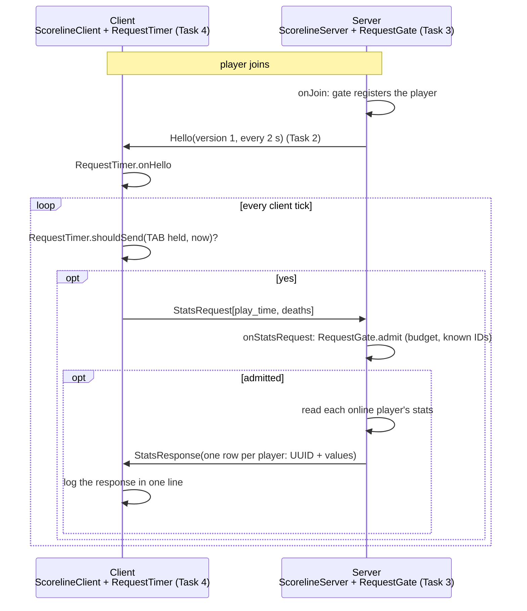
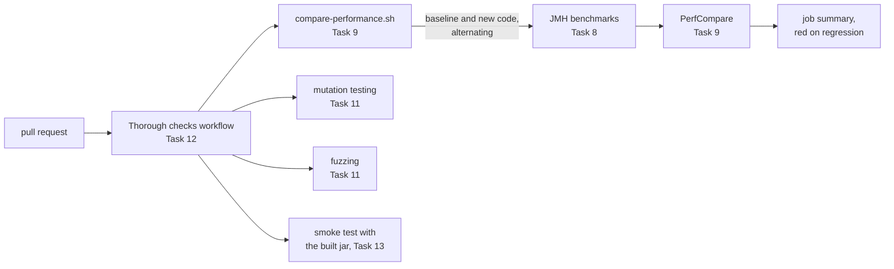
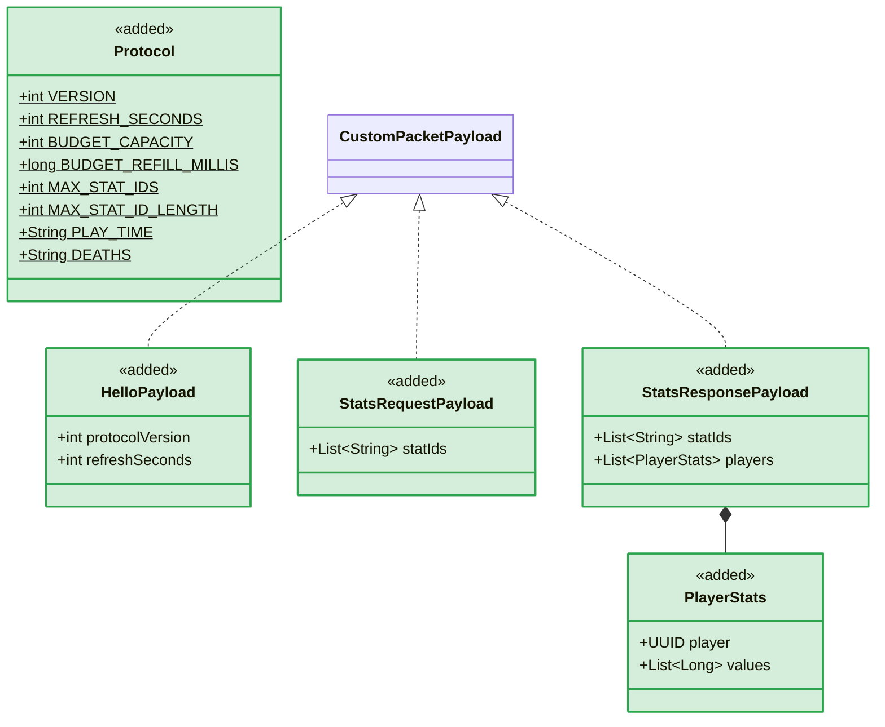
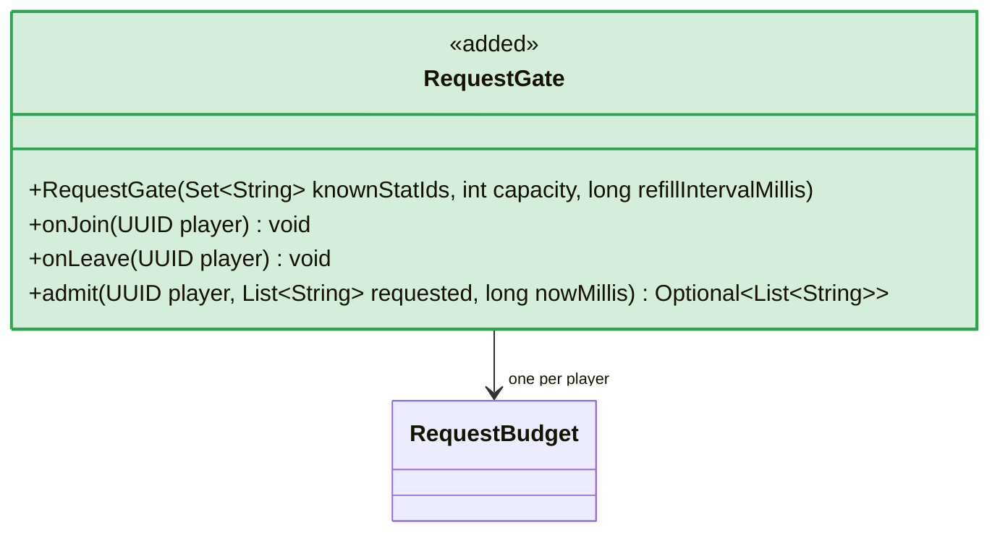
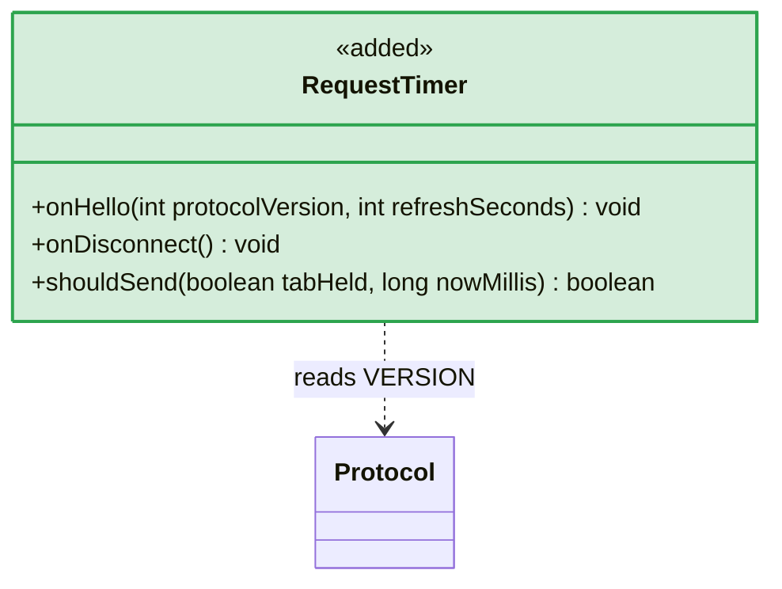
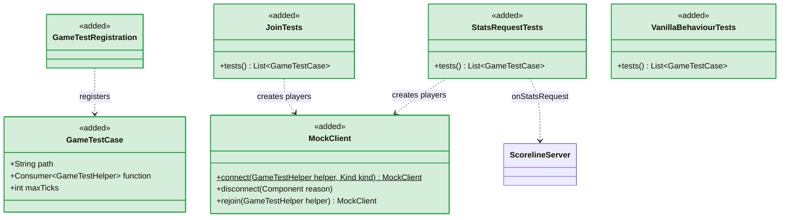
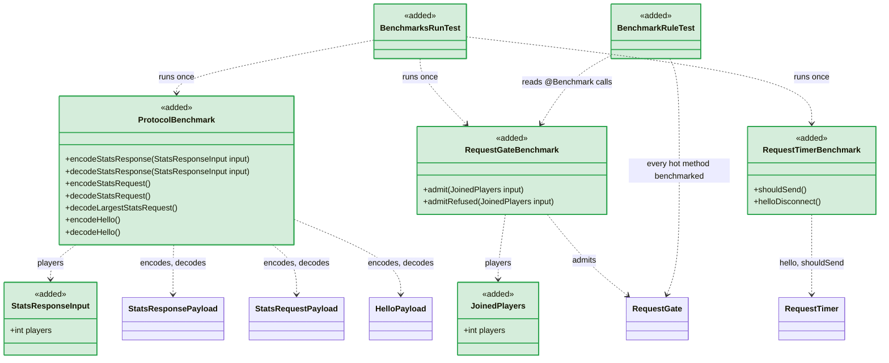
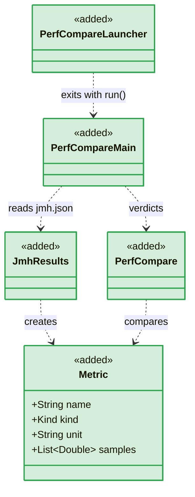
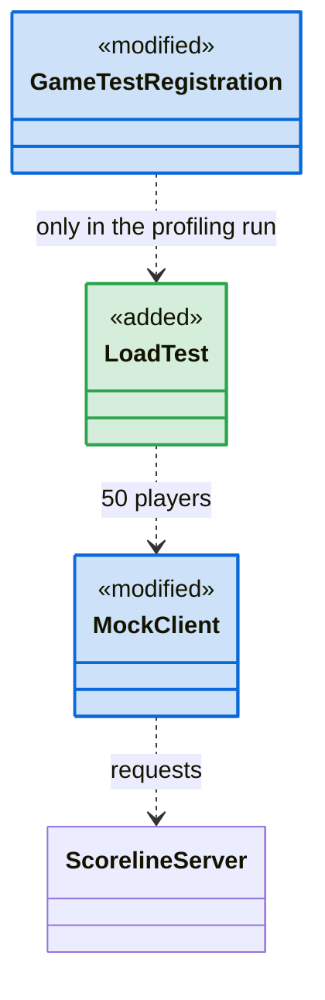

# Scoreline v0.2 Protocol – Implementation Plan

Nov 14, 2026

**Goal:** a modded client on a modded server receives a hello on join and, while TAB is held, gets playtime and deaths for every online player every 2 seconds. Game tests on a headless server prove that the answers are right and that the request budget holds; stored example messages pin the wire format of protocol version 1. From here on, pull requests compare the allocation of the new code with the old (microbenchmarks), and run mutation testing and fuzzing where their code changed; time is compared nightly and before a release. The smoke test runs a dedicated server with the built jar. spark and a manual profiling run with JFR method timing are available locally without any profiling code in the mod.

**Non-goals:**

- Drawing anything: the client only logs what it receives. The TAB columns arrive in v0.3, together with the client-side store they read from.
- The client startup check (v0.3), the refresh interval from a config file (v0.4), stats chosen by the player (v0.5).
- Answering from a shared snapshot (v0.7); v0.2 reads values on the main thread, as the spec allows until then.
- Stat modes and the game test "hidden stats are not sent" (v0.8).
- Splitting large responses by a byte budget (v0.11, with the tile protocol).
- Cost against server size beyond the spec's target (counts above 50, a scaling curve): the benchmarks measure 1, 10 and 50 players. Larger counts come with the work on larger servers.
- An automated load test: left out after the review of the test setup (spec, Testing); its purposes are covered by unit and game tests, and speed under load by the manual profiling run (Task 10).
- Storage figures, the simulation and the hand-over queue tests (v0.10, when there is storage); property tests (v0.10); the per-tick count game test (v0.7).
- Reading today's example messages with earlier releases' tests (from v1.0, spec Gates); v0.2 only makes its golden test able to take part later.
- CodeQL and OpenSSF Scorecard: considered and left out.

## How it works

1. **Join.** The server registers the player in its `RequestGate` (Task 3) and sends a hello (Task 2) if the client has Scoreline. The hello tells the client "this server speaks protocol 1, ask every 2 seconds".
2. **Ask.** Every client tick, `RequestTimer` (Task 4) decides from "hello received?", "TAB held?" and the time whether to send a request now.
3. **Answer.** The server's `RequestGate` decides whether to answer (budget left?) and with which stats (only known IDs). The server then reads the values and sends one row per online player.
4. **Show.** In v0.2 the client only logs the rows; v0.3 draws them.

A vanilla client gets no hello, because it lacks the channel, and a client that got no hello never asks. So vanilla and modded peers mix without errors. Tasks 2 to 4 are plain logic with unit tests; Task 5 connects them to NeoForge; Task 6 tests the connected whole inside a real server.

Tasks 7 to 12 add the tools that watch this code from now on:

5. **Compare.** `scripts/compare-performance.sh` (Task 9) builds the baseline (the pull request's base, the last checked commit, or a tag) next to the new code and runs the JMH benchmarks (Task 8) of both, alternating. `PerfCompare` (Task 9) compares the medians and fails on a clear regression: allocation on pull requests, time nightly, both before a release.
6. **Check the tests.** In the same workflow (Task 12), PIT changes the code in small ways and checks that a test notices; Jazzer feeds random bytes to the payload decoders (Task 11). Each runs on pull requests that change its code, and always before a release.
7. **Check the jar.** Every build checks the jar's contents; nightly and before a release a dedicated server starts with the built jar and stops cleanly (Task 13).
8. **Look by hand.** spark (Task 7) is loaded in local runs only, for profiling in the game; the manual profiling run (Task 10) records JFR method timing for 50 mock players, opened in Java Mission Control or `jfr view`.

**Spec changes** for this version, each in its own `docs(spec)` commit:

- Before this plan: a release without a `v*` tag is an error (Task 1), and the stat ID example uses vanilla's stat name (see "Decided here").
- During Tasks 2 to 6: how the client handles a hello from a server of another version (Mixed mod versions); the payload size limits (an open point answered); game tests with a mock client that exchanges payloads (Task 6).
- Before Task 7: the performance comparison, the profiling tools and the thorough checks join v0.2 (Tasks 7 to 13).
- The review of the test setup, also before Task 7:
  - allocation is compared on pull requests, time nightly and before releases, and both versions run the same benchmark sources and settings (Tasks 8, 9, 12)
  - benchmarks per operation, checked from the hot paths (Task 8)
  - `tools` gets a 100% coverage gate and mutation testing (Tasks 9, 11)
  - no automated load test: a manual profiling run with JFR method timing, no profiling code in the mod (Task 10)
  - slow checks run only where their code changed (Task 12)
  - the jar check and the smoke test with the built jar (Task 13)
  - game tests for a hostile modified client and for a player who leaves (Task 6)
  - the golden test is generic, so later releases can run it (Task 2), and the version guarantee holds from v1.0 within a major version

**New in this version:** NeoForge's payload registration (`RegisterPayloadHandlersEvent`) and its game-test framework. From Task 7 on: spark through CurseMaven (local runs only), JMH with the Gradle plugin `me.champeau.jmh`, ASM for the benchmark check, JFR method timing (Java 25, no code in the mod), PIT with `info.solidsoft.pitest`, Jazzer, shellcheck, and a plain Java Gradle module `tools` for the comparison and the release version.

**Decided here** (the spec leaves them open):

| Item | Value | Reason |
| --- | --- | --- |
| Protocol version | `1` | First version |
| Stat ID format | Vanilla's stat name (`Stat.getName()`), for example `minecraft.custom:minecraft.play_time` | It is Minecraft's own unique name for a stat, the one scoreboard objectives use. `minecraft:play_time` alone is only the value inside the stat type `minecraft:custom` and is not unique: `minecraft:stone` exists under mined, crafted, used and more. `ObjectiveCriteria.byName` turns the name back into the stat, so v0.5 needs no own parser. API stats (v0.6) keep IDs such as `questmod:quests_completed`, which never resolve as a vanilla stat |
| Request budget | 5 tokens, one back per 1,000 ms | The client asks every 2,000 ms; a burst of 5 covers re-pressing TAB a few times |
| Request limits | at most 16 stat IDs of at most 256 characters | Bounds what a client can make the server decode; v0.5 needs only 4 |
| Time limit | a median more than 1.5 × the baseline's is a regression, until the A/A run on GitHub's machines (T-117); then the largest ratio of that run + 0.15, at least 1.2 | The limit must sit above the noise of the machine that judges, not of a desktop: the desktop's A/A runs gave 1.07 and 1.21. 1.5 caught nothing false there |
| Allocation limit | more than 1.10 × the baseline's bytes per operation **and** more than 32 bytes more; from a baseline below 1 byte ("zero"), 8 bytes or more | Allocation varies far less than time; the 32 bytes keep small values from failing on a ratio. Zero stays zero: a path that allocated nothing and now makes a 16-byte object per tick is exactly what the allocation check is for |
| Improvement | a median below the baseline's ÷ 1.5 (time) is marked "improved" | Reported only, never fails |
| Where the comparison runs | pull request: allocation only, blocking; an allocation regression is measured once more (one more round of the failing benchmarks) and fails only if it repeats; nightly on `master` if it changed since the last nightly run: time and allocation, opens an issue on a regression; release: time and allocation against the previous release, blocking (spec, Gates) | Allocation is nearly exact, so a short run settles it while the pull request waits; time needs many forks and rounds, which only a run nobody waits for can afford |
| Rounds | pull request: 1 round; nightly and release: 5 rounds, each running the baseline and then the new code | Medians over rounds; alternating spreads the machine's drift over both versions |
| JMH settings | mode average time per call, in nanoseconds. Pull request: 1 fork, 3 warm-up iterations and 1 measured iteration of 1 s. Nightly and release: 2 forks, 3 warm-up and 5 measured iterations of 1 s. Both versions run with the new code's settings and benchmark sources (spec, Gates) | Allocation also needs the warm-up: the JIT's escape analysis removes allocations only once it has compiled the code. Two forks per round show the spread between JVMs that one fork hides. JMH's default mode is throughput (higher is better); `PerfCompare` reads a higher score as slower |
| Accepted regressions | a file `perf-accepted.txt` at the repository root: one line per metric key, a tab, the reason. The release comparison marks a listed regression `ACCEPTED` instead of failing; the release commit empties the file | An intended slowdown is a decision with a reason, made in a pull request before the release, and the changelog can quote it |
| Player counts in benchmarks | 1, 10 and 50, only where the input depends on them | One player, a small server and the spec's target; larger counts come with the work on larger servers |
| Profiling run (manual) | 50 mock players, each asking for `[PLAY_TIME, DEATHS]` every 40 ticks, for 600 ticks; JFR method timing on Scoreline's classes | The spec's 50-player target and the client's 2 s interval; started by hand, never in a check |
| Where the slow checks run | mutation testing: pull requests that change `common/src/main` or `tools/src/main`; fuzzing: pull requests that change `net/payload/`; both always before a release. The saved fuzzing inputs run in every build. Smoke test (Task 13): nightly, before a release, on the version-check pull request | A check costs minutes only where it can find something (spec, Gates) |
| Fuzzing time | 120 s per fuzz target on pull requests that change payload code and before a release | Three targets, about 6 minutes |
| Mutation gate | the score measured in Task 11, rounded down to the next 5% | A gate the current code meets; surviving mutants are reviewed once, not hidden by a low number |
| spark | CurseForge project `361579`, property `spark_curseforge_file_id` | Empty means no spark; CI always runs with it empty |

## Tasks

1. Release script: no tag is an error
2. Payloads and stored example messages
3. `RequestGate`: which request the server answers
4. `RequestTimer`: when the client asks
5. Wiring on NeoForge and trying it in the game
6. Game tests
7. spark in local runs only
8. JMH benchmarks with allocation
9. Comparing two versions: `PerfCompare` and the script
10. The manual profiling run
11. Mutation testing and fuzzing
12. The thorough-checks workflow
13. The jar check and the smoke test with the built jar

## Task 1: Release script: no tag is an error

**Why:** `scripts/next-version.sh` treats "no `v*` tag" as the first release. That case is over: v0.1.0 is tagged. Now a missing tag means the workflow checked out without tags, and the script should say so instead of producing a wrong version or a misleading message. This is small and independent of the protocol, so it goes first.

**Design:** with no tag matching `vX.Y.Z`, the script prints `No release tag found; check out with all tags (fetch-depth: 0)` to stderr and exits 1. Everything else stays as in v0.1 (v0.1 plan, Task 8). The header comment of the script and the `bump` input description in `.github/workflows/release.yml` (drop "ignored for the first release") are updated to match; the spec already says so. `version=0.1.0` stays in `gradle.properties`.

**Tests** (run by hand with throwaway tags, as in v0.1; to hide the real tags, run in a fresh clone with `git tag -d v0.1.0`)

| ID | Case → expected | Bug it catches |
| --- | --- | --- |
| T-24 | no `v*` tag, `minor` → stderr `No release tag found; check out with all tags (fetch-depth: 0)`, nothing on stdout, exit 1 | the old fallback still prints the version from `gradle.properties` |
| T-25 | only the tags `v0.2.0-rc1` and `vnext` → same as T-24 | the `vX.Y.Z` filter dropped, so a malformed tag is parsed and the arithmetic fails or yields garbage |
| T-26 | the rows of the v0.1 table with a tag (`v0.1.0` → patch `0.1.1`, minor `0.2.0`, major `1.0.0`; `v0.9.0` and `v0.10.0` → minor `0.11.0`; existing release branch → exit 1; `big` → usage, exit 1) still hold | the change broke the existing paths |

**Done when**

- [x] T-24 to T-26 give the expected output and exit codes
- [x] the script's header comment and the `bump` input description no longer mention a first release without a tag

The workflow runs from `master`, so the end-to-end check comes with the v0.2 release: its dry run with `bump: minor` must show `0.2.0`.

## Task 2: Payloads and stored example messages

**Why:** the three messages of the protocol are what client and server agree on. They are defined once in `common` as vanilla `CustomPacketPayload` records with a `StreamCodec`, so only their registration differs per loader. Their bytes are stored as example messages (golden files): later versions must still read them, which is how the spec's promise "later versions extend the protocol without breaking older clients" is tested.

**Background**

- **Payload.** Minecraft sends data between client and server as packets. A mod's own data travels in *custom payloads*: each has a type, named by an identifier such as `scoreline:hello`, so the receiver knows which handler gets it. In code a payload is a class (here a Java record) that implements vanilla's `CustomPacketPayload` and returns its type.
- **StreamCodec.** The object that turns a payload into bytes and back: an encoder that writes the fields in a fixed order and a decoder that reads them in the same order. Vanilla ships codecs for common types (`ByteBufCodecs.VAR_INT`, `ByteBufCodecs.STRING_UTF8`, …) that can be combined. Writing `encode`/`decode` by hand is also fine, and Hello needs it to skip unknown bytes.
- **FriendlyByteBuf.** Minecraft's byte buffer (a wrapper around Netty's `ByteBuf`) with methods such as `writeVarInt`, `writeUtf` and `writeUUID`. The codecs read and write through it.
- **VarInt / VarLong.** A variable-length integer: 7 bits per byte, the top bit says "another byte follows". Small numbers take one byte (`2` is `02`), large ones up to 5 (int) or 10 (long) bytes. Minecraft uses it for most counts and IDs.
- **Golden file.** A stored copy of the exact bytes of a message. A test compares the encoder's output with it and decodes it again. If someone changes the format by accident, the test fails, because the file never changes.

Further reading: NeoForge docs, "Networking" → "Payloads" (docs.neoforged.net).

**Design:** all in `io.github.foursource.scoreline.net` and `…net.payload` (measured by the coverage gate; until Task 5 through the `logicPackages` entry `net/**`, from Task 5 on because nothing in them is excluded).

- `Protocol`: the constants of the table "Decided here" (`VERSION`, `REFRESH_SECONDS = 2`, `BUDGET_CAPACITY`, `BUDGET_REFILL_MILLIS`, `MAX_STAT_IDS`, `MAX_STAT_ID_LENGTH`) and the two stat IDs `PLAY_TIME = "minecraft.custom:minecraft.play_time"` and `DEATHS = "minecraft.custom:minecraft.deaths"` as strings. No Minecraft classes.
- `HelloPayload(int protocolVersion, int refreshSeconds)`, type `scoreline:hello`, server → client. The decoder reads the two fields it knows and then **skips every remaining byte**: a newer server may append fields, and an older client must not fail on them.
- `StatsRequestPayload(List<String> statIds)`, type `scoreline:stats_request`, client → server. Decoding fails (an exception, which makes the server drop the connection, as for any malformed packet) for more than `MAX_STAT_IDS` IDs or an ID longer than `MAX_STAT_ID_LENGTH`. The constructor rejects duplicate IDs (`IllegalArgumentException`); the decoder calls it, so duplicates on the wire fail decoding too. The type stays a `List`: the order matters (the response's values follow it), and a `Set`'s `equals` would ignore it.
- `StatsResponsePayload(List<String> statIds, List<PlayerStats> players)` with `PlayerStats(UUID player, List<Long> values)`, type `scoreline:stats_response`, server → that client. Each entry's values are in the order of `statIds`. The constructor rejects an entry whose value count differs from the number of IDs (`IllegalArgumentException`), so a misaligned response can never be encoded. It also rejects duplicate IDs, because the client could not tell which column a value belongs to. The lists are copied with `List.copyOf`, so the records are immutable and compare by value.

**Wire format of protocol version 1** (the golden files depend on it):

| Message | Bytes in order |
| --- | --- |
| Hello | VarInt protocol version, VarInt refresh seconds |
| Request | VarInt count, then each ID as UTF-8 string (VarInt byte length, bytes) |
| Response | the ID list as in the request, VarInt player count, then per player: UUID (two longs, most significant first), VarInt value count (equal to the ID count), one VarLong per ID |

**Files:** golden files under `common/src/test/resources/protocol/v1/` (`hello.bin`, `stats_request.bin`, `stats_response.bin`). They are written once from the encoder's output by `scripts/generate-goldens.sh`, checked by hand against the table above, and never changed afterwards; a new protocol version adds a `v2` folder next to them.

**Added after the review of the test setup** (spec, Mixed mod versions and Gates):

- **One generic golden test** (`GoldenFilesTest`) besides the per-version tests: it reads every `vN/` folder on the test classpath and every `.bin` in it whose name is a payload type this code knows (other names are skipped: they belong to newer versions). Each file must decode with no bytes left unread; a request or response must re-encode to the same bytes (their formats never change); a hello must read the folder's version `N` as its protocol version (a newer hello may carry more fields, which the older decoder skips). The test is written so that it keeps working unchanged in the `v0.2.0` tag: from v1.0, the release workflow runs an earlier release's copy of it against today's folders, so the code players have reads the new messages.
- **Released folders are read-only:** `generate-goldens.sh` refuses to write into a version folder that any `v*` tag contains (nothing changed, exit 1). Task 12's workflow also fails the build when such a folder differs from a tag that contains it.
- **The largest legal request fits the server's limit:** Minecraft accepts at most 32,767 bytes per payload to the server, so the largest request the decoder accepts (`MAX_STAT_IDS` IDs of `MAX_STAT_ID_LENGTH` characters each, every character taking 3 bytes in UTF-8) must encode below that. Raising a limit in a later version then fails this test first.

**Tests** (unit, `common`)

| ID | Case → expected | Bug it catches |
| --- | --- | --- |
| T-27 | `Hello(1, 2)` encodes to exactly the bytes of `v1/hello.bin` (`01 02`), and the file decodes to `Hello(1, 2)`; its type is `scoreline:hello` | field order or width differs from the documented format; a type ID that matches neither the handler nor the golden file's name |
| T-28 | `v1/hello.bin` followed by `07 08 09` → decodes to `Hello(1, 2)` with no bytes left unread | a newer server's longer hello makes older clients fail |
| T-29 | request `[PLAY_TIME, DEATHS]` round-trips and matches `v1/stats_request.bin`; its type is `scoreline:stats_request` | IDs lost or reordered; a type ID that matches neither the handler nor the golden file's name |
| T-30 | request with `MAX_STAT_IDS` IDs → decodes; with `MAX_STAT_IDS + 1` → decoding throws a `DecoderException` whose message contains `MAX_STAT_IDS + 1` | unbounded list lets one packet make the server allocate without limit; off-by-one in the limit |
| T-31 | request with one ID of `MAX_STAT_ID_LENGTH` characters → decodes; `MAX_STAT_ID_LENGTH + 1` → a `DecoderException` whose message contains `MAX_STAT_ID_LENGTH + 1` | unbounded string length; off-by-one |
| T-32 | response `[PLAY_TIME, DEATHS]` with rows (UUID `A`, `72_000`, `3`) and (UUID `B`, `4_000_000_000L`, `0`) round-trips in row order and matches `v1/stats_response.bin`; its type is `scoreline:stats_response` | values written as `int` (the second row's playtime exceeds `Integer.MAX_VALUE`); rows reordered; UUID halves swapped; a type ID that matches neither the handler nor the golden file's name |
| T-33 | `PlayerStats` of player `A` with 1 value in a response with 2 IDs → `IllegalArgumentException` naming `A` | misaligned entries encoded silently, so the client reads the next player's UUID as a value |
| T-52 | `HelloPayload.current()` equals `Hello(Protocol.VERSION, Protocol.REFRESH_SECONDS)` | the server's hello swaps or drops the protocol constants |
| T-53 | `PlayerStats` of player `A` with 3 values in a response with 2 IDs → `IllegalArgumentException` naming `A` | the check compares with `<` instead of `!=`, so surplus values are encoded |
| T-54 | response with 2 IDs: first row (player `A`) 2 values, second row (player `B`) 1 value → `IllegalArgumentException` naming `B` | only the first row is checked; the error names the wrong row |
| T-55 | bytes in the response format with 2 IDs and one row of player `A` holding 1 VarLong → decoding throws an `IllegalArgumentException` naming `A` | the decoder bypasses the constructor check, so the client shows values under the wrong columns |
| T-56 | `PlayerStats` built from an `ArrayList`; the list is changed afterwards → `values()` unchanged | `List.copyOf` dropped, so the record is not immutable |
| T-57 | `StatsRequestPayload` built from an `ArrayList`; the list is changed afterwards → `statIds()` unchanged | the same for the request |
| T-58 | `StatsResponsePayload` built from two `ArrayList`s; both are changed afterwards → `statIds()` and `players()` unchanged | the same for the response |
| T-59 | `Hello(300, 200)` encodes to `AC 02 C8 01` (300 = `0x2C \| 0x80`, `0x02`; 200 = `0x48 \| 0x80`, `0x01`) and decodes back | the hand-written codec writes one byte per field; T-27's `01 02` reads the same as a byte or a VarInt |
| T-60 | response with `MAX_STAT_IDS` IDs and no rows → decodes; with `MAX_STAT_IDS + 1` → decoding throws a `DecoderException` whose message contains `MAX_STAT_IDS + 1` | the response's own ID codec drifts from the request's and loses its count limit; off-by-one |
| T-61 | response with one ID of `MAX_STAT_ID_LENGTH` characters and no rows → decodes; `MAX_STAT_ID_LENGTH + 1` → a `DecoderException` whose message contains `MAX_STAT_ID_LENGTH + 1` | the response's ID codec loses its length limit; off-by-one |
| T-62 | `PlayerStats` with a `null` player → `NullPointerException`; with a `null` value in the list → `NullPointerException` | a `null` reaches the encoder and fails on the network thread when sending, far from the code that built it |
| T-63 | `StatsRequestPayload([DEATHS, DEATHS])` → `IllegalArgumentException` naming `DEATHS`; the bytes of the list `[DEATHS, DEATHS]` → decoding throws the same | a client makes the server read and send the same stat twice |
| T-64 | `StatsResponsePayload([DEATHS, DEATHS], [])` → `IllegalArgumentException` naming `DEATHS` | the client cannot tell which column a value belongs to |
| T-148 | `GoldenFilesTest` over the test resources: `v1/` holds three known files, each decodes with nothing left unread, request and response re-encode to their bytes, the hello reads version 1; a temporary `v9/hello.bin` (version 9 followed by `07 08`) and `v9/unknown.bin` → the hello reads version 9, `unknown.bin` is skipped, the test passes (then remove both) | the generic test only reads `v1`, so an old release cannot check new folders; a newer hello or a new payload type makes the old test fail instead of being read or skipped |
| T-149 | `generate-goldens.sh` with a throwaway tag `v0.0.0-test` on a commit that holds `protocol/v1/`, and a changed generator output for `v1` → the script names the folder as released, changes nothing, exits 1; without the tag it asks as before (then delete the tag) | a released example message is regenerated by accident, so the format check compares against the changed bytes |
| T-150 | the largest legal request (`MAX_STAT_IDS` IDs of `MAX_STAT_ID_LENGTH` characters, each `'€'`, 3 bytes in UTF-8) encodes to fewer than 32,767 bytes | a later raise of a limit makes legal requests larger than Minecraft accepts, so the server drops clients that follow the protocol |

T-52 was added during Task 2, after a review found that comparing `current()` with the v1 literal `Hello(1, 2)` inside T-27 would make a v1 test fail when `Protocol.VERSION` is raised. It checks the current version, so it compares with the constants instead.

T-53 to T-62 were added after Task 2, when a review found cases that full coverage did not show: every branch ran, but these bugs would still pass. T-33 moves to `StatsResponsePayloadTest`, because it tests the response's constructor; T-33, T-53 and T-54 share one parametrized test. T-60 and T-61 test the response separately from T-30 and T-31, because both payloads define their own codec. T-29 no longer claims to catch a wrong charset: stat IDs are ASCII identifiers, whose bytes are the same in every common charset.

T-63 and T-64 were added while reading Task 3: requesting a stat twice makes no sense, so both payloads reject duplicate IDs. The gate keeps its own duplicate filter (T-36), because the list it gets may come from another source later.

Tests that expect an exception also check a fragment of its message: the player or ID it names, or for Minecraft's limits the number that broke the limit. The type alone is not enough once several checks throw the same type, because a test could pass on the wrong check. A fragment instead of the whole message keeps the tests independent of the wording. T-62 checks the type only: each of its cases holds a single `null`, so only one check can throw.

⚠ T-27 to T-32 use Minecraft's `FriendlyByteBuf` in a plain unit test. Step 1 confirms that this works without starting Minecraft.

**Steps**

1. **Check first.** Confirm that a JUnit test in `common` can encode and decode with `FriendlyByteBuf` over `Unpooled.buffer()` and create a `CustomPacketPayload.Type` from an `Identifier` without `Bootstrap.bootStrap()`. If a class needs the bootstrap, note which, and call it once in a JUnit extension. Found: ModDevGradle puts Minecraft and its libraries (Netty included) on the `main` source set only, so `common/build.gradle` calls `neoForge { addModdingDependenciesTo(sourceSets.test) }` to give the tests the same classpath.
2. Write `GoldenWriter` (test sources, a `void main` taking an output folder): it builds its messages from the current protocol (`HelloPayload.current()`, `PLAY_TIME`, `DEATHS`) plus fixed example data (the UUIDs and values of T-32), encodes each with its `STREAM_CODEC` and writes the readable bytes to `<out>/v<Protocol.VERSION>/<TYPE.id().getPath()>.bin`. So the same writer produces the next version's folder once `Protocol.VERSION` is raised. The tests keep their own literals from the Tests table, because a version's tests must keep checking that version's files. Register it in `common/build.gradle` as the `JavaExec` task `generateGoldens` with the test runtime classpath, writing to `build/goldens/`.
3. Write `scripts/generate-goldens.sh` (bash): it runs `./gradlew :common:generateGoldens`, then copies each file from `common/build/goldens/` to `common/src/test/resources/protocol/`. Nothing is added or changed without a confirmation: for a version folder that does not exist yet (a new protocol version) it shows the new files' bytes and asks once before saving them; within an existing version it shows the bytes of a missing file and asks before adding it, leaves an identical file alone, and for a file whose bytes differ shows the `xxd` diff and asks before overwriting. Answers are read from `/dev/tty`; without a terminal the answer is no. If any generated file was not saved, the script exits non-zero.
4. Run the script, then read each golden file with a hex viewer (`xxd` in Git Bash) and compare it with the wire format table before committing it.

**Done when**

- [x] `./gradlew :common:check` passes, T-27 to T-33 and T-52 to T-64 included, and the coverage gate still holds with the new classes
- [x] the three golden files are committed and their bytes match the wire format table
- [x] T-148 to T-150 pass; `GoldenFilesTest` names no version or file it expects, so a later release can run it unchanged

## Task 3: `RequestGate`: which request the server answers

**Why:** the server must decide, for each incoming request, whether to answer and with which stats: unknown IDs are ignored and each player has a request budget (spec, Networking, Server rules). Keeping that decision in a plain class makes it unit-testable; the Minecraft part (Task 5) only reads the values and sends.

**Design:** `RequestGate` in `…net`, plain Java, one per server, used on the main thread only.

- `RequestGate(Set<String> knownStatIds, int capacity, long refillIntervalMillis)`: in v0.2 the known IDs are `PLAY_TIME` and `DEATHS`. The set is copied (`Set.copyOf`), so a later change to the caller's set does not change the filter. A capacity or interval below 1 throws `IllegalArgumentException` here, naming the parameter as `RequestBudget` does, instead of at the first join.
- `void onJoin(UUID player)`: gives the player a full `RequestBudget`. A player who is already joined keeps the budget they have, so a join reported twice cannot refill it.
- `void onLeave(UUID player)`: forgets the player's budget, so the map does not grow with every session. A reconnect therefore starts with a full budget. This is accepted: it gains at most `capacity` requests, and a login costs the server far more than that. Keeping the budget past a leave would need the time on join and leave and a clean-up of old entries.
- `Optional<List<String>> admit(UUID player, List<String> requested, long nowMillis)`: "answer this request, and with which stats?" Empty means refused: the player is not joined, or the budget is used up. Otherwise it returns the requested IDs that are known, in request order, without duplicates. The budget is checked first, so a request with only unknown IDs still uses a token and returns an empty list; the caller then sends nothing.

**Tests** (unit; `CAP` = 3, `T` = 500 ms; players `P` and `Q`; unless a row says otherwise, the gate knows `{PLAY_TIME, DEATHS}` and `P` has joined)

`CAP` and `T` differ from `Protocol.BUDGET_CAPACITY` and `BUDGET_REFILL_MILLIS` on purpose: a gate that uses the constants instead of its constructor arguments must fail.

| ID | Case → expected | Bug it catches |
| --- | --- | --- |
| T-34 | `P` joined, `[PLAY_TIME, DEATHS]` at 0 → `[PLAY_TIME, DEATHS]` | starter |
| T-35 | `[DEATHS, "minecraft.custom:minecraft.jump", PLAY_TIME]` → `[DEATHS, PLAY_TIME]` | a real vanilla stat that v0.2 does not offer is passed on, because the gate checks the format instead of the known set; order lost |
| T-36 | `[DEATHS, PLAY_TIME, DEATHS]` → `[DEATHS, PLAY_TIME]` | duplicates double the response; the last occurrence is kept instead of the first; kept although `StatsRequestPayload` already rejects duplicates (T-63), because the gate's input may come from another source later |
| T-37 | `P` never joined → empty; `P` joined, then left → empty; joined again → admitted | budget kept after logout (map grows); request answered without a join |
| T-38 | `CAP` requests by `P` at 0 → admitted, the next refused; `Q` at 0 → admitted | gate ignores the budget; budgets shared between players |
| T-39 | `CAP` requests `["questmod:quests_completed"]` at 0 → each an empty list; then `[DEATHS]` at 0 → refused | unknown-only requests bypass the budget, so a client can spam the server for free |
| T-65 | `CAP` requests by `P` at 0; `[DEATHS]` at `T - 1` → refused; at `T` → `[DEATHS]` | the gate does not pass `nowMillis` to the budget (passes 0, or builds a new budget per call), so the budget never refills |
| T-66 | gate knows `{DEATHS}`; `[PLAY_TIME, DEATHS]` → `[DEATHS]` | the gate filters against `Protocol`'s IDs instead of its `knownStatIds` |
| T-67 | `P` and `Q` joined; `P` leaves; `Q` at 0 → admitted | `onLeave` clears every player's budget |
| T-68 | `CAP` requests `[]` at 0 → each an empty list; then `[DEATHS]` at 0 → refused | an early return for an empty request skips the budget, so a client can spam the server for free |
| T-69 | gate with capacity 0 → `IllegalArgumentException` naming `capacity`; with interval 0 → naming `refillIntervalMillis` | invalid values fail only at the first join, inside the join event, far from where the gate was built (assumed) |
| T-70 | gate built from a `HashSet` `{PLAY_TIME, DEATHS}`; `DEATHS` removed from that set afterwards; `[DEATHS]` → `[DEATHS]` | `Set.copyOf` dropped, so the filter changes when the caller's set changes |
| T-71 | `CAP` requests by `P` at 0; `onJoin(P)` again; `[DEATHS]` at 0 → refused | a second join replaces the budget with a full one, so a repeated join refills it and lets the player flood the server |

T-65 to T-71 were added before Task 3, when a review found that the first six tests run everything at time 0 and with exactly `Protocol`'s IDs and budget, so a gate that ignores the time or its constructor arguments would still pass. T-36 now checks that the first occurrence keeps its place. T-39 and T-68 share one parametrized test.

**Done when**

- [x] `./gradlew :common:check` passes, T-34 to T-39 and T-65 to T-71 included

## Task 4: `RequestTimer`: when the client asks

**Why:** the client asks only while TAB is held, repeats at the interval the server announced, and sends nothing at all to a server that sent no hello (spec, Networking, Compatibility). This state is easy to get subtly wrong (a request every tick, or requests to a vanilla server after leaving a modded one), so it is a plain class with unit tests; the client glue in Task 5 only feeds it the TAB key state and the time. It is polled each tick rather than driven by a key event: the repeats while TAB is held need a clock anyway, vanilla polls `keyPlayerList.isDown()` the same way to show the list, and polling cannot miss a release (window focus lost, a screen open, a rebound key).

**Design:** `RequestTimer` in `…net`, plain Java, one per client, used on the client thread only.

- `void onHello(int protocolVersion, int refreshSeconds)`: the server has the mod. A protocol version below 1 is ignored (no hello). A refresh interval below 1 second counts as 1 second (assumed, so a broken server cannot make the client send every tick). A version above `Protocol.VERSION` is accepted: a newer server sends nothing unasked except the hello, and the client asks only for what its own version knows (spec, Networking, Mixed mod versions). With version 1 the only one, the client needs no other use of the server's version yet.
- `void onDisconnect()`: back to "no hello", so leaving a modded server and joining a vanilla one sends nothing.
- `boolean shouldSend(boolean tabHeld, long nowMillis)`: called every client tick. True when a hello was received, TAB is held, and either TAB was just pressed or a full interval has passed since the last send. Releasing TAB resets, so the next press sends at once (assumed: fresh data is worth one extra request, and the server budget limits abuse).

**Tests** (unit; hello `(1, 2)` gives `R` = 2,000 ms)

| ID | Case → expected | Bug it catches |
| --- | --- | --- |
| T-40 | hello, TAB held at 0 → true | starter |
| T-41 | no hello; TAB held at 0, `R`, `10 * R` → false each time | client sends to a server without the mod |
| T-42 | hello; held at 0 → true; held at 50 → false; at `R - 1` → false; at `R` → true | a request every tick; off-by-one at the interval |
| T-43 | hello; held at 0 → true; released at 500; held at 600 → true (assumed) | a new press waits for the old interval, so the list shows stale data |
| T-44 | hello, then disconnect; held at 0 → false; hello again; held at `R` → true | hello state survives the disconnect, so the client sends to the next, vanilla server |
| T-45 | hello `(1, 0)`; held at 0 → true; at 999 → false; at 1,000 → true (assumed) | interval 0 makes the client send every tick |
| T-46 | hello `(0, 2)`; held at 0 → false | an unsupported protocol version is treated as a valid hello |
| T-72 | hello `(1, 5)`; held at 0 → true; at 4,999 → false; at 5,000 → true | the timer uses `Protocol.REFRESH_SECONDS` instead of the hello's interval, or the smaller of the two |
| T-73 | hello `(1, 1)`; held at 0 → true; at 999 → false; at 1,000 → true | the timer uses the larger of the hello's interval and `Protocol.REFRESH_SECONDS` |
| T-74 | hello; held throughout: at 0 → true; at `R + 30` → true; at `2R` → false; at `2R + 30` → true; at `2R + 31` → false | the last send time is not updated on a repeat, so after the first interval the client sends every tick; the interval is counted from the press instead of the last send |
| T-75 | hello; held at 0 → true; released at `R` → false | TAB is ignored once the interval has passed |
| T-76 | hello `(2, 2)`; held at 0 → true | the check is `!= Protocol.VERSION`, so a newer server is treated as one without the mod |
| T-77 | no hello; held at 0 → false; hello; still held at 50 → true (assumed) | the press state is tracked without a hello, so a player who holds TAB while joining gets nothing until they release it |
| T-78 | hello; held at 0 → true; disconnect; hello; still held at 50 → true (assumed) | the last send or press state survives the disconnect, so the first request to the next server is delayed |
| T-79 | hello `(1, -5)` → as T-45; hello `(1, Integer.MAX_VALUE)`; held at 0 → true; at `Integer.MAX_VALUE * 1000L - 1` → false; at `Integer.MAX_VALUE * 1000L` → true | the clamp checks `== 0` instead of `< 1`; `refreshSeconds * 1000` overflows as `int` and the client sends every tick |
| T-80 | hello `(-1, 2)`; held at 0 → false | the version check is `== 0` instead of `< 1` |
| T-81 | no hello; disconnect twice → no exception; hello; held at 0 → true | a disconnect without a hello fails or breaks the timer; this is what happens each time the player leaves a vanilla server |
| T-82 | hello `(1, 2)`, then hello `(0, 2)`; held at 0 → true (assumed) | an ignored hello clears the valid one |
| T-83 | hello `(1, 5)`; disconnect; hello `(1, 2)`; held at 0 → true; at `R - 1` → false; at `R` → true | the clamp compares with the previous interval instead of 1 second, so a server's longer interval sticks to every later server |
| T-84 | hello `(1, 2)`, then hello `(0, 5)`; held at 0 → true; at `R - 1` → false; at `R` → true | an ignored hello still sets its interval |
| T-85 | hello `(1, 2)`; held at 0 → true; hello `(1, 5)` without disconnect; still held at `R` → false; at 4,999 → false; at 5,000 → true | a later hello is ignored, so the old interval stays; or it counts as a TAB press and sends at once |

T-72 to T-82 were added before Task 4, when a review found that hello `(1, 2)` equals `Protocol`'s values, so a timer that ignores the hello's interval would pass, and that the tests stop right after the first repeat. T-72 and T-73 check both directions, so neither the larger nor the smaller of the two intervals passes. The interval is a server setting (spec, Settings), so the client uses the hello's value as it is; a client setting in a later version would make it the larger of the two and change T-73. T-79 shares a parametrized test with T-45, T-80 with T-46.

T-83 and T-84 were added during Task 4, after a review found that every interval test starts from a fresh timer, so an interval left over from an earlier hello, or set by an ignored one, went unnoticed. T-85 was added with the spec's rule that a later hello replaces the earlier one (Networking, Mixed mod versions); hellos repeat from v0.4, when a config reload may send a new interval.

**Done when**

- [x] `./gradlew :common:check` passes, T-40 to T-46 and T-72 to T-85 included

## Task 5: Wiring on NeoForge and trying it in the game

**Why:** the pieces from Tasks 2 to 4 must be connected to the game: the payloads registered, the hello sent on join, the TAB key watched, the values read and sent. This is the first time Scoreline talks over the network, and the first Minecraft code beyond logging, so the NeoForge-specific parts are checked against current docs first.

**Background**

- **Events.** NeoForge tells mods about things that happen (a player logged in, a client tick passed) by posting *events*. A mod subscribes a method to an event type, and NeoForge calls it each time. Some events go to the mod's own event bus (setup, such as registering payloads); game events go to `NeoForge.EVENT_BUS`. The entry class `ScorelineNeoForge` gets the mod bus in its constructor.
- **Payload registration and channels.** Each payload type must be registered on both sides, in the `RegisterPayloadHandlersEvent`, together with its codec, its direction (to client, to server) and its handler. Each registered type is a *channel*. When a player connects, client and server first pass through a *configuration phase* where they compare their channels, then enter the *play phase* where the game runs. A channel registered as **optional** lets a peer without it connect anyway. The sender must then check that the other side has the channel before sending on it.
- **Two sides, several threads.** The client and the server are separate programs, even in singleplayer, where the client starts an *integrated server* inside the same process. Packets arrive on a network thread, but game state (players, stats) may only be touched on the server's main thread. Step 1 confirms which thread NeoForge runs handlers on.
- **Stats.** Every player has a stats counter on the server (`ServerPlayer.getStats()`) that maps a `Stat` to a number. Playtime counts in ticks (20 per second); deaths counts deaths.

Further reading: NeoForge docs, "Concepts" → "Events" and "Networking" (docs.neoforged.net).

**Design:** Minecraft-dependent code sits in two new packages in `common`, `client` and `server`. The NeoForge module only registers. These are the first classes in `common` that unit tests cannot run, so the coverage gate changes here from "include the listed packages" to "include everything, exclude the listed files".

- `server.ScorelineServer` (common) owns the `RequestGate`, one per running server.
  - `onJoin(ServerPlayer)`: registers the player with the gate and sends a hello if the client has the hello channel.
  - `onLeave(ServerPlayer)`: lets the gate forget the player.
  - `Optional<StatsResponsePayload> onStatsRequest(ServerPlayer requester, List<String> ids, long nowMillis)`: "what does this player get back?" Logs the request (`Scoreline stats_request: requester=<UUID> now=<ms>ms statIDs=[…]`), asks the gate, then reads each online player's value for each admitted ID and builds the response. Empty means send nothing. It returns the payload instead of sending it, so the game tests in Task 6 can check it; the handler sends it in one line.
  - An ID becomes a `Stat` through `ObjectiveCriteria.byName`, which is how vanilla reads stat names for scoreboards. The gate has already made sure only known IDs arrive.
- `client.ScorelineClient` (common) owns the `RequestTimer`.
  - `onHello(HelloPayload hello)` logs the hello (`Scoreline hello: version=<version> refresh=<seconds>s`) and informs the timer; `onDisconnect()` informs the timer.
  - `onTick(long nowMillis)`, called each client tick, reads whether the player-list key is held (`Minecraft.getInstance().options.keyPlayerList.isDown()`, which is vanilla), asks the timer, and sends a request for `[PLAY_TIME, DEATHS]` when told to and the server has the request channel.
  - `onStatsResponse(StatsResponsePayload response)` logs the whole response in one line, with the full stat IDs: `Scoreline stats_response: uuid=<UUID> <stat ID>=<value> … uuid=<UUID> …`.
  - All three protocol log lines (hello, request, response) are INFO in a development environment (`Services.PLATFORM.isDevelopmentEnvironment()`) and DEBUG otherwise.
- `platform.services.INetworkHelper` (common) is the loader's network access. `common` compiles against vanilla Minecraft, so it can neither check a channel (`hasChannel` is added by NeoForge's patches) nor send (`PacketDistributor` is NeoForge API). `Services` loads it like `IPlatformHelper`; it is a separate service because networking is its own concern.
  - `boolean hasChannel(ServerPlayer player, CustomPacketPayload.Type<?> type)`: whether that player's client can receive the payload.
  - `void sendToPlayer(ServerPlayer player, CustomPacketPayload payload)`.
  - `boolean serverHasChannel(CustomPacketPayload.Type<?> type)`: whether the server the client is connected to can receive the payload.
  - `void sendToServer(CustomPacketPayload payload)`.
- `neoforge` only registers and forwards; it has two entry classes, because client classes such as `Minecraft` do not exist on a dedicated server:
  - `ScorelineNeoForge` (`@Mod`, both sides) registers the three payloads as optional under a fixed channel version `"1"`. NeoForge disconnects on a channel version mismatch even for optional channels, so this never follows `Protocol.VERSION`; protocol versions are negotiated through the hello (spec, Mixed mod versions). It registers the request handler; the two client-bound payloads are registered without a handler. It holds the `ScorelineServer` of the running server: created on `ServerStartingEvent`, dropped on `ServerStoppedEvent` (in singleplayer every world opened starts a new integrated server). It forwards player logged in and out to it, and sends the result of `onStatsRequest` back with `context.reply(…)`.
  - `ScorelineNeoForgeClient` (`@Mod(dist = Dist.CLIENT)`, created on the client only) holds the `ScorelineClient`. It adds the handlers for hello and response in `RegisterClientPayloadHandlersEvent`, and forwards `ClientTickEvent.Post` and `ClientPlayerNetworkEvent.LoggingOut`.
  - Both read the time with `Util.getMillis()` and pass it in. Handlers run on the main thread, NeoForge's default.
- `neoforge` implements `INetworkHelper` with `player.connection.hasChannel(…)`, `PacketDistributor.sendToPlayer(…)`, the client connection's `hasChannel(…)` and `ClientPacketDistributor.sendToServer(…)`, and registers the implementation in `META-INF/services/`. Fabric API has the same four operations (`ServerPlayNetworking.canSend`/`send`, `ClientPlayNetworking.canSend`/`send`), so a later Fabric port only adds its own implementation.
- **Coverage gate, include by default.** Until now the gate measured only the packages in `logicPackages`, so a new class was unmeasured unless someone added it, and a forgotten one dropped out silently. From here on, `common/build.gradle` measures every class of `common`'s main code except the files in a list `coverageExcludes`. A new class is measured unless someone decides otherwise, and each exclusion shows in the diff with its reason.
  - Exclusions name single files, never packages or wildcards over names, so a new file next to an excluded one is still measured. Each file gets two patterns: `<path>/<Name>.class` and `<path>/<Name>$*.class`, the second for its nested and anonymous classes (lambdas make no class files).
  - Each entry has a comment saying why unit tests cannot run it. The first list:

    | File | Why it is excluded |
    | --- | --- |
    | `client/ScorelineClient` | Needs a running client (`Minecraft`, the connection) |
    | `server/ScorelineServer` | Needs a running server; Task 6's game tests cover it, but they run in the game process, which JaCoCo does not measure |
    | `platform/Services` | Loads the loader's implementations through `ServiceLoader` when the class loads; `common`'s tests have none |
    | `platform/services/IPlatformHelper` | Its `default` method `getEnvironmentName` counts as code; it only formats a loader answer |
    | `ScorelineCommon` | Start-up and logging only |

    `Constants` and `INetworkHelper` need no entry: compile-time constants, a private empty constructor and abstract interface methods produce no measured code.
  - The limits (95% of lines, 90% of branches) apply twice: to the measured code as a whole, as before, and to each class on its own. With the total alone, a small untested class hides behind well-tested ones (a test with one untested class of five lines left the total at 95.9%).
  - Two guards fail the check: no class is measured at all (kept from `checkLogicPackages`), or an exclusion matches no class file (a renamed or deleted class, so stale entries cannot pile up).
  - The spec's rule (Testing: the gate covers the logic code) does not change, only its mechanism. `CLAUDE.md` (Rules from the spec) is updated in the same commit, because it names `logicPackages`.

**Steps**

1. **Check first.** In the NeoForge documentation for 26.3 (docs.neoforged.net, "Networking" → "Registering payloads"), confirm: how `RegisterPayloadHandlersEvent` and its registrar register a payload as optional, on which thread a handler runs by default (the values must be read on the main thread), how the server checks whether a client has a channel, and whether the hello can be sent at player login (channels are negotiated in the configuration phase before it). Also look up the payload size limits NeoForge applies to registered payloads, and update the spec's open point on payload size with the answer.
2. **Check first.** Confirm the client tick event and the client disconnect event on NeoForge 26.3, and that `Minecraft.getInstance().options.keyPlayerList.isDown()` reports a held TAB key.
3. Start `./gradlew :neoforge:runClient`, open a singleplayer world (it runs an integrated server, so both sides of the protocol run), hold TAB for about five seconds and read the log.
4. Compatibility by hand: start `./gradlew :neoforge:runServer` (set `online-mode=false` in `neoforge/runs/server/server.properties`) and join it with a vanilla 26.3 client from the official launcher. Then join a vanilla 26.3 server (the official server jar, also offline mode) with `runClient`.
5. Turn the coverage gate around in `common/build.gradle`: replace `logicPackages` with `coverageExcludes` (the table in Design), filter the class files with `exclude` instead of `include`, add a second rule with `element = 'CLASS'` and the same limits, and add the guard for exclusions that match nothing next to the existing one. The existing empty-measurement guard (v0.1, T-10) stays; its message no longer names `logicPackages`. Update `CLAUDE.md`. Then check that the gate works: add an untested class with one branch to `common`'s main code, run `./gradlew :common:check` and see it fail on coverage; remove the class again. Rename one excluded class in `coverageExcludes` to a name that does not exist and see the stale-entry guard fail; undo it.

**Done when**

- [x] in singleplayer, the log shows the hello on join and, while TAB is held, one `Scoreline stats_response:` line about every 2 seconds, with playtime rising; none when TAB is released
- [x] a vanilla client joins the modded server and plays normally
- [x] the modded client joins a vanilla server, plays normally and logs no requests
- [x] the modded client joins a modded server that a vanilla client has also joined, and its log shows the stats of both players
- [x] the spec's open point on payload size limits is answered and ticked
- [x] `./gradlew build` passes
- [x] the coverage gate measures all of `common`'s main classes except the files in `coverageExcludes`, each with its reason
- [x] a new untested class fails `./gradlew :common:check`, and so does an exclusion that matches no class
- [x] `./gradlew build` still passes after the coverage change

## Task 6: Game tests

**Why:** unit tests cannot see whether the server reads the right stat for the right player. Game tests run inside a real headless server with mock players. They also pin down the vanilla behavior Scoreline relies on (a death raises the deaths stat by one), so a Minecraft update that changes it fails the build (spec, Testing). The smoke run already starts the game-test server, so these tests run in the build workflow without a new step.

**Background**

- **Game test.** A test that runs inside a real Minecraft server. Each test gets its own small area of the world, built from a *structure template* (a saved block layout, possibly empty), and a `GameTestHelper` to place blocks, spawn entities and assert results. A test passes when it calls `succeed()` and fails on an assertion or a timeout, counted in ticks.
- **Registration.** Since Minecraft 1.21.5 there are no test annotations. A test has four parts, each with an ID in a registry:
  - the *test function*, a `Consumer<GameTestHelper>` in the registry `BuiltInRegistries.TEST_FUNCTION`, registered with a `DeferredRegister` like any other registry entry;
  - a *structure template* (`minecraft:empty`, one block of air, is built in);
  - an *environment*, settings such as time of day (`minecraft:default` has none);
  - a *test instance* (`FunctionGameTestInstance`) that ties them together and sets `max_ticks`, `required` and so on (`TestData`). It can be a JSON file under `data/scoreline/test_instance/`, or registered from code through NeoForge's `RegisterGameTestsEvent` (mod bus): `registerTest(Identifier, GameTestInstance)`.
- **Game-test server.** `./gradlew :neoforge:runGameTestServer` starts a headless server that runs the registered tests, then exits with the number of *required* tests that failed as its exit code (0 = all passed). Without a filter it runs every test, Minecraft's own `minecraft:always_pass` included. The program argument `--tests <selector>` limits the run to matching IDs, with `*` as a wildcard. A selector that matches nothing makes the server exit with -1.
- **Mock player.** A server player with no real client behind it. Minecraft's `GameTestHelper` offers three, and none fits: `makeMockPlayer` is not a `ServerPlayer`; `makeMockServerPlayer` is not in the player list and has no connection; `makeMockServerPlayerInLevel` joins the player list and fires the login event, but is deprecated for removal and its connection has not negotiated any channels, so NeoForge refuses to send any Scoreline payload to it.
- **Optional payloads from any client.** Scoreline registers its payloads as optional, so a vanilla client can join. NeoForge then accepts these payloads *from* every client, also one that never negotiated the channel (`NetworkRegistry.hasAdhocChannel`): a modified client can send a request, and our handler runs. Sending the response back fails (`UnsupportedOperationException: Payload … may not be sent to the client`). So `ScorelineServer.onStatsRequest` first checks that the requester has the response channel, and answers nothing otherwise (found by T-125).
- **Embedded channel.** Netty's `EmbeddedChannel` is a network channel kept in memory, without a socket. A `Connection` wrapped in one works like a real one, but what the server sends stays in the channel's outbound queue, where a test can read it (`outboundMessages()`), as Java objects, not bytes.
- **Mock connection.** NeoForge's `NetworkRegistry.configureMockConnection(Connection)` (marked `@VisibleForTesting`, meant for game tests) marks a connection as a NeoForge client that has every registered channel, as if the configuration phase had run. NeoForge's own `testframework` builds its mock players this way (`ExtendedGameTestHelper.makeTickingMockServerPlayerInLevel`, on GitHub `neoforged/NeoForge`); our helper is a small version of it.

Further reading: NeoForge docs, "Miscellaneous" → "Game Tests" (docs.neoforged.net; the 26.1 page, which matches 26.3).

**Design:**

- `gametest/GameTestRegistration` (neoforge): registers every test, holds none. An `@EventBusSubscriber` class with two static listeners on the mod bus: `RegisterEvent` puts each test function into `Registries.TEST_FUNCTION`, and `RegisterGameTestsEvent` registers the environment `scoreline:default` (no settings; the event cannot look up `minecraft:default`) and one test instance per test, with structure `minecraft:empty`. So there are no JSON files. The ID is `scoreline:` plus the test's path, which starts with its plan ID (for example `scoreline:t121_hello_sent_at_login`).
- `gametest/GameTestCase` (neoforge): a record of one test: its path, its function and `maxTicks` (20 unless given).
- Test groups (neoforge), each with `static List<GameTestCase> tests()`, which `GameTestRegistration` joins into one list: `JoinTests` (login and logout), `StatsRequestTests` (answering requests), `VanillaBehaviourTests` (Minecraft behaviour Scoreline relies on). A new group is one more entry in that list. An annotation found by FML's class scan was considered and left out: it saves one line per test, but turns compile errors into startup errors and depends on FML's internal scan API.
- Every test goes the way a real client does: its players log in through `MockClient` (the login event registers them with the mod's running `ScorelineServer`), requests are sent with `MockClient.send`, and responses are read with `MockClient.received`. No test creates its own `ScorelineServer` or calls `onJoin` or `onStatsRequest` directly, so the handler, the reply and the gate are tested together.
- `gametest/MockClient` (neoforge): `MockClient.connect(helper, Kind.MODDED)` creates a logged-in mock player whose client "has Scoreline". In this order: a `Connection` in an `EmbeddedChannel`, then `configureMockConnection`, then `PlayerList.placeNewPlayer` with a cookie of `ConnectionType.NEOFORGE`. The order matters: `placeNewPlayer` fires the login event, and our listener calls `ScorelineServer.onJoin`, which only sends the hello if the channel is already set up. `disconnect(reason)` logs the player out the normal way (at most once), and `rejoin(helper)` logs the same profile in again. `Kind.VANILLA` logs in a *vanilla* client: then, instead of `configureMockConnection`, it marks the connection the way NeoForge marks a real vanilla client (`NetworkRegistry.initializeOtherConnection`): an empty channel setup (`ChannelAttributes.setPayloadSetup(connection, NetworkPayloadSetup.empty())`) and `ChannelAttributes.setConnectionType(connection, ConnectionType.OTHER)`. A modded client whose Scoreline channel version does not match ends up the same way, so this mode covers it too. It also offers:
  - sending a payload *to* the server: hands it to the player's `connection.handleCustomPayload`, the same entry NeoForge uses for a real packet after decoding;
  - reading the payloads the server sent *to* this player, from the channel's outbound queue;
  - disconnecting the player when its test ends (a `GameTestListener`), so mock players of finished tests do not appear in later tests' responses.
- `neoforge/build.gradle`: the `gameTestServer` run gets `--tests scoreline:*`, so it runs our tests only. The line setting `neoforge.enabledGameTestNamespaces` is removed: neither Minecraft nor NeoForge 26.3 reads it any more.

The test functions and `MockClient` use NeoForge classes, so they live in `neoforge`, in their own source set `gametest` (`neoforge/src/gametest/java`). The jar is built from `main` only, so it never carries them. In `neoforge/build.gradle`:

- `sourceSets { gametest }`, and `gametestImplementation sourceSets.main.output`, so the tests see the mod's classes;
- `addModdingDependenciesTo sourceSets.gametest` inside `neoForge { }`, so the source set sees Minecraft and NeoForge;
- `sourceSet sourceSets.gametest` added to the mod in `mods { scoreline { … } }`, so the game loads both folders as one mod (the listener in `gametest` belongs to `scoreline`);
- `sourceSet = sourceSets.gametest` in the `gameTestServer` run (and later `profileServer`), so the run's classpath includes it.

**Tests** (game tests)

| ID | Case → expected | Bug it catches |
| --- | --- | --- |
| T-47 | mock player killed once → its deaths stat rises by exactly 1 | Minecraft changed where deaths are counted (pins vanilla behavior) |
| T-48 | modded mock client with play_time `1234` and deaths `2` (set through its stats counter) sends `StatsRequestPayload([PLAY_TIME, DEATHS])` → it receives one `StatsResponsePayload`, whose row for its UUID holds `1234`, `2` | stat mapping swapped or wrong stat read; wrong UUID; the payload handler not registered, or it does not reply |
| T-49 | two modded mock clients with different values; one sends a request → its response has a row for each, each with its own values | answers only the requester, or copies the requester's values to everyone |
| T-50 | a modded mock client sends `BUDGET_CAPACITY + 1` requests in the same tick → it receives `BUDGET_CAPACITY` responses | the glue bypasses the gate |
| T-51 | one game test is changed to fail on purpose → `scripts/smoke.sh` exits 1 (then restore it) | failing game tests do not fail the run, so the workflow stays green |
| T-121 | a mock client logs in → exactly one hello in its outbound payloads, with protocol 1 | the login listener is not registered, or `onJoin` checks the channel before it exists, so no client ever gets a hello |
| T-123 | a vanilla mock client logs in → no Scoreline payload in its outbound payloads, and it is still connected | the `hasChannel` check in `onJoin` removed or bypassed: NeoForge throws on sending to a client without the channel, so vanilla players fail to join |
| T-124 | a modded and a vanilla mock client are online; the modded one asks → the response has a row for each, with each one's own values | vanilla players left out of the list (automates Task 5's manual check "stats of both players") |
| T-125 | a vanilla mock client sends a `StatsRequestPayload` anyway (a modified client) → no exception, it receives nothing and stays connected; a modded client's next request is answered, with a row for the vanilla player too | the server answers a client that cannot receive the response: the reply throws and the work is wasted. NeoForge does not block the request, because optional payloads are accepted from any client (added during the work: the first version of this test expected NeoForge to disconnect the client, and found the bug instead) |

⚠ T-49: game tests may run in parallel, so other tests' mock players can be online too. Assert the rows of this test's players, not the number of rows.

⚠ T-50: the handler passes the real clock, so the test cannot set the time. The extra request is refused only because all requests arrive within one tick, far less than one refill interval. The refill rules themselves stay with `RequestGate`'s unit tests, which control the time.

T-122 (a request through the payload path gets a response) was dropped: T-48 now sends its request the same way and catches the same bug.

**Added after the review of the test setup.** Scoreline is public, so a server may have players with modified clients; and nothing checked that the server forgets a player who leaves (deleting the logout listener left every test green). Two tests close this, and the review fixes one comment:

| ID | Case → expected | Bug it catches |
| --- | --- | --- |
| T-151 | **Hostile client**, one test with three parts and three modded clients, a bystander `B` online throughout: (1) a flood of `BUDGET_CAPACITY + 100` requests in one tick → `BUDGET_CAPACITY` responses; (2) the largest legal request (`MAX_STAT_IDS` unknown IDs of `MAX_STAT_ID_LENGTH` characters) → no response, no exception; (3) afterwards all three clients are still connected and `B`'s request is answered | a large flood gets more through the gate than one request over the limit (T-50 checks that edge); an unusual but legal request throws in the handler or disconnects the client; a misbehaving client disturbs other players |
| T-152 | **Logout**: a modded client uses its whole budget, disconnects and rejoins with the same profile → its next `BUDGET_CAPACITY` requests are all answered; repeated 10 times | the logout listener is missing or not wired, so the gate keeps the drained budget (`onJoin` keeps an existing one) and the gate's map grows with every player who ever joined; repeated joins and leaves break the bookkeeping |

T-50 stays as the edge case (one request over the budget); T-151 part (1) checks that a large flood is held to the same budget.

The comment on `MockClient.Kind.VANILLA` says a client with a different channel version looks like a vanilla client; the comment on `ScorelineNeoForge.CHANNEL_VERSION` says NeoForge disconnects it. Step 6 finds out which is true and corrects the other.

The game-test run is also measured for coverage, as a report only: `ScorelineServer` and the `neoforge` glue are outside the coverage gate, and the report shows which of their lines the game tests reach.

⚠ T-121: if `MockClient` sets up the channel after `placeNewPlayer`, the test fails although the mod is right. A failing T-121 is first checked against the order in Design.

**Steps**

1. **Check first.** The game-test framework changed in Minecraft 1.21.5 (test instances, environments, structure templates). Read the NeoForge 26.3 documentation on game tests: how a test function is registered, whether an empty structure template is needed, how a mock server player is created and whether it joins the player list, and whether a failing test makes `runGameTestServer` exit with a non-zero code. Found (in the 26.1 docs and the 26.3 sources of Minecraft and NeoForge): see Background. `neoforge.enabledGameTestNamespaces` is gone; none of the helper's mock players can exchange payloads, hence `MockClient`.
2. **Check first.** Where the game-test code goes so the released jar does not carry it. Either a separate Gradle source set that only the game-test runs load (see how ModDevGradle adds a source set to a mod), or the `main` source set with registration only when `GameTestHooks.isGametestEnabled()` is true. Prefer the source set if ModDevGradle supports it without much setup; note the choice here. Found: ModDevGradle 2.0.147 supports it (README, "Isolated Source Sets" and a run's `sourceSet`; its own test project adds a source set to a mod the same way). Chosen: the source set, see Design.
3. **Check first.** On which tick our request handler runs when `MockClient` hands it a payload: NeoForge may queue the handler to the main thread, so the response may only be in the outbound queue on a later tick. T-122 then waits with `succeedWhen`. Found: on the same tick, during the call. Our handler is registered for the main thread, so NeoForge wraps it in `MainThreadPayloadHandler`, which calls `enqueueWork`; that runs the work at once when the caller is already on the server thread, and game tests are. An `EmbeddedChannel` writes at once too. T-48 to T-50 check right after sending, without `succeedWhen`.
4. **Check first.** That `--tests` reaches the game-test server through the run's `programArguments` (the log line "Will run tests matching scoreline:*" shows it). Found: it does. A run with `programArguments.addAll '--tests', 'scoreline:*'` and no Scoreline tests logged "Test selection matcher (scoreline:*) found no tests" and exited with -1, so `runGameTestServer` failed. Add the argument in the same commit as the first test, or the smoke run fails.
5. If the smoke script's failure message no longer fits (a failing game test is not "Scoreline did not load"), make it say which check failed.
6. **Check first.** In NeoForge 26.3's source (`NetworkRegistry`, the configuration phase), what happens to a client whose Scoreline channel version differs from the server's when the channels are optional: disconnected, or treated like a client without the channel. Correct the wrong comment, and note the answer here. Found: `NetworkComponentNegotiator` drops an optional channel only when the other side lacks it; a channel both sides have with different versions fails the negotiation (`neoforge.network.negotiation.failure.version.mismatch`), so the client cannot connect. The comment on `ScorelineNeoForge.CHANNEL_VERSION` was right; `MockClient.Kind.VANILLA`'s is corrected.
7. **Check first.** Whether JaCoCo's agent can be attached to the `gameTestServer` run (a `jvmArgument` with `-javaagent:` pointing at the agent jar from Gradle's `jacocoAgent` configuration) and its result turned into a report for `common`'s and `neoforge`'s classes. ModLauncher loads the mod's classes in its own class loader, so the report must match classes by name; note what was found. Found: it works with the agent jar unpacked from Gradle's `jacocoAgent` configuration (`jacoco.agent` is internal to Gradle) and passed through the run's `jvmArguments`; ModLauncher loads the classes unchanged, so the report matches them. The first run showed all 33 lines of `ScorelineServer` and all of `ScorelineNeoForge` reached; `ScorelineNeoForgeClient` is client code, which the server never runs.

**Done when**

- [x] `./gradlew :neoforge:runGameTestServer` runs T-47 to T-50, T-121 and T-123 to T-125 and passes
- [x] T-51 seen: a failing game test makes `scripts/smoke.sh` exit 1
- [x] the jar from `./gradlew build` contains no classes from the `gametest` source set
- [x] the pull request's `build` check runs the game tests and is green
- [x] T-151 and T-152 pass; with the `onPlayerLoggedOut` listener removed for a moment, T-152 fails
- [x] the channel-version comments agree with what NeoForge does
- [x] the game-test run writes a coverage report that lists `ScorelineServer`; it is not a gate

## Task 7: spark in local runs only

**Why:** spark shows, inside a running game, which code costs tick time, and server admins send their reports as spark links. It should be there whenever the client or server is started from this project, but never become something players or admins have to install. This task is independent of the others.

**Background**

- **Gradle configuration.** A named list of dependencies with a purpose: `implementation` is compiled against and shipped, `compileOnly` is only compiled against, and so on. Where a dependency is declared decides where it ends up.
- **`localRuntime`.** A configuration for jars that only this project's runs need. ModDevGradle does not create it (checked in 2.0.147); NeoForge's example project (the MDK) declares it in its build script, and so do we: `configurations { localRuntime; runtimeClasspath.extendsFrom localRuntime }`. A bare name in the `configurations` block creates an empty configuration, and `extendsFrom` puts everything declared in it on `runtimeClasspath`, which `runClient` and `runServer` use. Its jars are not written into the mod's published metadata and not packed into the jar, because those come from `implementation` and `runtimeOnly` (through `runtimeElements`), never from `runtimeClasspath`. Other projects that depend on Scoreline never see them.
- **Runs and source sets.** Each run uses the runtime classpath of one source set. `runGameTestServer` uses the `gametest` source set (Task 6), so it reads `gametestRuntimeClasspath`, not `runtimeClasspath`, and gets spark only if that configuration also extends `localRuntime`.
- **CurseMaven.** CurseForge has no Maven repository of its own. CurseMaven (cursemaven.com) serves CurseForge files as Maven artifacts under `curse.maven:<slug>-<project ID>:<file ID>`. The file ID names one exact upload, so a build is repeatable.
- **`exclusiveContent`.** A Gradle repository filter: Gradle then asks CurseMaven only for the group `curse.maven`, and asks no other repository for that group. Without it, every dependency lookup would also try CurseMaven, which is slower and lets a third-party repository answer for names it should not serve.
- **Gradle property from the command line or the environment.** `-Pname=value`, or the environment variable `ORG_GRADLE_PROJECT_name`, overrides the value in `gradle.properties`. The workflows use this to run without spark. In Windows PowerShell 5.1, `$env:NAME = ''` deletes the variable instead of setting it empty, so locally use `-Pname=` or Git Bash.

**Design:**

- `gradle.properties` gets `spark_curseforge_file_id`, with a comment: the file must be the spark build for `minecraft_version`; an empty value starts the runs without spark; raise it together with `minecraft_version`. Until the version check exists (v0.9), this comment is the reminder the spec asks for. The property is not a placeholder in any resource file, so it does not go into `expandProps`.
- `neoforge/build.gradle` adds CurseMaven with `exclusiveContent` for the group `curse.maven`, declares `localRuntime` and makes `runtimeClasspath` extend it, and adds `localRuntime "curse.maven:spark-361579:${spark_curseforge_file_id}"` only when the property is not empty.
- `gametestRuntimeClasspath` does **not** extend `localRuntime`: `runClient` and `runServer` get spark, `runGameTestServer` never does. Game tests run headless and nobody profiles them, and the smoke run should measure Scoreline alone.
- `build.yml` sets `ORG_GRADLE_PROJECT_spark_curseforge_file_id` to an empty string for the whole workflow, so CI never depends on CurseMaven being reachable. Today no CI step resolves `runtimeClasspath`, so this is a safeguard for a later workflow that starts the client or server run.

**Tests** (by hand)

| ID | Case → expected | Bug it catches |
| --- | --- | --- |
| T-86 | `runClient` with the file ID set, open a world, run `/spark tps` → spark answers | the dependency is declared in a configuration the runs do not use |
| T-87 | `./gradlew build`, then look in the jar: no spark classes, and `META-INF/neoforge.mods.toml` names no spark dependency; the published metadata (`neoforge/build/publications/`) names no `curse.maven` artifact | spark declared with `implementation` or `jarJar`, so players would need it or get it bundled |
| T-88 | `./gradlew :neoforge:runClient -Pspark_curseforge_file_id=` → the game starts and the log has no spark line | an empty ID fails the build with an unresolvable artifact, so a Minecraft update is blocked by spark |
| T-89 | In Git Bash: `ORG_GRADLE_PROJECT_spark_curseforge_file_id= ./gradlew :neoforge:dependencies --configuration runtimeClasspath` → no `curse.maven` line; with the variable set to `123` the line shows `spark-361579:123` | the workflow override does not reach Gradle, so CI downloads spark |

**Steps**

1. **Check first.** spark's CurseForge project ID (`361579` is assumed), the file ID of its build for NeoForge 26.3, and that CurseMaven still serves it. If there is no 26.3 build yet, leave the property empty and note it in the pull request.
2. **Check first.** In the ModDevGradle docs for our version, confirm that `localRuntime` behaves as described in Background. Found: ModDevGradle 2.0.147 has no `localRuntime` (neither its docs nor its jar mention it), so the build script declares it; Background and Design say how.

**Done when**

- [x] T-86 to T-89 seen
- [x] the comment next to `spark_curseforge_file_id` says to update it with `minecraft_version`

## Task 8: JMH benchmarks with allocation

**Why:** the spec wants every pull request to compare the performance of the new code with the old (Testing). That needs benchmarks that measure the logic code reliably. v0.2 has the first code worth measuring: the payload codecs and `RequestGate`, both of which run for every request, and `RequestTimer`, which runs every client tick. Later versions add their benchmarks here (snapshot in v0.7, storage in v0.10).

**Background**

- **Why simple timing lies on the JVM.** The JIT compiler compiles a method only after it has run many times, so early runs are slow (warm-up). It also removes code whose result is never used (dead-code elimination) and computes constant inputs ahead of time, so a naive loop can measure nothing at all.
- **JMH** (Java Microbenchmark Harness, from the OpenJDK project) handles this. A benchmark is a method marked `@Benchmark` that returns its result (or hands it to a `Blackhole`), so the JIT cannot drop it. `@State` classes hold the input, built in a `@Setup` method outside the measured time. `@Param` gives a field several values, and each value is measured separately. JMH runs each benchmark in a fresh JVM (a *fork*), first some warm-up iterations, then the measured iterations.
- **Allocation profiler.** `-prof gc` adds the metric `gc.alloc.rate.norm`: bytes allocated per call of the benchmark. Unlike time, it hardly changes between runs, so it can carry a tight limit.
- **`me.champeau.jmh`.** The Gradle plugin for JMH. It adds a source set `jmh` (`common/src/jmh/java`) and a task `jmh` that builds a benchmark jar and runs it; its results can be written as JSON.
- **Running JMH from code.** Besides the command line, JMH has a Java API: `new Runner(options).run()`, with the options built by `OptionsBuilder` (which benchmarks, forks, iterations). `forks(0)` runs the benchmarks inside the calling JVM instead of fresh ones. JMH warns that such timings are not reliable, which does not matter when the only question is whether every benchmark runs. `shouldFailOnError(true)` makes `run()` throw when a benchmark throws; by default JMH only logs it.
- **ASM.** A library that reads and writes compiled `.class` files. Its `ClassReader` walks a class's methods and, inside each, every instruction, including each method call with its owner class, name and signature. JMH depends on it, so it is already on the benchmarks' classpath. A test can build a call graph from the compiled classes without running them.

Further reading: the JMH samples (github.com/openjdk/jmh, `jmh-samples`), the plugin's README, and the ASM user guide (asm.ow2.io, "ASM 4 guide", chapter on the core API).

**Design:** benchmarks in `common/src/jmh/java/io/github/foursource/scoreline/…`, one class per measured class. Where the input depends on the player count, a benchmark has `@Param({"1", "10", "50"}) int players`: a single player, a small server and the spec's target, each compared on its own. Later work on larger servers adds values instead of new benchmarks. Benchmarks whose input does not depend on the player count have no such parameter, so they do not run three times for nothing. The `players` field therefore sits in a nested `@State` class that only the per-player benchmarks take as an argument: JMH multiplies only the benchmarks that use the state holding an `@Param`.

**Which code gets a benchmark** (spec, Gates). Benchmarks measure **operations on the hot paths**, not methods. A hot path starts at a *hot root*: a method the loader calls per tick or per network message. In v0.2 these are `ScorelineClient.onTick`, the payload handlers `ScorelineServer.onStatsRequest`, `ScorelineClient.onHello` and `ScorelineClient.onStatsResponse`, and the `STREAM_CODEC` of each registered payload (Minecraft runs it for every message sent or received). Every method of the measured classes (those the unit coverage gate measures) that a hot root reaches must also be reached by some `@Benchmark` method; one benchmark of an operation covers every helper it calls (the payload constructors run in the decoders, `RequestBudget.tryAcquire` in `admit`). Code that runs only at startup or once per join (`RequestGate`'s constructor, `onJoin`, `onLeave`) is not hot and needs no benchmark. Methods that must be called in pairs to keep the state stable are measured as one pair. Minecraft-dependent code (`ScorelineServer`, `ScorelineClient`) cannot run in JMH; the check follows calls *through* it to the plain code, and its own cost is looked at in the manual profiling run (Task 10). Later versions add their hot roots (the server tick in v0.7) to the list.

- `ProtocolBenchmark`: the three payloads on the wire, and the most a client can make the server decode.
  - `encodeStatsResponse` and `decodeStatsResponse`: a `StatsResponsePayload` with `players` rows of `[PLAY_TIME, DEATHS]`, from the nested state `StatsResponseInput`.
  - `encodeStatsRequest` and `decodeStatsRequest`: a `StatsRequestPayload` with both IDs, the normal request.
  - `decodeLargestStatsRequest`: a request with `MAX_STAT_IDS` different IDs of `MAX_STAT_ID_LENGTH` characters each, the largest the decoder accepts. It bounds what one packet from an abusive client costs. The characters take 3 bytes each in UTF-8 (for example `一`): the limit counts characters, so this is the most bytes a client can send, and the strings use 2 bytes per character in memory instead of 1. ASCII characters would measure the cheapest case instead.
  - `encodeHello` and `decodeHello`: `HelloPayload.current()`, sent once per connection.
- `RequestGateBenchmark`: the server's side of the protocol logic.
  - `admit`: one of `players` joined players asks for `[PLAY_TIME, DEATHS]` at a time that always leaves budget, so the measured path is the admitted one.
  - `admitRefused`: the same, but `@Setup` uses up the player's budget and the time stays fixed, so every call is refused. This is the path a flooding client hits on almost every request.
  - `players` sits in the nested state `JoinedPlayers`, which both take as an argument.
- `RequestTimerBenchmark`: the client's side. No player count.
  - `shouldSend`: after a hello, with TAB held and the time advancing by one tick (50 ms) per call, so most calls return false and one in 40 returns true, as in the game. Its time hardly matters; its allocation shows whether the client makes garbage every tick.
  - `helloDisconnect`: `onHello` and then `onDisconnect`, one connection to a modded server.
- The `jmh` source set gets the same Minecraft classpath as the tests (`addModdingDependenciesTo`), because the codecs need `FriendlyByteBuf`.
- The plugin is configured with the settings of "Decided here", `-prof gc`, `failOnError = true` (by default JMH logs a benchmark that throws, leaves it out of the results and still succeeds, so a broken benchmark would look removed), and JSON output to `common/build/results/jmh/results.json`, all in `common/build.gradle`, so no benchmark can forget the mode. For a quick local run, start the benchmark jar directly with JMH's own options (`java -jar common/build/libs/<name>-jmh.jar -bm avgt -tu ns -f 1 -wi 1 -i 1 -prof gc`); the jar does not carry the plugin's settings. The jar holds Minecraft and its libraries, more than 65,535 files, so it needs `zip64 = true`. The plugin is declared in the root `build.gradle` with `apply false`, like ModDevGradle: a version in `common` alone gives it a plugin classloader of its own, and Spotless's shared build service then fails between `common` and `neoforge`.
- The encode benchmarks write the payload as Minecraft sends it: its type's identifier (`type().id()`), then the codec's bytes. That is the real cost of a send, and it runs `type()`, which the benchmark rule check below would otherwise report.
- The buffer an encode benchmark writes into comes from `ByteBufAllocator.DEFAULT`, the allocator of the game's network pipeline. Minecraft's string writer (`Utf8String.write`) takes a temporary buffer from the output buffer's allocator for every string. With `Unpooled.buffer()` that is Netty's unpooled allocator, which creates a native buffer each time, so the benchmark would measure that allocation instead of the codec. The bytes a decode benchmark reads are written once in setup into a buffer from `ByteBufAllocator.DEFAULT` too, because the game decodes from its pipeline's pooled buffers, and Netty reads strings differently from a heap buffer than from a direct one. Native memory such pooled buffers hold is not heap allocation, so `gc.alloc.rate.norm` does not count it.
- **Benchmark rule check.** It checks the rule "Which code gets a benchmark" in every build, instead of in review, and `jmhTest` proves that every benchmark still runs.
  - `BenchmarksRunTest` (JUnit) runs every benchmark once through JMH's Java API: `forks(0)`, no warm-up, one measurement iteration of 10 ms, `shouldFailOnError(true)`. It fails if a benchmark throws, or if a benchmark in JMH's own list (`META-INF/BenchmarkList`) has no result for one of its parameter values. The list is compared with the results, so a new benchmark needs no second edit. The timings are thrown away. A `Test` task `jmhTest` runs it.
  - `BenchmarkRuleTest` (JUnit, same source set) reads the compiled classes with ASM and builds two call graphs over `common`'s main code: one from the hot roots, one from the `@Benchmark` methods. Every method of the measured classes (the same `coverageExcludes`) in the first must be in the second, or the test fails and names it. Calls from `@Setup` methods, and from helpers only they reach, do not count: setup prepares input, it is not measured. Calls through lambdas and method references are followed: the compiler turns them into an `invokedynamic` instruction whose arguments name the target method. The hot roots are a list in `common/build.gradle`, like `coverageExcludes`; a listed root that does not exist fails the test, so the list stays true.
  - `check` depends on `jmhTest`. It takes a few seconds.
  - Why a call graph and not JaCoCo coverage of `jmhTest`: coverage counts everything that runs, so `@Setup` code would count (a setup that encodes every payload covers the codecs with no benchmark measuring them), and every lambda would count as a method of its own.

Each benchmark returns its result, so the JIT cannot drop the work (T-91); the return types are the implementer's choice.

**Tests**

| ID | Case → expected | Bug it catches |
| --- | --- | --- |
| T-90 | `./gradlew :common:jmh` → `results.json` holds every benchmark of the three classes, those with a `players` parameter once each for `1`, `10` and `50` and the others once, each with a time score and a `gc.alloc.rate.norm` secondary score | the profiler or the JSON output is not configured, so Task 9 has nothing to compare; the parameter is missing, so only one player count is measured; the parameter sits on the whole class, so benchmarks without a player count run three times for nothing |
| T-120 | in `results.json`, the response's allocation for 50 players is larger than for 10, and that for 10 larger than for 1 | the `@Setup` builds the payload without using `players`, so all three measure the same input (added with the 1/10/50 parameter) |
| T-91 | each benchmark's time score is at least 10 × that of an empty benchmark (checked once by hand with a temporary empty `@Benchmark`); a method that is only a few comparisons and field writes (`shouldSend`) needs at least 3 ×, and its result must depend on state that changes with every call | dead-code elimination: the result is not used, so the benchmark measures nothing |
| T-126 | in `results.json`, `decodeLargestStatsRequest` allocates more than `decodeStatsRequest` | the `@Setup` builds the normal request for both, so the worst case is never measured |
| T-127 | in `results.json`, `admitRefused` and `shouldSend` each allocate less than 1 byte per call (assumed) | the refused path builds a result before checking the budget; `@Setup` does not use up the budget, so `admitRefused` measures the admitted path; the timer boxes or allocates every tick |
| T-128 | a temporary public method in `RequestGate` that no benchmark calls → `BenchmarkRuleTest` fails and names `RequestGate` and the method | the check misses methods, or reads the wrong classes |
| T-129 | a temporary `throw` in `RequestTimerBenchmark`'s `@Setup` → `jmhTest` fails, naming `RequestTimerBenchmark` | JMH only logs the error (`shouldFailOnError` missing), so a broken benchmark passes the build |
| T-130 | `jmhTest` passes on the finished benchmarks, and every benchmark in `META-INF/BenchmarkList` has a result for each of its player counts | the test runs no benchmark (wrong include pattern or empty list), or skips some, and passes anyway |
| T-133 | a temporary benchmark change: `encodeHello` and `decodeHello` stop using the hello codec, which then runs only in `@Setup` → `BenchmarkRuleTest` fails and names `HelloPayload`'s codec methods (removing `encodeStatsRequest` alone would not fail, because `decodeStatsRequest` reads the same codec) | setup code counted as measured, so a benchmark can be deleted with the check green |
| T-134 | a public method called only through a private helper of another `common` class, which a benchmark calls (`RequestBudget.tryAcquire` through `RequestGate.admit`) → counted as benchmarked | the check follows only direct calls, so every indirectly measured method needs a pointless benchmark of its own |
| T-153 | `RequestGate`'s constructor, `onJoin` and `onLeave` have no benchmark → `BenchmarkRuleTest` passes; a temporary call of `onJoin` inside `ScorelineServer.onStatsRequest` → it fails and names `RequestGate.onJoin` | the check still demands every public method, or does not start from the hot roots |
| T-154 | a temporary entry in the hot-root list naming a method that does not exist → `BenchmarkRuleTest` fails and names the entry | a renamed root silently drops its whole path from the check |
| T-155 | a hot root reaches plain code only through a lambda or a method reference (for example a temporary `Optional.map(gate::something)` in `onStatsRequest`) → the reached method must have a benchmark, and the check names it while it has none | the check stops at `invokedynamic`, so code behind a lambda is never required to be measured |

T-91 was relaxed for tiny methods during Task 8. The empty benchmark took 0.42 ns and `shouldSend` 2.15 ns (5 ×), every other benchmark at least 14 ×. `shouldSend` is not eliminated: its clock advances on every call and one call in 40 returns true, so the JIT cannot compute the result ahead. It is simply a few comparisons and field writes, and 10 × an empty call is more than such a method costs.

⚠ T-91 is the classic JMH mistake and no later check catches it: a benchmark that measures nothing compares fine against another that measures nothing.

⚠ T-127 assumes that neither path needs to allocate (`Optional.empty()` is shared, the budget is plain arithmetic). If one does allocate, find out why before relaxing the case.

**Steps**

1. **Check first.** The current version of `me.champeau.jmh`, that it works with our Gradle version and Java 25, and that a `jmh` source set can get the Minecraft classpath through ModDevGradle's `addModdingDependenciesTo`. Found: 0.7.4 works with Gradle 9.7.1 and JDK 25 (JMH 1.37 prints warnings about `sun.misc.Unsafe`, which do not affect the results), and `addModdingDependenciesTo(sourceSets.jmh)` gives the benchmarks Minecraft and Netty.
2. Add the plugin to `common/build.gradle`, configure it, and write the three benchmark classes.
3. Run it and read the JSON once, to know its shape for Task 9.
4. **Check first.** Whether `BenchmarksRunTest` can live in the `jmh` source set (and so in the benchmark jar) or needs a source set of its own; that the list of benchmarks JMH generates when the `jmh` source set compiles is on `jmhTest`'s classpath; and that `forks(0)` runs every benchmark from a JUnit test. Found: the test has a source set of its own, `jmhTest`, so JUnit stays out of the benchmark jar. The plugin does not put the benchmark list (`META-INF/BenchmarkList`) and JMH's generated classes into the `jmh` source set's output, but into the outputs of its tasks `jmhRunBytecodeGenerator` and `jmhCompileGeneratedClasses`; without them `Runner` fails with "Unable to find the resource: /META-INF/BenchmarkList". `jmhTest`'s classpath therefore adds both tasks' outputs. `forks(0)` then runs all 19 combinations in a few seconds.
5. Add `jmhTest` with `BenchmarksRunTest` and `BenchmarkRuleTest`, and hook it into `check`. Then try T-128, T-129, T-133, T-134 and T-153 to T-155 with the temporary changes, and remove them again. Found: a payload codec is a static field built from method references in the class's static initializer, so reading `STREAM_CODEC` counts as reaching that initializer, and a `Class#STREAM_CODEC` hot root starts there; abstract methods (the `INetworkHelper` interface) have no code and are skipped, like bridge methods. With the temporary changes the check named `RequestGate.onJoin` (T-153), `HelloPayload`'s codec methods (T-133), the unknown root (T-154) and `RequestGate.t155Probe` behind a method reference (T-155); a `throw` in a benchmark's setup failed `BenchmarksRunTest` (T-129).

**Done when**

- [x] T-90, T-91, T-120, T-126 to T-130, T-133, T-134 and T-153 to T-155 seen
- [x] `./gradlew build` runs each benchmark once through `jmhTest`, but never the timed `jmh` task (it belongs to the comparison)
- [x] the benchmark sources are not measured by the coverage gate and not packed into the mod jar
- [x] a benchmark that throws fails the timed `:common:jmh` run (`failOnError`)

## Task 9: Comparing two versions: `PerfCompare` and the script

**Why:** benchmark numbers alone say little, because shared build machines vary a lot between runs (spec, Testing → Gates). What holds up is the old and the new version run on the same machine, alternating, and compared by their medians. The comparison decides whether a pull request fails, so it is plain Java with unit tests. The script around it builds the baseline and runs both versions.

**Background**

- **git worktree.** A second working folder of the same repository, checked out at another commit (`git worktree add <folder> <ref>`). The script builds the baseline there, without touching the current checkout.
- **A/A test.** Comparing a version with itself. Every difference it reports is noise, so it shows how often the limits would raise a false alarm.

**Design:** a new Gradle module `tools`, plain Java (`java` plugin, no Minecraft, no ModDevGradle), included in `settings.gradle`. It is a development tool and never packed into the mod. Its input is the JMH results (Task 8), turned into a list of metrics, each with a name, a kind (`TIME` or `ALLOCATION`), a unit and one sample per round.

- File names inside a round folder: the JMH results are copied as `jmh.json`; other files are ignored. A metric is matched across versions by name and kind together (`Metric.key()`), because a benchmark gives a time and an allocation metric under one name.
- `JmhResults`: turns the JMH `results.json` of each round into metrics. A benchmark with parameters gets them in its name (`ProtocolBenchmark.encodeStatsResponse[players=50]`), so two parameter values never mix. Time comes from the primary score, allocation from `gc.alloc.rate.norm`.
- `PerfCompare`: compares the baseline's metrics with the new code's, metric by metric, by the median of the samples and with the limits of "Decided here". Each metric gets one verdict: `OK`, `REGRESSION`, `IMPROVED`, `NEW` (no baseline), `REMOVED` (only in the baseline) or `ACCEPTED` (a regression listed in `perf-accepted.txt`, release only).
  - `REMOVED` fails like a regression. Both versions run the same benchmark sources (below), so a metric missing in the new code means a benchmark broke there, not that it was deleted. In the fallback, where each version runs its own benchmarks, `REMOVED` is reported only.
  - Also unreadable input (exit 2): the two versions have a different number of samples for one metric (a benchmark failed in some rounds), or a different unit for one metric, or a score that is not a finite number (Gson reads `NaN`, and every comparison with it is false, so it would pass as `OK`).
  - Allocation from a baseline below 1 byte: 8 bytes or more is a regression ("Decided here").
- `PerfCompareMain`: reads the files, prints a Markdown table (metric, baseline median, new median, ratio, verdict) and exits 1 if any metric is a `REGRESSION` or (outside the fallback) `REMOVED`, 2 on unreadable input, else 0. A missing folder, or a new folder without results, is unreadable input (exit 2), so a broken script never passes as "nothing regressed". An empty baseline folder is exit 2 as well, unless the script was started with `ALLOW_NO_BASELINE=1`; then it prints "no baseline: nothing compared" and exits 0. Only the v0.2 pull request sets it, because `master` has no benchmarks yet (deciding "no baseline" from a folder that exists would make every comparison green once the benchmarks move). With `--accepted <file>` (release) it reads the accepted regressions. When the fallback was used (`--fallback`), a line above the table says that each version ran its own benchmark sources. An extra measurement (`--recheck`) without results is unreadable input, and a regressed metric it lacks stays a regression. `main` sits in a one-line launcher class, `PerfCompareLauncher`, which only calls `System.exit(PerfCompareMain.run(...))`. Gradle runs it as `:tools:comparePerformance`; through Gradle both failure codes become exit 1, and the message tells them apart.
- `scripts/compare-performance.sh [--allocation-only] [--accepted <file>] <baseline ref>` (bash, `set -euo pipefail`): creates a worktree of the baseline under `build/perf/baseline-src` and measures both versions with the same ruler (spec, Gates):
  - It copies the new code's `common/src/jmh` over the baseline's, builds each version's benchmark jar (`:common:jmhJar`), and starts both jars with one set of JMH options (the settings of "Decided here" for the mode: `--allocation-only` for pull requests, else nightly and release). The options on JMH's command line override what the old jar would use.
  - If the new benchmarks do not compile against the old code, it uses the baseline's own benchmarks and passes a flag, so the table says the comparison used each version's own benchmarks.
  - For each round it runs the baseline, then the new code, and copies the results into `build/perf/{baseline,new}/round-<n>/`; finally it runs `PerfCompareMain` through Gradle.
  - It warns when the checkout has uncommitted changes, because they are measured too.
  - It removes the worktree at the end, also on failure.
- The `tools` module gets JUnit and Gson (for the JSON). Its own coverage gate is stricter than `common`'s (spec, Gates): 100% of lines and branches for every class, except the launchers `PerfCompareLauncher` and `NextVersionLauncher`, which only call `System.exit` with their tool's result. This code decides whether a pull request fails. PIT runs on `tools` too (Task 11). Its tests carry plan IDs like any other.
- **One more measurement before an allocation failure.** One fork can differ from another by a single compiler decision, so a lone allocation regression on a pull request may be noise. `PerfCompareMain` writes the regressed benchmarks (`Class.method`) to `build/perf/regressions.txt`; the script then runs only those benchmarks once more for both versions and passes that extra round with `--recheck`. It is compared on its own, not added to the rounds: with one round per pull request, a median over the regressed and the normal sample would still fail. A regression counts only if it is a regression in the extra round too. Time (nightly, release) is not re-run: its rounds already give medians.
- **The release version is computed in `tools`.** `next-version.sh` decides the version of every release, but only the one-off checks T-24 to T-26 tested it. Its arithmetic (`vX.Y.Z` tags, patch, minor or major, the v0.9 to v0.10 step) moves into a class `NextVersion` in `tools`, under the 100% gate and PIT; the script keeps only reading the tags and checking with git that the result is not in use. It starts `NextVersionLauncher` with Java's source launcher (`java <file> <bump> <tags…>`), which compiles the two classes from the source tree, so the release workflow's version job needs a JDK 25 (one `setup-java` step) but no Gradle build.
- **shellcheck** reads every script under `scripts/` and reports common bash mistakes (unquoted variables, unchecked `cd`); Task 12 runs it in the build. Every script starts with `set -euo pipefail`, or says why not.
- The Spotless setup moves from `multiloader-common` into a convention plugin of its own, `scoreline-style` in `build-logic`, which `multiloader-common` and `tools` both apply. Applying Spotless in `tools` with its own version would give it a second plugin classloader, and Spotless's shared build service fails between modules that load it differently (seen with JMH in Task 8).

**Tests** (unit in `tools`, except T-103 and T-104; `B` = baseline, `N` = new; time in ns, allocation in bytes per operation)

| ID | Case → expected | Bug it catches |
| --- | --- | --- |
| T-92 | time `B` [100, 100, 100], `N` [100, 100, 100] → `OK`, ratio 1.0 | starter |
| T-93 | time `B` [100, 100, 100]; `N` median 100 × 1.5 → `OK`; `N` median 100 × 1.5 + 1 → `REGRESSION` | off-by-one at the limit; the limit read as a percentage |
| T-94 | time `B` [100, 100, 100], `N` [100, 100, 1000] → `OK` | the mean instead of the median, so one noisy round fails the pull request |
| T-95 | time `B` [100, 200], `N` [150, 150] → `OK`, both medians 150 | the median of an even count picks one sample instead of the middle of two |
| T-96 | allocation `B` [1000]; `N` [1000 × 1.10] → `OK`; `N` [1000 × 1.10 + 1] → `REGRESSION` | the time limit used for allocation, so a 40% allocation increase passes |
| T-97 | allocation `B` [10]; `N` [10 + 32 = 42] → `OK`; `N` [43] → `REGRESSION` (both limits must be exceeded, and 32 bytes more is the larger one here). `B` [0.0001]; `N` [7] → `OK`; `N` [8] → `REGRESSION` | a ratio against 0 divides by zero or flags every byte; a path that allocated nothing starts making a small object per call and passes on the 32-byte margin |
| T-98 | time `B` [300, 300, 300], `N` [199, 199, 199] → `IMPROVED` | an improvement counted as a change that fails |
| T-99 | a metric only in `N` → `NEW`; one only in `B` → `REMOVED` | a new benchmark fails the pull request that adds it; a benchmark that crashed in the new code passes as removed |
| T-100 | `encodeStatsResponse[players=50]` and `encodeStatsResponse[players=200]` in both, only the second slower → only the second is `REGRESSION` | metrics keyed by benchmark name without parameters, so values of different player counts mix |
| T-101 | three metrics, one `REGRESSION` → exit 1, and the table lists all three | the first regression stops the report; or the exit code ignores it |
| T-102 | a JMH file that is not valid JSON → exit 2, message names the file | broken input read as "no results", so the job is green |
| T-103 | `compare-performance.sh HEAD` (A/A) → every metric `OK`; note the largest time ratio seen | the limits are tighter than the noise, so pull requests fail at random |
| T-104 | a throwaway commit that adds a 1 KB allocation to `StatsRequestPayload`'s decoder, compared with `HEAD~1` → that benchmark's allocation is `REGRESSION`, exit 1 | the chain (worktree, rounds, conversion) loses the signal |
| T-135 | one metric with 3 samples in `B` and 2 in `N` → exit 2, message names the metric | a benchmark that failed in one round is compared on fewer samples without anyone noticing |
| T-136 | one metric in `ns/op` in `B` and `us/op` in `N` → exit 2, message names both units | a pull request that changes the time unit compares numbers of different units |
| T-137 | a JMH file with the score `NaN` → exit 2, message names the file | `NaN` fails every comparison and so passes as `OK` |
| T-138 | an empty baseline folder → exit 2; the same with `ALLOW_NO_BASELINE=1` → "no baseline: nothing compared", exit 0 | a comparison that measured no baseline passes as "nothing regressed" |
| T-139 | a `REGRESSION` whose key is listed in the accepted file → `ACCEPTED`, exit 0; an unlisted one in the same run → exit 1; a listed key that is no regression → reported as "accepted but not needed" | the accepted file silences everything, or an old entry hides a later regression |
| T-140 | `compare-performance.sh HEAD~1` on a throwaway commit that only shortens the IDs of `decodeLargestStatsRequest`'s input → every metric `OK` | the baseline runs its own benchmark sources, so a cheaper input looks like a faster decoder |
| T-141 | a throwaway commit that renames a method a benchmark calls, compared with `HEAD~1` → the script falls back to each version's own benchmarks, the table says so, exit 0 | a benchmark that no longer compiles against the old code aborts the comparison, or the fallback is silent |
| T-142 | the `tools` coverage report → 100% of lines and branches for every class but the launchers `PerfCompareLauncher` and `NextVersionLauncher`; a temporary untested branch in `PerfCompare` → `:tools:check` fails | the gate is not applied to `tools`, or excludes more than the launcher |
| T-143 | JMH results of one benchmark with time and allocation → one `TIME` metric from the primary score and one `ALLOCATION` metric from `gc.alloc.rate.norm` | the two secondary scores swapped, or allocation read from `gc.alloc.rate` (MB/s) |
| T-144 | the same key twice in one version with different units → exit 2 | rounds of one version mixed across units |
| T-145 | a baseline folder that holds round folders but no results, with `ALLOW_NO_BASELINE=1` → "no baseline", exit 0 | the script's v0.2 case fails |
| T-156 | `PerfCompareMain` with allocation `REGRESSION`s among `OK`s → `regressions.txt` holds exactly those benchmarks as `Class.method`; with `--recheck` an extra round in which a metric is back to the baseline → that metric `OK` with a note; one still regressed → `REGRESSION`, exit 1 | one noisy fork fails a pull request; or the re-run hides a real regression because only the new round is compared |
| T-157 | `next-version.sh` after the move: every row of the T-26 table gives the same answer as before, and the script contains no version arithmetic. `NextVersion`'s unit tests repeat T-24 to T-26 under those IDs | the move into Java changes a release's version, or the script still does its own arithmetic |
| T-158 | `shellcheck scripts/*.sh` → no findings | an unquoted path or an unchecked `cd` in a script that decides a release or a pull request |
| T-169 | the same benchmark with its parameters in a different order in the JMH file → the same metric name | the parameters are named in the order JMH writes them, so the same benchmark gets two names |
| T-170 | time and allocation of one benchmark → two rows, one per kind | metrics keyed by name alone, so one kind overwrites the other |
| T-171 | one metric in three rounds, read as three metrics → merged into one row with three samples before the median | the rounds are not merged, so only one round's sample counts |
| T-172 | `--allocation-only` with a time regression and unchanged allocation → time not compared, exit 0 | pull request mode compares time too, so machine noise fails pull requests |
| T-173 | valid JSON in which a benchmark lacks its `score` → `PerfInputException` naming the file | a file missing a field JMH always writes is read as a benchmark without results |
| T-174 | a `Metric` without samples → `IllegalArgumentException` | the median reads past the end of an empty array |
| T-175 | a new folder that holds no results → exit 2 | a broken script passes as "nothing regressed" |
| T-176 | `PerfCompareMain` with wrong command-line arguments → exit 2 and the usage | a call with a typo compares nothing and passes |
| T-177 | a JMH file from a run without `-prof gc`, and a benchmark with empty `params` → no allocation metric, and no `Name[]` | allocation read as 0, or one benchmark named two ways |
| T-178 | `regressions.txt` cannot be written → exit 2 | the extra measurement is skipped without notice, so a noisy regression fails the pull request |
| T-179 | several release tags in mixed order (`v0.9.0`, `v0.10.0`, `v0.10.3`, `v1.0.0`, `v0.99.0`, plus `v0.2.0-rc1`, `vnext`, `v1.0`) → the highest by number is raised | the tags compared as text, so `v0.9.0` ranks above `v0.10.0`, or the first tag is taken instead of the highest |
| T-180 | `NextVersion.run`: a valid call → the version and a single line end `\n` on stdout, nothing on stderr, exit 0; no tag, or no arguments → the message on stderr, nothing on stdout, exit 1 | a `\r` from Windows' line end reaches the script's tag check; an error prints a version too, or exits 0 |
| T-181 | T-98's case through `PerfCompareMain` → exit 0, the row marked `IMPROVED` | the command line counts an improvement as a failure |
| T-182 | a `REMOVED` row → fails the comparison; the same row with the fallback flag → does not fail | a benchmark that crashed in the new code passes; or a deleted benchmark fails although each version ran its own benchmarks |
| T-183 | T-99's case through `PerfCompareMain` → a metric only in `N`: exit 0; one only in `B`: exit 1 | the exit code ignores `NEW` and `REMOVED` |
| T-184 | T-99's `REMOVED` case through `PerfCompareMain` with `--fallback` → exit 0, and the line above the table says each version ran its own benchmark sources | with the fallback a deleted benchmark fails; or the table hides that the sources differed |
| T-185 | `JmhResults` names → the class's simple name and the method, parameters in brackets (`RequestGateBenchmark.admit[players=50]`) | the package left in the name, or the parameters dropped, so player counts mix |
| T-186 | `PerfCompare.compare` with 3 samples in `B` and 2 in `N` for one metric → `IllegalArgumentException` naming the metric | the comparison itself accepts uneven samples, so only the command line notices |
| T-187 | `PerfCompare.compare` with `ns/op` in `B` and `us/op` in `N` → `IllegalArgumentException` naming both units | the comparison itself compares numbers of different units |
| T-188 | `PerfCompare.compare` with an accepted key: a listed regression → `ACCEPTED` with its reason; an unlisted one stays `REGRESSION`; a listed key that is no regression → in "accepted but not needed" | the accepted keys silence everything, or an old entry hides a later regression |
| T-189 | `PerfCompare.confirm`: a regression the recheck measured within the limits → `OK` with a note; one that repeats, or one the recheck lacks → stays `REGRESSION` | the recheck clears regressions it did not measure |
| T-190 | `PerfCompare.compare` with `allocationOnly` → no time rows at all | pull request mode compares time too, and only the command line filters it |
| T-191 | a baseline or new folder that does not exist → exit 2 | a wrong path in the script is read as an empty baseline |
| T-192 | `NextVersion.next` with the bump `big` → `IllegalArgumentException` with the usage | an unknown bump raises some part anyway |

⚠ T-103: if the largest ratio of the A/A run is above 1.25, the time limit of 1.5 is too close to the noise; raise it in "Decided here" before going on. If it is far below, note it: the limit can be tightened later.

**Steps**

1. Create the `tools` module: listed in `settings.gradle`, with its own `build.gradle` using only the `java` plugin and the Java toolchain. It must not use the `multiloader-*` convention plugins, which would treat it as part of the mod.
2. Write the script. The baseline worktree is a separate Gradle project with its own build outputs; run Gradle there with `-p <folder>`, so the two builds never share outputs.

**Done when**

- [x] `./gradlew :tools:check` passes with the 100% gate, T-92 to T-102, T-135 to T-139, T-142 to T-145, T-156, T-169 to T-192 and the unit tests of T-24 to T-26 included
- [x] T-103, T-104, T-140, T-141, T-157 and T-158 seen, and the largest A/A ratio is noted in the pull request
- [x] the mod jar contains nothing from `tools`
- [x] `next-version.sh` contains no version arithmetic

## Task 10: The manual profiling run

**Why:** microbenchmarks measure single operations of the plain code. What Scoreline costs a running server with 50 players asking every 2 seconds, including the parts only a server runs (`ScorelineServer`, reading stats, NeoForge's dispatch), is only seen in a running server. An automated load test was left out (spec, Testing): a load test looks for problems that only appear under load, and the exact ones (wrong answers, leaks) are covered more cheaply by unit and game tests (Task 6, T-151 and T-152), while tick time on shared build machines is too noisy to show Scoreline's microseconds. What stays is a run you start by hand when you want to look, with no profiling code in the mod.

**Background**

- **Java Flight Recorder (JFR).** A recorder built into the JDK. It writes *events* (garbage collections, file reads, method samples) into a `.jfr` file. It is started with the JVM option `-XX:StartFlightRecording=filename=<file>,...`. Java Mission Control (JMC) or the command `jfr view` shows what was recorded.
- **Method timing (Java 25, [JEP 520](https://openjdk.org/jeps/520)).** JFR can count and time chosen methods without any code in them: the option `method-timing=<filter>` makes the JVM add timing to those methods' bytecode when their classes load. The filter names a class (all its methods), a method (`Class::method`), or an annotation (`@pkg.Name`, all methods annotated with it or in classes annotated with it); several filters are joined with `;`. JFR then records an event `jdk.MethodTiming` per method with the number of calls and the minimum, average and maximum time. `report-on-exit=method-timing` prints the table when the JVM exits. Timing adds a little cost to each call, so it suits methods called up to a few thousand times per second, not hundreds of hot methods at once.

Further reading: JEP 520, and the Javadoc of `jdk.jfr`.

**Design:**

- **`LoadTest`** in the `gametest` source set, and a run `profileServer` (type `gameTestServer`), started with `./gradlew :neoforge:runProfileServer`. 50 players log in through `MockClient`; each sends a `StatsRequestPayload` every 40 ticks for 600 ticks, spread over the 40 ticks; the test checks that every request was answered.
  - The game-test server runs its ticks back to back, but the request budget reads the real clock, so the test paces itself to 50 ms per tick (30 s of real time).
  - A response can reach the client's queue a tick after its request, so the count is checked a few ticks after the last request.
  - The players' outbound queues are emptied every tick (`MockClient.takeReceivedPayloads`), or 750 responses pile up and the recording measures garbage collection.
  - `GameTestRegistration` registers `LoadTest` only when the run sets a system property, and then nothing else: other tests' requests would land in the timings, and the normal run's `--tests scoreline:*` cannot leave a test out.
- The run's JFR option records method timing: `-XX:StartFlightRecording=filename=…/neoforge/build/perf/profile.jfr,method-timing=<filter>,report-on-exit=method-timing,dumponexit=true`, with a filter that names Scoreline's server-side classes (`ScorelineServer`, `RequestGate`, `RequestBudget`). JFR refuses to start if the recording's folder does not exist, so the run creates it first. The run prints the timing table when it ends and leaves the recording for JMC.
- The release checklist (Task 12) says when to start it: when a pull request since the last release changed code on a hot path (Task 8's list).

**Tests**

| ID | Case → expected | Bug it catches |
| --- | --- | --- |
| T-108 | `./gradlew :neoforge:runProfileServer` → passes; all 750 requests answered | requests refused by the budget (the game's time is not passed in), so the run profiles the refused path |
| T-109 | the build's game-test run → `LoadTest` does not run | the profiling run registered for every game-test run, so each build takes 30 s longer |
| T-159 | after `runProfileServer`, `jfr view method-timing neoforge/build/perf/profile.jfr` lists `ScorelineServer.onStatsRequest(…)` with 750 invocations, and `RequestGate.admit(…)` with 750 | the filter matches nothing (wrong class names or syntax), so the run measures nothing and nobody notices |

T-105 to T-107, T-131 and T-132 are not used: they belonged to the load test that was left out.

**Steps**

1. **Check first.** The exact `method-timing` filter syntax for several classes in JDK 25 (`;` between filters, and whether the option must be quoted in a ModDevGradle `jvmArgument`), and that classes loaded by NeoForge's class loaders are timed. Note what was found.
2. Open one `profile.jfr` in Java Mission Control (from adoptium.net or jdk.java.net/jmc) and find the `jdk.MethodTiming` events, to get to know the tool.

**Done when**

- [ ] the mod code contains no JFR or profiling code: no `jdk.jfr` import in `common` or `neoforge/src/main`
- [ ] T-108, T-109 and T-159 seen

## Task 11: Mutation testing and fuzzing

**Why:** the coverage gate proves that lines ran, not that a test checked their result; this plan has twice found tests that ran every branch and would still pass a bug (Tasks 2 and 3). Mutation testing finds these automatically. Fuzzing covers another gap: the round-trip tests check that what is encoded decodes again, but nothing checks what random bytes from a client do to the server's decoder. Scoreline is public, so a server may have players with modified clients (spec, Testing). Both run on pull requests that change their code, and always before a release (Task 12); the saved fuzzing inputs run in every build.

**Background**

- **Mutation testing.** PIT makes many small copies of the code, each with one change (a *mutant*): `<` becomes `<=`, a condition becomes `true`, a call is removed, a return value becomes 0. It runs the tests against each. A mutant that makes a test fail is *killed*; one that passes every test *survives* and shows a missing check. The *mutation score* is the share killed. Some mutants cannot be killed because they do not change behaviour (*equivalent mutants*), so 100% is not the aim.
- **`info.solidsoft.pitest`.** The Gradle plugin for PIT, used with PIT's JUnit 5 plugin. PIT's incremental *history* (testing only mutants in changed code) has moved into a commercial add-on (arcmutate); open-source PIT refuses `withHistory`. A full run of `common` and `tools` takes under a minute, so none is needed.
- **Fuzzing.** A fuzzer calls a function with generated input, watches which branches the input reaches, and changes the input to reach new ones. It reports inputs that throw an exception the test does not allow, run out of memory or take too long.
- **Jazzer.** A fuzzer for Java with JUnit 5 support: a method marked `@FuzzTest` takes the generated bytes. In a normal test run it runs only the inputs saved so far (in the test resources), so it is fast and repeatable. With the environment variable `JAZZER_FUZZ=1` it generates new input for a set time.

Further reading: pitest.org ("Quickstart"), github.com/CodeIntelligenceTesting/jazzer ("JUnit integration").

**Design:**

- **PIT** in `common/build.gradle`: target classes `io.github.foursource.scoreline.*`, excluding the files of `coverageExcludes` (the same list, so the two never disagree), the JUnit 5 plugin, no history (see Background), HTML and XML reports. The task is `./gradlew :common:pitest`; it is not part of `check`, because it runs in its own job. The mutation gate (`mutationThreshold`) is set from the first run as "Decided here" says.
- **PIT on `tools`** as well, with its own gate (`tools` decides whether a pull request fails, and its limits are exactly the `<` against `<=` bugs mutation testing finds). `PerfCompareLauncher` is excluded, like in its coverage gate. The task is `./gradlew :tools:pitest`.
- **Fuzz tests** in `common`'s tests, one `@FuzzTest` per decoder: `StatsRequestPayload` (what a client sends the server, the main target), `StatsResponsePayload` and `HelloPayload` (what a server sends a client). Each feeds the bytes to the decoder and allows only a decoded payload or the exceptions Minecraft's decoder turns into a clean disconnect (Step 2 confirms which). A decoded payload must encode and decode again to an equal payload.
- Before fuzzing, one plain unit test pins the case the fuzzer would look for first (T-110).

**Tests**

| ID | Case → expected | Bug it catches |
| --- | --- | --- |
| T-110 | request bytes with the ID count `Integer.MAX_VALUE` (VarInt `FF FF FF FF 07`) → `DecoderException` whose message contains the count, no `OutOfMemoryError`, within 100 ms | the decoder allocates a list of the announced size before checking the limit, so one packet takes the server's memory |
| T-111 | fuzz `StatsRequestPayload`'s decoder → only allowed outcomes; a decoded request re-encodes and decodes to an equal one | an unexpected exception, a hang or unbounded allocation for some input |
| T-112 | fuzz `StatsResponsePayload`'s decoder → as T-111 | the same on the client, from a broken or hostile server |
| T-113 | fuzz `HelloPayload`'s decoder → as T-111 | the "skip remaining bytes" rule (T-28) fails for some lengths |
| T-114 | `./gradlew :common:pitest :tools:pitest` → passes with the gates set, in about a minute (PIT's history is no longer open source, and a full run is short enough to need none) | the gate is not set, or the run grows so long that pull requests wait for it |
| T-115 | each surviving mutant of the first run → either a new test case (next free ID, in the task that owns the class) or a note in this task that it is equivalent | the score becomes the gate and the gaps it found are forgotten |

⚠ T-110 matters most for the server, and T-30 does not cover it: T-30's count is only one above the limit, which a list allocated up front survives.

**Steps**

1. **Check first.** The current versions of `info.solidsoft.pitest`, PIT's JUnit 5 plugin and Jazzer, that they read Java 25 class files, and that PIT and Jazzer run with the Minecraft classes on `common`'s test classpath (the spec's open point). For Jazzer also: whether its JUnit mode fuzzes only one `@FuzzTest` per JVM (then each target needs its own Gradle test run in Task 12), and how to limit its instrumentation to Scoreline's classes (`instrumentation_includes` or similar); without that it instruments all of Minecraft and Netty and runs slowly. Note what was found; if Jazzer cannot run, propose the alternative in the spec first.
2. **Check first.** Which exceptions from a payload decoder end in a clean disconnect in Minecraft 26.3 (`DecoderException`, `IllegalArgumentException` and `IndexOutOfBoundsException` are assumed), so the fuzz tests allow exactly those.
3. Run PIT once and go through the surviving mutants (T-115) before setting the gate.
4. Fuzz each target locally for a few minutes (`JAZZER_FUZZ=1`) before the workflow does it.

**Done when**

- [ ] `./gradlew :common:check` passes, T-110 included, and runs the saved fuzz inputs of T-111 to T-113
- [ ] `./gradlew :common:pitest` passes with the gate set, and T-114 seen
- [ ] `./gradlew :tools:pitest` passes with its own gate set
- [ ] every surviving mutant of the first run is killed by a new test or noted as equivalent (T-115)

## Task 12: The thorough-checks workflow

**Why:** the checks of Tasks 9, 11 and 13 take minutes, so they run in their own workflow beside the build: on each pull request what a pull request can wait for and what its changes can affect, the slow checks nightly and before a release (spec, Gates and GitHub setup). The pull request's checks must be required, or a red result would not stop a merge. The build workflow gains the fast checks that came out of the review of the test setup.

**Background**

- **Jobs run in parallel.** A workflow's jobs run on separate machines at the same time unless one `needs` another. The jobs therefore finish in the time of the slowest.
- **`workflow_dispatch` input.** A manual button can ask for values; here the baseline ref. On `pull_request` there is no input, so the workflow uses the pull request's base commit.
- **Job summary.** Text written to the file named by `$GITHUB_STEP_SUMMARY` appears on the run's page, so the comparison table is readable without downloading anything.
- **`actions/cache`.** Saves files between runs under a key. The nightly job keeps the last checked commit in it.
- **Required check.** A branch protection setting on GitHub: the pull request cannot merge until the named checks are green. This is done on GitHub, not in the repository.
- **Path filters and required checks.** A workflow can be limited to changed paths (`on.pull_request.paths`), but a required check whose workflow was skipped stays "expected" forever and blocks the merge. So the jobs always run; their first step asks git which files the pull request changed (`git diff --name-only <base>...HEAD`) and the remaining steps run only if a relevant path changed. A job with nothing to do ends green within a minute.

**Design:** `.github/workflows/thorough-checks.yml`, on `pull_request`, `schedule` (nightly) and `workflow_dispatch` (inputs `mode`: `pull-request`, `nightly` or `release`, and `baseline`, empty meaning the pull request's base or, nightly, the last checked commit), with read-only permissions (plus `issues: write` for the nightly job) and `ORG_GRADLE_PROJECT_spark_curseforge_file_id` empty, as in `build.yml`.

- **performance (pull request):** full-history checkout (the baseline must exist locally), runs `compare-performance.sh --allocation-only` against the pull request's base, with the one extra measurement of a regression (Task 9), writes its table to the job summary, uploads `build/perf/` as an artifact. Red when the script exits non-zero. The v0.2 pull request runs it with `ALLOW_NO_BASELINE=1`, because `master` has no benchmarks yet.
- **mutation (pull request):** runs when `common/src/main` or `tools/src/main` changed ("Decided here"). Runs `./gradlew :common:pitest :tools:pitest` in full (about a minute; PIT's history is not open source any more) and uploads the reports.
- **fuzzing (pull request):** runs when `common/src/main/java/io/github/foursource/scoreline/net/payload/` changed. Runs the fuzz tests with `JAZZER_FUZZ=1` for the fuzzing time of "Decided here" per target, one target per Gradle run if Task 11 found that Jazzer needs it; on a finding it uploads the crashing input, so it can be added to the saved inputs with the fix.
- **nightly:** runs only if `master` changed since the commit the last nightly run checked; that commit is the baseline, kept as the name of a cache entry, so no commit to `master` is needed. Runs the full comparison (time and allocation) and the smoke test with the built jar (Task 13). On a regression or a failed smoke test it opens an issue with the table or the log and the commits in between.
- **release:** the release workflow runs, before tagging: the full comparison against the previous release tag with `--accepted perf-accepted.txt`; mutation testing; fuzzing for its full time; the smoke test with the built jar. It fails the release on an unaccepted regression or any failed check. The release commit empties `perf-accepted.txt`. (From v1.0 it also runs the earlier releases' golden tests against today's folders; spec, Gates.)
- **`build.yml` gains** (fast, every push and pull request): the game tests as a step of their own (`./gradlew :neoforge:runGameTestServer`, which `smoke.sh` used to run; Task 13); the jar check runs inside `./gradlew build`; `shellcheck scripts/*.sh` (Task 9); and a step that fails if a folder under `common/src/test/resources/protocol/` that exists in the latest `v*` tag differs from it (`git diff --exit-code <tag> -- <folder>`; Task 2). It no longer runs `smoke.sh`.
- **Release checklist:** `design/release-checklist.md` lists what is done by hand before pressing release, each with when it is due: the in-game check of Task 5 (every release, until the client startup check of v0.3 exists); the manual profiling run of Task 10 (when a pull request since the last release changed code on a hot path); T-118's throwaway regression (when `thorough-checks.yml` or `release.yml` changed); later the visual checklist (v0.3) and the storage volume run (v0.10). The release pull request's description links it.
- The release pull request is opened with the App token, so these checks run on it too, and the release waits for them like for the build (spec, Release details).

**Tests** (on GitHub)

| ID | Case → expected | Bug it catches |
| --- | --- | --- |
| T-116 | the v0.2 pull request → all jobs green; mutation and fuzzing ran (their code changed); the performance summary says "no baseline: nothing compared" | the missing baseline on `master` fails the job, or `ALLOW_NO_BASELINE` is set for every pull request |
| T-117 | manual run with `mode` = `nightly` and `baseline` = the pull request's head commit (A/A) → performance green, every metric `OK`; the largest time ratio sets the time limit ("Decided here") | the inputs are ignored; or the A/A noise on GitHub's machines exceeds the limits |
| T-118 | a throwaway commit with T-104's allocation, pushed to the pull request → the pull request's performance job red after the extra measurement, the summary names that benchmark; then dropped again | the job's exit code is lost (for example behind a pipe), so a regression stays green |
| T-119 | a throwaway commit that deletes the assertions of one `RequestBudget` test, pushed to the pull request → mutants of `RequestBudget` survive, the score drops below 95 %, the mutation job is red and the report names them | the job ignores PIT's exit code, or its threshold is not applied |
| T-146 | (after the merge, see below) two manual runs in nightly mode with no commit in between → the second skips the comparison and says why | the nightly run repeats unchanged code, which is what the split was meant to stop |
| T-147 | a release dry run with T-118's throwaway regression → fails; with its key in `perf-accepted.txt` → passes and reports it `ACCEPTED` | the release ignores the comparison, or the accepted file is not read |
| T-160 | a throwaway pull request that changes only `README.md` → mutation and fuzzing are green within a minute and say that nothing relevant changed; the pull request can merge | a skipped required check blocks every merge; or the path test is inverted and the slow jobs run on every change |
| T-161 | a throwaway branch with a throwaway tag `v0.0.0-test` on a commit with `protocol/v1/`, then one byte of `v1/hello.bin` changed → the build step names the folder and fails (then delete the tag and branch) | a released example message changes and the format check compares against the new bytes |
| T-162 | manual run in nightly mode on a branch where Task 13's smoke test fails on purpose (a temporary `throw` in the mod's constructor) → the job is red and an issue is opened that quotes the log | the nightly smoke result is lost, so a broken jar is noticed only at release |

GitHub offers a workflow's manual button only once the workflow file is on the default branch, so T-117, T-146 and T-162 are run right after the v0.2 merge; their ticks go into a small `docs:` commit, as `CLAUDE.md` says for work outside the repository.

**Steps**

1. After the workflow exists, mark `performance`, `mutation` and `fuzzing` as required checks for `master` in the repository settings (Settings → Branches → the rule for `master`), next to `build`. The tick for this goes into a small `docs:` commit, as `CLAUDE.md` says.

**Done when**

- [ ] T-116 to T-119, T-146, T-147 and T-160 to T-162 seen on the pull request
- [ ] the three checks are required for `master`
- [ ] `design/release-checklist.md` exists and the release pull request template links it

## Task 13: The jar check and the smoke test with the built jar

**Why:** every test so far loads the mod from the build's class folders, with the game-test code merged in. The jar players download is never started by any check: a placeholder left unfilled in `neoforge.mods.toml`, a missing service registration, test classes or spark packed by mistake, or a class that only fails on a dedicated server (for example client code loaded on the server) would all pass. The spec's smoke test means exactly this: a dedicated server starts with the mod and stops cleanly (spec, Testing). This task replaces v0.1's smoke run, which was the game-test server plus a log check.

**Background**

- **Dedicated server.** The Minecraft server players run, started from a server jar, without a window. The game-test server of Task 6 is a variant built for tests: it starts from the build's class folders through ModDevGradle and runs tests instead of waiting for players. Only a dedicated server with the jar in its `mods/` folder starts the mod the way a server admin does.
- **NeoForge server installer.** NeoForge publishes an installer jar per version (on maven.neoforged.net). `java -jar neoforge-<version>-installer.jar --installServer <folder>` downloads Minecraft's server and the libraries and writes start scripts (`run.sh`, `run.bat`) into the folder. The folder is reused between runs; CI keeps it in a cache keyed by the NeoForge version.
- **Server console.** A dedicated server reads commands from its standard input: writing `stop` there saves the worlds and exits. The server only starts after `eula.txt` says `eula=true`; `server.properties` sets the port and, for a test, `online-mode=false` and a small world.

Further reading: NeoForge docs, "Getting Started" → server installation (docs.neoforged.net).

**Design:**

- **Jar check:** a Gradle task `checkJar` in `neoforge/build.gradle`, run by `check` after the jar is built. It opens the jar as a zip file and fails, naming what it found, unless:
  - `META-INF/neoforge.mods.toml` contains the version from `gradle.properties` and no `${`;
  - each file under `META-INF/services/` names classes that exist in the jar;
  - no class from the `gametest` source set and nothing from spark (`me/lucko/`) is in it.
- **`scripts/smoke.sh`** (bash, `set -euo pipefail`) is rewritten:
  1. installs the NeoForge server of `gradle.properties`'s `neo_version` into `build/smoke-server/` if it is not there yet;
  2. empties its `mods/` folder and copies the jar built by `./gradlew build` into it; writes `eula.txt` and a small `server.properties`;
  3. starts the server with its input connected to the script, waits for the line that says the server is ready (`Done (`), with a time limit;
  4. passes only if the log shows `Scoreline <version> loaded` with the version from `gradle.properties`;
  5. writes `stop`, waits for the process to exit with code 0 within a time limit, and passes only if it did.

  On any failure it prints the last lines of the log and which step failed.
- The game tests no longer run inside `smoke.sh`; `build.yml` runs them as a step of their own (Task 12), so T-51 (a failing game test fails the build) now holds for that step.

**Tests**

| ID | Case → expected | Bug it catches |
| --- | --- | --- |
| T-163 | `./gradlew build` → `checkJar` passes on the real jar | the check reads the wrong file or path, so it fails on a correct jar |
| T-164 | `version` removed from the `expandProps` map for a moment → `checkJar` fails and names `neoforge.mods.toml` and the unfilled placeholder | a jar whose metadata says `${version}` is published |
| T-165 | a temporary class in the `gametest` source set added to the jar's inputs → `checkJar` fails and names it | test code shipped to players |
| T-166 | `scripts/smoke.sh` after `./gradlew build` → exit 0; the log shows the loaded line and a clean stop | the script waits on the wrong line, or the server never really started with the jar |
| T-167 | a temporary `throw` in `ScorelineNeoForge`'s constructor → `smoke.sh` exits 1, says the mod did not load, and prints the log's end | a mod that fails at startup passes the smoke test |
| T-168 | the jar left out of `mods/` (a temporary change in the script) → exit 1, "Scoreline did not load" | the check passes on the server alone, without the mod |

⚠ T-166 is the first time the mod runs as a server admin runs it. If it fails on a class from the client (`NeoForgeNetworkHelper` refers to client classes in method bodies), that is a real bug the game-test server could not show.

**Steps**

1. **Check first.** The NeoForge 26.3 server installer: its URL for the version in `gradle.properties`, the `--installServer` option, the start script it writes and the Java it needs; how long the first install and a later start take. Note the times here; they decide whether the smoke test could later run on every pull request.
2. **Check first.** The exact log line a 26.3 dedicated server prints when it is ready, and that `stop` on standard input ends it with exit code 0.
3. Write `checkJar` and try T-164 and T-165.
4. Rewrite `smoke.sh`, try T-166 to T-168, and update `release.yml`, which runs it on the tag.

**Done when**

- [ ] `./gradlew build` runs `checkJar`, and T-163 to T-165 are seen
- [ ] `scripts/smoke.sh` passes with the built jar, and T-166 to T-168 are seen
- [ ] `build.yml` runs the game tests as their own step and no longer calls `smoke.sh`; `release.yml` runs the new `smoke.sh`
