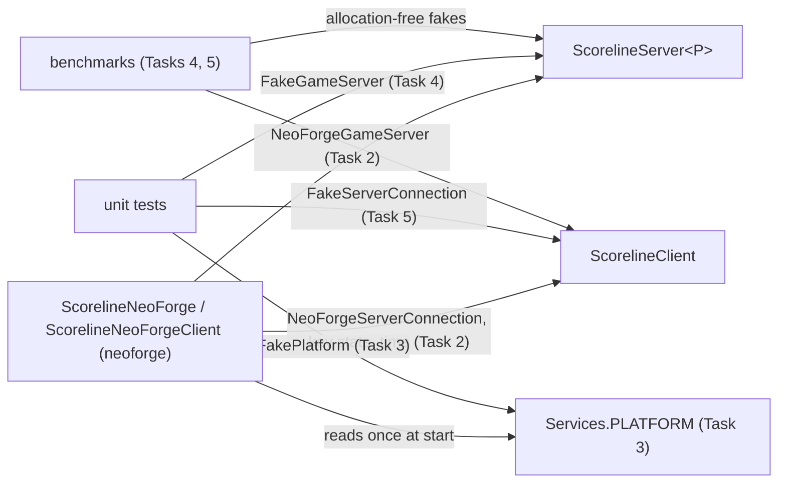
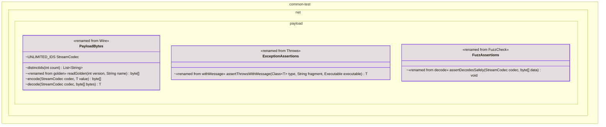
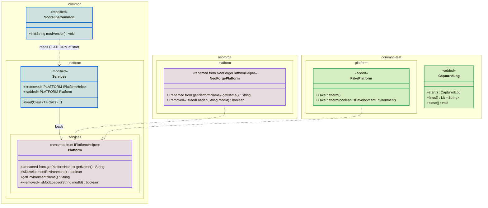
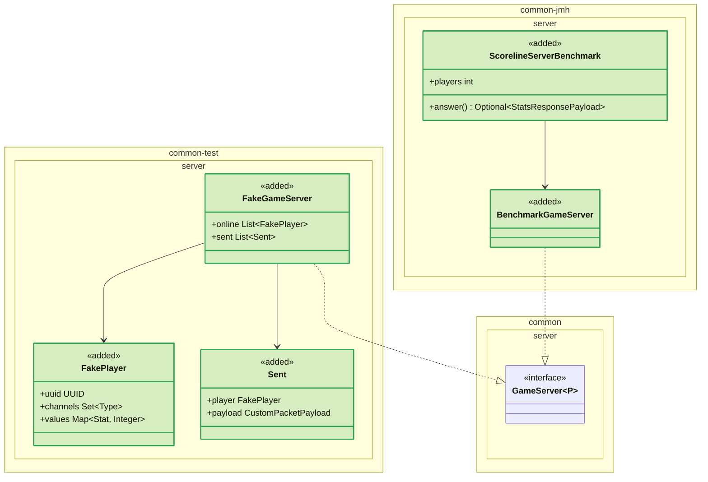
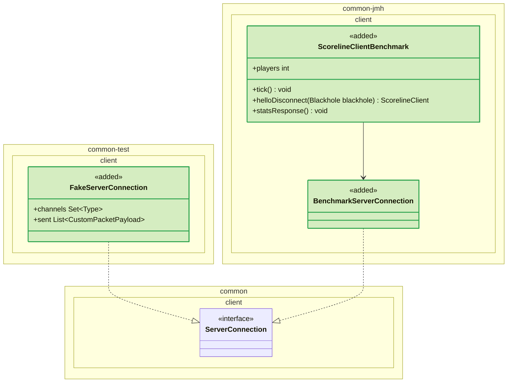

# Scoreline v0.2.1 Testability – Implementation Plan

Nov 22, 2026

**Goal:** every class of `common`'s main code is measured by the unit coverage gate and by mutation testing. `coverageExcludes` ends empty. The server and client sides of the protocol (`ScorelineServer`, `ScorelineClient`) get their players, channels, key state, log level and time passed in, so plain JUnit tests check what so far only game tests saw. Benchmarks cover their hot paths. The names that break the naming rules (`IPlatformHelper`, `INetworkHelper`, `Wire`, `Throws`, `FuzzCheck`, `golden`, test methods with a capital after the ID) are replaced. Nothing changes on the wire or in the game.

**Non-goals:**

- Protocol, payloads and golden files: unchanged; the protocol version stays `1`.
- Its own release: v0.2.1 is a plan and one pull request, without a tag. Its commits (`refactor:`, `test:`, `build:`) appear under "Other" in the next release's changelog.
- Building the response log line only when DEBUG is on: `onStatsResponse` builds the line also when it is not written. v0.3 shows the values in the TAB list, so this line is rethought there and not tuned here.
- Resolving the stat IDs once instead of per request: a change for speed, which belongs with the snapshot in v0.7.
- `Constants` and `ScorelineCommon`: their names do not break the naming rules and stay.
- The game tests: they stay as they are and must still pass. They test through NeoForge's real handlers, which this plan does not change.

## How it works

1. The loader module creates `ScorelineServer` with an `GameServer` adapter for the running `MinecraftServer`, and `ScorelineClient` with a `ServerConnection` adapter for the client's connection. These adapters are the only places that touch NeoForge or a game singleton. The client's loader reads the player-list key each tick and passes it to `onTick`, next to the time (Task 2).
2. Both sides write their network log at DEBUG on loggers of their own: `scoreline.net` for joins, leaves and refusals, `scoreline.net.payload` for each payload received. Players find these lines in `logs/debug.log`; the client and server dev runs show DEBUG in their console (Task 2).
3. `Services` and the start-up log get a `FakePlatform` registered for the tests (Task 3).
4. Unit tests run vanilla's `Bootstrap` once, so stat IDs resolve to the real `Stat` objects, read the log with `CapturedLog`, and drive the server with fakes (Task 4), then the client (Task 5). Benchmarks drive each side with fakes that allocate nothing, in the same tasks.
5. Tasks 3 to 5 each remove their classes from `coverageExcludes`. Task 6 checks the whole: gates, game tests, the game by hand and the performance comparison.

**Deviations from the spec:** none. The spec's rule that shared code gets game state passed in (Architecture, Rules; Testing) was added for this plan. The one read of a loader service left in `common` is `ScorelineCommon.init`'s start-up line, which is start-up code, not logic.

**Alternatives considered:**

| Option | Why not |
| --- | --- |
| Mockito mocks of `ServerPlayer` and `MinecraftServer` | Mocks the game's own classes: deep stubs (`level().getServer().getPlayerList()`), a new dependency with a Java agent, tests that break when Minecraft changes a getter. The benchmarks would measure the mocks and their allocation |
| A wrapper object per player (`ConnectedPlayer` with `uuid()`, `hasChannel(…)`, …) instead of a type parameter | The loader would create one wrapper per online player per request: 50 allocations on the hot path, which the allocation comparison would then report |
| Move the decisions into a new plain class and keep `ScorelineServer` excluded | Leaves the code that orders the channel check before the budget and builds one row per player outside the gate. That is the code that needed the fix `ff6deb7` in v0.2 |
| Keep the network access as a `ServiceLoader` service (`Services.NETWORK`) and only rename it | The loader creates both classes, so it can pass the adapter in. A global service would let later code skip the parameter and reach the game again. It would also need a fake registration wherever `Services` loads, because `Services` loads all its services at once |
| Keep `ScorelineCommon.logProtocol` reading `Services.PLATFORM` per message | Breaks the spec's new rule on the hot path; the tests would share one mutable fake platform, and the benchmarks would need a platform registration of their own |
| A shared `testFixtures` source set for the fakes of tests and benchmarks | The test fakes record every call (they allocate); the benchmark fakes must allocate nothing. Two small sets of fakes with different jobs are clearer than one set with modes |
| Tests in the same task as each class's refactoring (server, then client, then platform) | `Services` loads `NETWORK` and `PLATFORM` together when the class loads, so no test can load `Services` while `INetworkHelper` has no implementation on the test classpath. Removing `NETWORK` first (Task 2), with the game tests as the safety net, avoids throwaway stubs |
| Release v0.2.1 | Only refactoring and tests: a changelog without anything for players |

**Commit scopes:** `test` (Task 1), `net` (Task 2), `platform` (Task 3), `server` (Task 4), `client` (Task 5), `coverage` (Task 6). Types: `refactor:` for code moved or renamed with the same behaviour, `test:` for new tests and benchmarks, `build:` for Gradle changes, `docs(plan):` for ticks.

**New in this version:** vanilla's `Bootstrap` in unit tests and benchmarks; a log appender in tests (log4j-core, already on the test classpath through Minecraft); a service registration in `common/src/test/resources`; a logger per category of log lines, with DEBUG in the client and server dev runs. No new dependency.

## Tasks

1. Test helper names: `Wire`, `Throws`, `FuzzCheck`, `golden` and the test method names
2. Pass the game in: `INetworkHelper` splits into `ServerConnection` (renamed) and `GameServer` (new); the key state is passed in; the network log lines get loggers of their own
3. `Platform`: the platform service under its new name, with a fake in tests
4. `ScorelineServer`: unit tests and benchmark
5. `ScorelineClient`: unit tests and benchmark
6. Documents, profiling run and the full check

## Task 1: Test helper names

**Why:** three test helpers have one-word names that do not say what they do (`Wire.encode`, `Throws.withMessage`, `FuzzCheck.decode`). `Wire.golden` reads a file but is named like a value. And 16 test methods in `RequestBudgetTest` start with a capital after their ID (`t01_NewBudgetAllowsRequest`), unlike the other 55. The later tasks add tests next to them, so the names are fixed first. Nothing else changes.

**Design:** renames only, in `common/src/test/java/io/github/foursource/scoreline/net/payload/` (all package-private, as now):

- `Wire` → `PayloadBytes`: turns payloads into bytes and back, and reads golden files. `golden` → `readGolden`; `encode`, `decode`, `distinctIds` and `UNLIMITED_IDS` keep their names, which read well after the class name: `PayloadBytes.encode(…)`.
- `Throws` → `ExceptionAssertions`, its method `withMessage` → `assertThrowsWithMessage`, so a call reads like JUnit's own assertions.
- `FuzzCheck` → `FuzzAssertions`, its method `decode` → `assertDecodesSafely`: it asserts that any bytes give a payload or a clean decoder error.
- The 16 methods `tNN_Upper…` in `RequestBudgetTest` → `tNN_lower…` (`t01_newBudgetAllowsRequest`).

**Alternatives considered**

| Option | Why not |
| --- | --- |
| JUnit's `assertThrows` plus `assertTrue(message.contains(…))` in each test, without a helper | 10 call sites would repeat the same two lines; the helper also puts the message into the failure text |
| Rename the saved fuzz input folders as well | The fuzz test classes and methods keep their names; only the helper changes. The folders are named after the test class and method (`common/src/test/resources/io/github/foursource/scoreline/net/payload/HelloPayloadFuzzTestInputs/t113_helloDecoder/`), so they stay valid |

**Steps**

1. Rename with the IDE's refactoring (VS Code: F2 on the class or method name), so every call site follows. Note the number of tests `./gradlew :common:test` runs before and after.

**Done when**

- [x] `./gradlew :common:check` passes, with as many tests as before the renames
- [x] no file in `common/src/test` mentions `Wire`, `Throws`, `FuzzCheck` or `golden(`, and no test method starts with `t<digits>_<capital letter>`
- [x] the three `…FuzzTest` classes still replay their saved inputs in `:common:test`

## Task 2: Pass the game in

**Why:** `ScorelineServer` and `ScorelineClient` reach the game themselves, so unit tests could not run them:

- `Services.NETWORK` for channel checks and sending;
- `requester.level().getServer()` for the online players;
- `player.getStats()` for the values;
- `Minecraft.getInstance().options.keyPlayerList` for the TAB key;
- `Services.PLATFORM`, per message, for the log level.

This task moves the first four into a one-line adapter in the loader module, or into a value the loader passes in, the way the time is already passed in. The fifth goes away: the network log lines get loggers of their own and are always written at DEBUG; whether they show is the logging configuration's business. Behaviour in a player's game does not change. The unit tests and benchmarks of the two classes follow in Tasks 4 and 5, so until then the game tests and a run in the game check them.

**Background**

- **A type parameter for the player.** `ScorelineServer
` does not know what a player is. The loader decides (`ServerPlayer`), and tests and benchmarks pick something simpler. This is plain Java generics; it is named here because the loader now writes `new ScorelineServer<>(…)`.
- **Two adapters, two sides.** `NeoForgeGameServer` uses server classes only. `ScorelineNeoForge` creates it when a server starts. `NeoForgeServerConnection` uses `Minecraft`, which a dedicated server does not have. So only `ScorelineNeoForgeClient` creates it: NeoForge loads that class on the client alone (`@Mod(dist = Dist.CLIENT)`, see v0.2 Task 5).
- **Named loggers.** SLF4J loggers (Log4j 2 underneath, in the game and in `common`'s tests) form a tree by their names: `scoreline.net.payload` is a child of `scoreline.net`, which is a child of `scoreline`. A logger without a setting of its own takes its parent's level and hands its events to its parent's appenders as well. So the code picks a logger and a level per line, and the configuration decides which loggers and levels are written where. Docs: https://logging.apache.org/log4j/2.x/manual/architecture.html (logger hierarchy and additivity).
- **Where the lines go in the game.** Read from the sources of the versions this build uses (FML loader 12.0.12, `net/neoforged/fml/startup/log4j2.xml`; ModDevGradle 2.0.147, `RunUtils.writeLog4j2Configuration` and `PrepareRunOrTest`):
  - In a player's game or on a server, NeoForge's configuration lets every level through to the appenders. The console and `logs/latest.log` take INFO and above, `logs/debug.log` also takes DEBUG. Protocol lines at DEBUG therefore land in `debug.log` only, as in v0.2.
  - In a dev run, ModDevGradle writes its own configuration. Its root level is the run's `logLevel` (default INFO), and its console takes everything the root lets through; `net.minecraft` and `com.mojang` keep a fixed INFO. `logLevel = org.slf4j.event.Level.DEBUG` on a run thus shows Scoreline's DEBUG lines in that run's console, next to the DEBUG lines of NeoForge and other mods.
  - A run's `loggingConfigFile` replaces the generated file with one of our own, copied as it is. That could raise `scoreline.net` alone, at the price of a copy of the generated configuration (about 120 lines) that has to follow ModDevGradle's updates.

**Design**

- `server.GameServer
` (new interface, `common`): the running game server as the loader sees it; everything `ScorelineServer` needs from the game. Implementations keep no players of their own; each call asks the server.
  - `List
 getOnlinePlayers()`: every player online now, the requester included, in the server's order.
  - `UUID getUUIDOf(P player)`.
  - `boolean checkPlayerHasChannel(P player, CustomPacketPayload.Type<?> type)`: whether that player's client can receive the payload.
  - `void sendTo(P player, CustomPacketPayload payload)`.
  - `int getStatValueOf(P player, Stat<?> stat)`: the player's current value of the stat.
- `client.ServerConnection` (renamed from `platform.services.INetworkHelper`, `common`): the client's connection to the server, as the loader sees it. The interface keeps its client half (`serverHasChannel` renamed); its server half (`hasChannel(ServerPlayer, …)`, `sendToPlayer`) moves into `GameServer` and is removed here.
  - `boolean checkServerHasChannel(CustomPacketPayload.Type<?> type)` (was `serverHasChannel`): whether the connected server can receive the payload; false while not connected (main menu).
  - `void sendToServer(CustomPacketPayload payload)`: unchanged.
- Loggers in `ScorelineCommon`, one per category of log lines, named after the mod ID so they form one tree. A later category gets its logger there too.
  - `LOG` (changed): now named `scoreline` (`Constants.MOD_ID`, was `Constants.MOD_NAME`), the root of the tree; the start-up lines and `Services.load`'s line. The texts of the start-up lines do not change, so the smoke test and the build workflow still find `Scoreline <version> loaded`.
  - `NET_LOG` (new): `scoreline.net`, what the server decides about players and requests: joins, leaves and refusals.
  - `PAYLOAD_LOG` (new): `scoreline.net.payload`, one line per payload received, on either side.
  - The dev console's pattern (`%c{2.}`) shortens every part of a logger name but the last to two letters (`sc.ne.payload`); the log files show the full name.
- `server.ScorelineServer
` (changed), same behaviour as in v0.2:
  - `ScorelineServer(GameServer
 server)` (was `ScorelineServer()`): the gate as before (`PLAY_TIME`, `DEATHS`, `Protocol.BUDGET_*`).
  - `void onJoin(P player)`, `void onLeave(P player)` (were `ServerPlayer`): as before, through `server.getUUIDOf(…)`, `checkPlayerHasChannel(…)` and `sendTo(…)`. New: each writes one line at DEBUG on `NET_LOG`, `Player <uuid> joined the server` and `Player <uuid> left the server`, so the log shows when the gate learns or forgets a player.
  - `Optional<StatsResponsePayload> onStatsRequest(P requester, List<String> ids, long nowMillis)` (was `ServerPlayer requester`): as before. The rows come from `server.getOnlinePlayers()`, the values from `server.getStatValueOf(…)`. Stat IDs still become stats through `ObjectiveCriteria.byName`. The four log lines keep their content with new wording, all at DEBUG: `Server received: stats_request requester=<uuid> now=<ms>ms statIDs=[…]` on `PAYLOAD_LOG`, and the three refusals on `NET_LOG`, each `Server: requester=<uuid> now=<ms>ms stats_request was rejected as …` with the reason as before.
- `client.ScorelineClient` (changed), same behaviour as in v0.2:
  - `ScorelineClient(ServerConnection connection)` (was `ScorelineClient()`).
  - `void onTick(boolean playerListKeyDown, long nowMillis)` (was `onTick(long)`): without the request channel nothing happens and the timer is not asked. Otherwise, when the timer says so, it sends `[PLAY_TIME, DEATHS]`.
  - `onHello`, `onDisconnect`, `onStatsResponse`: unchanged, except their lines, at DEBUG on `PAYLOAD_LOG`: `Client received: hello version=<v> refresh=<s>s`, and per player in the response `Client received: stats_response uuid=<uuid> <stat ID>=<value> …`.
- A logger is not game state: it reaches nothing of the game, and tests read it through an appender (`CapturedLog`, Task 3).
- `ScorelineCommon`: `logProtocol` is removed. Reading its loggers does not load `Services`: only `init` uses it. The benchmark rule follows calls, not reads of these fields, so the hot paths reach no new measured code through it.
- Removed: `Services.NETWORK` and the registration file `META-INF/services/io.github.foursource.scoreline.platform.services.INetworkHelper`. The loader now creates the connection itself and passes it in, so `ServiceLoader` no longer needs it.
- `neoforge`, in `io.github.foursource.scoreline.platform`, glue without decisions:
  - `NeoForgeGameServer implements GameServer<ServerPlayer>`: `NeoForgeGameServer(MinecraftServer server)`; `getOnlinePlayers()` returns `server.getPlayerList().getPlayers()` (the server's own list, not a copy), `getUUIDOf` `player.getUUID()`, `checkPlayerHasChannel` `player.connection.hasChannel(type)`, `sendTo` calls `PacketDistributor.sendToPlayer`, `getStatValueOf` returns `player.getStats().getValue(stat)`.
  - `NeoForgeServerConnection implements ServerConnection` (renamed from `NeoForgeNetworkHelper`, which keeps its two client methods, `serverHasChannel` renamed; its two server methods move into `NeoForgeGameServer`): `checkServerHasChannel` asks `Minecraft.getInstance().getConnection()`, which is null while not connected, so it is the one method with a null check, as before. `sendToServer` calls `ClientPacketDistributor.sendToServer`.
  - `ScorelineNeoForge` creates `new ScorelineServer<>(new NeoForgeGameServer(event.getServer()))` on `ServerStartingEvent`.
  - `ScorelineNeoForgeClient` creates `new ScorelineClient(new NeoForgeServerConnection())`. Its tick listener calls `client.onTick(Minecraft.getInstance().options.keyPlayerList.isDown(), Util.getMillis())`.
- `neoforge/build.gradle`: the `client` and `server` runs get `logLevel = org.slf4j.event.Level.DEBUG`, so their console shows the network log. `gameTestServer` and `profileServer` keep INFO: the game tests' output stays short, and the profiling run no longer formats and writes the network log, as in a player's game (in v0.2 every dev run wrote them at INFO).
- `coverageExcludes`: unchanged. The hot roots reach no new measured code (`GameServer` and `ServerConnection` are interfaces without code, and the logger is a library), so the benchmark rule demands nothing new yet. The benchmarks of the two classes come with their tests, when each class is measured (Tasks 4 and 5).

```mermaid
classDiagram
    namespace common {
        class ScorelineCommon {
            <<modified>>
            +LOG Logger «renamed scoreline»
            +«added» NET_LOG Logger
            +«added» PAYLOAD_LOG Logger
            +«removed» logProtocol(String format, Object... args) void
        }
    }
    namespace common.platform {
        class Services {
            <<modified>>
            +«removed» NETWORK INetworkHelper
        }
    }
    namespace common.net {
        class RequestGate
        class RequestTimer
    }
    namespace common.server {
        class GameServer~P~ {
            <<added>>
            +getOnlinePlayers() List~P~
            +getUUIDOf(P player) UUID
            +checkPlayerHasChannel(P player, Type type) boolean
            +sendTo(P player, CustomPacketPayload payload) void
            +getStatValueOf(P player, Stat stat) int
        }
        class ScorelineServer~P~ {
            <<modified>>
            +«removed» ScorelineServer()
            +«added» ScorelineServer(GameServer~P~ server)
            +«removed» onJoin(ServerPlayer player) void
            +«added» onJoin(P player) void
            +«removed» onLeave(ServerPlayer player) void
            +«added» onLeave(P player) void
            +«removed» onStatsRequest(ServerPlayer requester, List~String~ ids, long nowMillis) Optional~StatsResponsePayload~
            +«added» onStatsRequest(P requester, List~String~ ids, long nowMillis) Optional~StatsResponsePayload~
        }
    }
    namespace common.client {
        class ServerConnection {
            <<renamed from platform.services.INetworkHelper>>
            +«renamed from serverHasChannel» checkServerHasChannel(Type type) boolean
            +sendToServer(CustomPacketPayload payload) void
            +«removed» hasChannel(ServerPlayer player, Type type) boolean
            +«removed» sendToPlayer(ServerPlayer player, CustomPacketPayload payload) void
        }
        class ScorelineClient {
            <<modified>>
            +«removed» ScorelineClient()
            +«added» ScorelineClient(ServerConnection connection)
            +«removed» onTick(long nowMillis) void
            +«added» onTick(boolean playerListKeyDown, long nowMillis) void
            +onHello(HelloPayload hello) void
            +onDisconnect() void
            +onStatsResponse(StatsResponsePayload response) void
        }
    }
    namespace neoforge {
        class ScorelineNeoForge {
            <<modified>>
        }
        class ScorelineNeoForgeClient {
            <<modified>>
        }
    }
    namespace neoforge.platform {
        class NeoForgeGameServer {
            <<added>>
            +NeoForgeGameServer(MinecraftServer server)
            +getOnlinePlayers() List~ServerPlayer~
            +getUUIDOf(ServerPlayer player) UUID
            +checkPlayerHasChannel(ServerPlayer player, Type type) boolean
            +sendTo(ServerPlayer player, CustomPacketPayload payload) void
            +getStatValueOf(ServerPlayer player, Stat stat) int
        }
        class NeoForgeServerConnection {
            <<renamed from NeoForgeNetworkHelper>>
            +«renamed from serverHasChannel» checkServerHasChannel(Type type) boolean
            +sendToServer(CustomPacketPayload payload) void
            +«removed» hasChannel(ServerPlayer player, Type type) boolean
            +«removed» sendToPlayer(ServerPlayer player, CustomPacketPayload payload) void
        }
    }
    ScorelineServer --> GameServer : asks, sends hello
    ScorelineServer --> RequestGate
    ScorelineServer ..> ScorelineCommon : logs on NET_LOG, PAYLOAD_LOG
    ScorelineClient --> ServerConnection : asks, sends request
    ScorelineClient --> RequestTimer
    ScorelineClient ..> ScorelineCommon : logs on PAYLOAD_LOG
    NeoForgeGameServer ..|> GameServer
    NeoForgeServerConnection ..|> ServerConnection
    ScorelineNeoForge ..> NeoForgeGameServer : creates
    ScorelineNeoForge ..> ScorelineServer : creates, forwards events
    ScorelineNeoForgeClient ..> NeoForgeServerConnection : creates
    ScorelineNeoForgeClient ..> ScorelineClient : creates, passes key state and time
    style GameServer fill:#2da44e33,stroke:#2da44e,stroke-width:2px
    style ServerConnection fill:#8250df33,stroke:#8250df,stroke-width:2px
    style NeoForgeGameServer fill:#2da44e33,stroke:#2da44e,stroke-width:2px
    style NeoForgeServerConnection fill:#8250df33,stroke:#8250df,stroke-width:2px
    style ScorelineServer fill:#0969da33,stroke:#0969da,stroke-width:2px
    style ScorelineClient fill:#0969da33,stroke:#0969da,stroke-width:2px
    style ScorelineCommon fill:#0969da33,stroke:#0969da,stroke-width:2px
    style Services fill:#0969da33,stroke:#0969da,stroke-width:2px
    style ScorelineNeoForge fill:#0969da33,stroke:#0969da,stroke-width:2px
    style ScorelineNeoForgeClient fill:#0969da33,stroke:#0969da,stroke-width:2px
```

**Alternatives considered**

| Option | Why not |
| --- | --- |
| `getStatValueOf(P player, String statId)`, with the adapter resolving the ID | Moves `ObjectiveCriteria.byName` and its "always found" assumption into the loader module, where no unit test reaches it and the spec allows no logic |
| Pass the online players as a parameter of `onStatsRequest` | The loader would reach `requester.level().getServer()` per request, and `onJoin`'s channel check and send would still need an adapter; one interface covers both |
| A wrapper per player (`Player` with `uuid()`, `hasChannel(…)`, …, and a `NeoForgePlayer` around each `ServerPlayer`) instead of the type parameter | Either a new wrapper per online player per request (50 allocations on the hot path), or a map of wrappers kept in step with joins and leaves: a second player list that can go stale |
| `OnlinePlayers
` as the interface's name, in a field `players` | Calls read `players.uuid(player)` and `players.all()`: the interface stands for the server, not for a group of players |
| Static methods on `GameServer` instead of an instance | `common` cannot name the loader's class, static methods cannot be replaced by fakes, and a static `getOnlinePlayers()` would need a global reference to the server |
| A key reader (`BooleanSupplier`) in `ScorelineClient`'s constructor instead of the key state per tick | The time is already passed per call; one more value per call keeps both the same way and needs no object |
| One adapter class for both sides, as `NeoForgeNetworkHelper` was | Its client methods name `Minecraft`; it only worked because the server never called them. Two classes keep client code out of the server's path |
| A `ProtocolLog(boolean isDevelopmentEnvironment)` passed into both classes, writing at INFO in a dev environment and at DEBUG otherwise | Code decides what the logging configuration already decides. Each further category of lines would need a class and a constructor parameter of its own, and the loader would read the platform for each |
| An own Log4j configuration for the dev runs (`loggingConfigFile`) that raises `scoreline.net` alone | A copy of ModDevGradle's generated configuration to keep in step with its updates. Worth it only if the dev console gets too noisy at DEBUG, which Step 5 checks |
| `Configurator.setLevel("scoreline.net", DEBUG)` in the loader when it runs in a dev environment | A decision in the loader module, and Log4j's own API in code that otherwise only knows SLF4J |

**Tests**

None in this task: it adds no measured code, and its behaviour is checked by the game tests and the run in the game below. T-197 and T-198 belonged to the `ProtocolLog` of an earlier draft of this plan; the IDs stay unused. The level and logger of the network log lines are checked with each line in Tasks 4 and 5 (T-204, T-206, T-207, T-210, T-215, T-223, T-224).

Edge cases without a test:
- The adapters are glue and run only in the game: the game tests cover `NeoForgeGameServer`, and the run in the game below covers `NeoForgeServerConnection`.
- The `logLevel` of the dev runs: build configuration, checked by Step 4.

**Steps**

1. Rename and move with the IDE, so git keeps each file's history: `INetworkHelper` → `client.ServerConnection` and `NeoForgeNetworkHelper` → `NeoForgeServerConnection`, then the method `serverHasChannel` → `checkServerHasChannel`. Then create `GameServer` and `NeoForgeGameServer`, move the two server methods' bodies there, and delete them from the renamed classes. Last, delete `Services.NETWORK` and the registration file.
2. `./gradlew :common:compileJava` while `common` changes (the loader module compiles `common`'s sources again, so `./gradlew build` fails until the loader classes follow), then `./gradlew build` and `./gradlew :neoforge:runGameTestServer`: the game tests exercise the server path end to end through the new adapter.
3. `logLevel` on the `client` and `server` runs in `neoforge/build.gradle`.
4. `./gradlew :neoforge:runClient`, a singleplayer world, TAB held for about five seconds: the client path has no game test, so this is its check until Task 5.
5. **Verify in a run.** In that client run's console, how many DEBUG lines of NeoForge and other mods appear around Scoreline's? If they bury Scoreline's lines, propose the own configuration (Alternatives) as a change to this plan before going on.

**Done when**

- [x] `./gradlew build` passes
- [x] all game tests pass unchanged
- [x] in singleplayer, the console shows the hello and, while TAB is held, a `Client received: stats_response` line at DEBUG about every 2 seconds; none when TAB is released
- [x] `ScorelineServer` and `ScorelineClient` import nothing from `io.github.foursource.scoreline.platform` or `net.minecraft.client`
- [x] no file in `common/`, `neoforge/` or the build files mentions `INetworkHelper`, `NeoForgeNetworkHelper`, `Services.NETWORK`, `logProtocol` or `ProtocolLog`
- [x] the two adapters make no decision except `NeoForgeServerConnection.checkServerHasChannel`'s null check

## Task 3: `Platform`: the platform service

**Why:** `common` asks the loader two things through a `ServiceLoader` service: the platform's name (logged at start) and whether it runs in a development environment (also named in the start-up line). The interface is called `IPlatformHelper` and has a method nobody calls (`isModLoaded`). `Services`, the interface's default method and `ScorelineCommon` are excluded from coverage, because `common`'s tests had no implementation of the service. This task gives the tests one.

**Background**

- **`ServiceLoader` in tests.** `ServiceLoader` finds an implementation through a text file on the classpath, `META-INF/services/<the interface's fully qualified name>`, with one implementing class per line. In the game the file comes from the NeoForge jar. `common`'s tests have `common/src/test/resources` on their classpath, so a file there registers a test implementation, and `Services` loads it the usual way. The file name must follow the interface's name and package, or nothing is found. `ServiceLoader` creates the class with its public no-argument constructor. Docs: https://docs.oracle.com/en/java/javase/25/docs/api/java.base/java/util/ServiceLoader.html
- **Reading the log in a test.** Scoreline logs through SLF4J, and on `common`'s test classpath SLF4J writes to Log4j 2. A test run while planning showed `Log4jLoggerFactory`.
  - Log4j hands each event to the *appenders* attached to a logger and, unless switched off, to those of its parents. A test can attach its own appender to `scoreline` that keeps the events in a list, and it also receives the events of `scoreline.net` and `scoreline.net.payload`.
  - The level filter runs before the appenders. `log4j2-test.xml` sets the root to INFO, so DEBUG events reach an appender only once `scoreline` has a level of its own; a child logger without a level of its own follows. `CapturedLog` gives `scoreline` a logger configuration of its own (`LoggerConfig`) at DEBUG with the appender, and removes it again on close, so after a test the levels are exactly what `log4j2-test.xml` says.
  - The same test run confirmed both for the root logger, then named `Scoreline` (the name does not change how it works): an `AbstractAppender` subclass on it received an INFO event and, after `setLevel`, a DEBUG event.
  - Docs: https://logging.apache.org/log4j/2.x/manual/appenders.html and configuration: https://logging.apache.org/log4j/2.x/manual/configuration.html
- **Why the log is checked.** PIT (mutation testing, gate 100 %) removes calls to void methods such as `LOG.debug(…)`. Such a mutant survives unless a test checks the line. So every log line `common` writes gets an assertion.
- **Static initialisers and PIT.** PIT runs many mutants in one JVM and swaps the mutated class in. A static initialiser that has already run does not run again. So `Services.PLATFORM`, which is set when `Services` loads, does not show a mutant of `load`; only a direct call of `load` does.
- **Static initialisers and the log.** `Services` loads the first time a test touches it, and `load` then writes its DEBUG line. If `ScorelineCommon.init` is the first to touch it, that line lands between the two INFO lines of the start. A test that checks `init`'s lines therefore loads `Services` before it starts capturing.

**Design**

- `platform.services.Platform` (was `IPlatformHelper`, same package): what `common` needs to know about the loader. The package stays, as the place for a later service interface.
  - `String getName()` (was `getPlatformName`): the loader's name, for example `NeoForge`.
  - `boolean isDevelopmentEnvironment()`: unchanged.
  - `default String getEnvironmentName()`: unchanged, `development` or `production`.
  - `isModLoaded` is removed: nothing calls it, and the gate is meant to keep out untested code nobody uses.
- `platform.Services`: `PLATFORM` (now of type `Platform`) and `load(Class<T>)`, which still logs `Loaded <service> for service <interface>` at DEBUG.
- `ScorelineCommon.init`: its second line uses `getName()` and `getEnvironmentName()`.
- `neoforge`: `NeoForgePlatformHelper` → `platform.NeoForgePlatform`; its registration file becomes `META-INF/services/io.github.foursource.scoreline.platform.services.Platform`.
- Test code: `platform.FakePlatform implements Platform`, name `Fake`.
  - `FakePlatform()` is a production environment; `ServiceLoader` uses this constructor.
  - `FakePlatform(boolean isDevelopmentEnvironment)` is for tests that need either answer, so no test changes the shared instance.
  - Registered in `common/src/test/resources/META-INF/services/io.github.foursource.scoreline.platform.services.Platform`.
- `CapturedLog` (in `common/src/test/java/io/github/foursource/scoreline/`) captures what the `scoreline` logger and its children write while it is open. Tasks 4 and 5 use it too.
  - `static CapturedLog start()` gives `scoreline` a logger configuration of its own at DEBUG, with an appender that keeps the events.
  - `List<String> lines()` returns each event as `<LEVEL> [<logger>] <formatted message>`, for example `DEBUG [scoreline.net.payload] Client received: hello version=1 refresh=2s`. The logger is part of the line, so a test also catches a line written to the wrong category.
  - `close()` removes that configuration and stops the appender.
  - It implements `AutoCloseable`, so a test opens it in `try (…)`.
- `coverageExcludes`: `platform/Services`, `platform/services/IPlatformHelper` and `ScorelineCommon` are removed. None of them is on a hot path after Task 2, so the benchmark rule demands nothing new.

**Alternatives considered**

| Option | Why not |
| --- | --- |
| A mutable `development` field on the registered fake | Every test would share one instance through `Services.PLATFORM`, so the order of tests could decide results. A constructor argument needs no reset |
| `name()` and `environmentName()`, in `platform` without the `services` subpackage | Renames that fix no naming rule: getters may start with `get`. The subpackage keeps a place for later service interfaces |
| Expose the formatted log lines from the classes (a method returning the text) instead of capturing the log | The log call itself would stay unchecked, and PIT's removed-call mutants would survive |
| Log4j's `ListAppender` from `log4j-core-test` | A new test dependency for what a 20-line appender does |
| `Configurator.setLevel("scoreline", DEBUG)` and back in `CapturedLog` | Leaves behind a logger configuration that `log4j2-test.xml` does not have; removing the own configuration restores the state exactly |
| Drop the DEBUG line in `Services.load` instead of testing it | It is the one place that shows which implementation a loader picked, which matters once Fabric returns (v0.9) |

**Tests** (unit, `common`)

| ID | Case → expected | Bug it catches |
| --- | --- | --- |
| T-199 | `Services.PLATFORM` → a `FakePlatform` | the registration file still has the old interface name, so nothing is loaded |
| T-200 | `Services.load(Platform.class)` → a `FakePlatform`, and the line `DEBUG [scoreline] Loaded <it> for service interface io.github.foursource.scoreline.platform.services.Platform` | `load` returns null or the wrong object; the DEBUG line removed |
| T-201 | `Services.load` of a test interface with no registered implementation → `IllegalStateException` whose message names that interface | a missing service is ignored (null), or the message hides which one |
| T-202 | `new FakePlatform(true).getEnvironmentName()` → `development`; `new FakePlatform(false)` → `production` | the two words swapped |
| T-203 | `init("1.2.3")` → the lines `INFO [scoreline] Scoreline 1.2.3 loaded` and `INFO [scoreline] Running at Fake in a production environment`, in that order | the start line changed; the smoke test and the build workflow search for exactly it |

⚠ T-200: `PLATFORM` alone does not catch a mutant of `load` (see Background); the direct call does.

⚠ T-203: touch `Services.PLATFORM` before `CapturedLog.start()`, or the result depends on the test order (see Background).

Edge cases without a test:
- Two registered implementations cannot happen: a jar carries one loader's registration, and `checkJar` checks that every registration names a class in the jar.
- An empty or missing version cannot reach `init`: the build fills it from `gradle.properties`, and `checkJar` checks it.

**Done when**

- [x] `./gradlew :common:check` passes with `Services`, `Platform` and `ScorelineCommon` measured
- [x] `./gradlew :common:pitest` kills every mutant
- [x] `./gradlew :neoforge:checkJar` passes, and the jar's only service registration is `META-INF/services/io.github.foursource.scoreline.platform.services.Platform`
- [x] `./gradlew :neoforge:runServer` logs `Running at NeoForge in a development environment`

## Task 4: `ScorelineServer`: unit tests

**Why:** `ScorelineServer` makes the server's decisions about every request:

- the channel check comes before the budget, so a client that cannot receive the answer spends nothing;
- a refused or empty request gets no answer;
- every online player gets one row, with the values in the order of the request.

So far only game tests saw this, and their coverage is a report, not a gate. After Task 2 the class gets the game through `GameServer`, so plain tests can drive it. Once the class is measured, the benchmark rule (`BenchmarkRuleTest`) demands a benchmark that reaches `onStatsRequest`, so the server's benchmark comes in this task too.

**Background**

- **Vanilla's `Bootstrap`.** Minecraft keeps its blocks, items and statistics in *registries*. `net.minecraft.server.Bootstrap.bootStrap()` fills them once at start; before it, `SharedConstants.tryDetectVersion()` loads the version data the bootstrap reads. `ObjectiveCriteria.byName("minecraft.custom:minecraft.play_time")` looks the stat up in those registries, so code that resolves stat IDs outside the game bootstraps first.
  - A test run while planning confirmed this for 26.3. In `common`'s unit tests it takes about 7 s once per JVM; afterwards `byName` returns the same objects as `Stats.CUSTOM.get(Stats.PLAY_TIME)` and `Stats.CUSTOM.get(Stats.DEATHS)`.
  - In a benchmark's `@Setup` it worked in `:common:jmhTest`.
  - With the bootstrap in `@BeforeAll`, PIT killed every mutant of a copy of `RequestBudgetTest` and timed out none.
  - Source: the class `net.minecraft.server.Bootstrap` in the decompiled Minecraft sources that ModDevGradle attaches in the IDE.

**Design**

- Tests in `common/src/test/java/io/github/foursource/scoreline/server/`:
  - `FakePlayer` (record): `UUID uuid`, `Set<CustomPacketPayload.Type<?>> channels`, `Map<Stat<?>, Integer> values`.
  - `FakeGameServer implements GameServer<FakePlayer>`:
    - `online`, the changeable list `getOnlinePlayers()` returns;
    - `sent`, a list of `Sent(FakePlayer player, CustomPacketPayload payload)` records.
  - `ScorelineServerTest` bootstraps in `@BeforeAll`, creates the server with a `FakeGameServer`, and reads the log with `CapturedLog` (Task 3).
- Benchmark in `common/src/jmh/java/io/github/foursource/scoreline/server/`. The network log lines are DEBUG, below the benchmark's log level, so they are not written:
  - `BenchmarkGameServer implements GameServer<UUID>`: channels always there, `sendTo` does nothing, every value 1; `getOnlinePlayers()` returns a list built in `@Setup`. It allocates nothing.
  - `ScorelineServerBenchmark`, `@Param({"1", "10", "50"}) players`, bootstrap in `@Setup`. `answer()` returns `Optional<StatsResponsePayload>`: one answered request per call, the time advancing by `BUDGET_REFILL_MILLIS` so the budget never runs out (as `RequestGateBenchmark.admit`).
- `coverageExcludes`: `server/ScorelineServer` is removed.

**Alternatives considered**

| Option | Why not |
| --- | --- |
| The bootstrap in a JUnit extension shared by all test classes | Only this class needs it; an extension would hide a 7-second step behind an annotation |
| Fake stats in tests and benchmarks (an own `Stat` subclass) instead of the bootstrap | `Stat`'s constructor needs a `StatType` from the registries, and `onStatsRequest` resolves IDs through `ObjectiveCriteria.byName`, which reads the registries anyway |
| A shared `testFixtures` source set for the fakes of tests and benchmarks | The test fakes record every call (they allocate); the benchmark fakes must allocate nothing |

**Tests** (unit, `common`; `CAP` = `BUDGET_CAPACITY`, `T` = `BUDGET_REFILL_MILLIS`; players `A`, `B`, `C` have both client-bound channels unless a row says otherwise; `A` is the requester and has joined)

| ID | Case → expected | Bug it catches |
| --- | --- | --- |
| T-204 | `onJoin(A)` → exactly one payload sent, `HelloPayload.current()` to `A`, and the line `DEBUG [scoreline.net] Player <A> joined the server` | hello not sent, sent twice, or sent to another player; the join line removed |
| T-205 | `B` has no channel; `onJoin(B)` → nothing sent; then `B` gains the response channel and asks → answered | the gate registration skipped for a client without the hello channel, or a send to a vanilla client |
| T-206 | `onLeave(A)` → the line `DEBUG [scoreline.net] Player <A> left the server`; then `A` asks → empty, and the log has the refusal line naming `A` | leave not forwarded to the gate; the leave line removed |
| T-207 | `A` lacks the response channel and asks `CAP` times at 0 → each empty, with the `[scoreline.net]` line "lacks the response channel"; then with the channel, `CAP` requests at 0 → all answered | the budget spent before the channel check |
| T-208 | `C` never joined and asks → empty | a request from an unknown player answered |
| T-209 | `CAP` requests at 0 → answered; one more at 0 → empty; at `T` → answered | the server's gate built with other limits than `Protocol.BUDGET_*` |
| T-210 | only unknown IDs → empty, with the `[scoreline.net]` line "none of the requested stat IDs"; then `CAP - 1` requests at 0 answered and the next refused | an unknown-only request costs nothing, or is answered with an empty response |
| T-211 | an empty ID list → empty | an empty response sent |
| T-212 | `[DEATHS, "x:unknown", PLAY_TIME]` → response IDs `[DEATHS, PLAY_TIME]`, each row's values in that order | values in a fixed order instead of the request's |
| T-213 | online `[B, A, C]` with different values → three rows in that order, each with its own player's values | only the requester's row, or one player's values in every row |
| T-214 | stat values `-1` and `Integer.MAX_VALUE` → sent as `-1` and `2147483647` | a value cut on the way to `long`, or read as unsigned |
| T-215 | any request, answered or refused → first the line `DEBUG [scoreline.net.payload] Server received: stats_request requester=<A> now=<ms>ms statIDs=[…]` | the request log removed |

⚠ T-207: the order of the channel check and the budget is the point of the `ff6deb7` fix. Without its second half, a test that only checks "empty" passes with the order swapped.

Edge cases without a test:
- Duplicate IDs cannot reach the server: the request decoder rejects them (T-63), and the gate drops repeats anyway (T-36).
- A join reported twice keeps the budget (T-71). A leave for a player who never joined removes nothing from the gate's map, and the gate's later answers for others are unchanged (T-67).
- Time going backwards belongs to `RequestBudget` (v0.1 plan, T-07 and T-21).
- A request after a logout is T-206.
- A new world or server gets a new `ScorelineServer` from the loader, and the class keeps no static state.
- The largest legal request is a payload limit (T-150); the server answers only the two known IDs.
- Many players: `ScorelineServerBenchmark` with 50.
- A failing send belongs to NeoForge: `onJoin` sends only after the login, through `PacketDistributor`.

**Steps**

1. **Verify in a run.** `./gradlew :common:jmh` once, then `git status`. Only `:common:jmhTest` sets a working directory, and the bootstrap may make Minecraft's logging configuration write `logs/latest.log` into `common/`. If a `common/logs/` folder appears, add it to `.gitignore` in this task's commit. If not, nothing changes.

**Done when**

- [ ] `./gradlew :common:check` passes with `ScorelineServer` measured and the benchmark rule satisfied
- [ ] `./gradlew :common:pitest` kills every mutant
- [ ] after `./gradlew :common:jmh`, `git status` shows no new untracked files

## Task 5: `ScorelineClient`: unit tests

**Why:** `ScorelineClient` decides when the client asks: only with the request channel, and only when `RequestTimer` says so. It also logs the hello and the responses. No test has run it so far, and v0.3 builds the TAB overlay on this class, so it gets its tests before that.

**Design**

- Tests: `client.FakeServerConnection implements ServerConnection`:
  - `channels`, a changeable set;
  - `sent`, a list of the payloads sent.

  `ScorelineClientTest` reads the log with `CapturedLog` (Task 3).
- Benchmark in `common/src/jmh/java/io/github/foursource/scoreline/client/`, needed by the benchmark rule once the class is measured; the network log lines stay unwritten at DEBUG, as in Task 4:
  - `BenchmarkServerConnection implements ServerConnection`: the channel always there, `sendToServer` does nothing.
  - `ScorelineClientBenchmark`:
    - `tick()` returns `void`: key held, the time advancing 50 ms (one client tick) per call, so every 40th call sends.
    - `helloDisconnect(Blackhole blackhole)` returns `ScorelineClient`: a hello, then a disconnect, as one pair, as `RequestTimerBenchmark.helloDisconnect` does.
    - `statsResponse()` returns `void`: `@Param({"1", "10", "50"}) players`, a response with both IDs for that many players.
- `coverageExcludes`: `client/ScorelineClient` is removed, which leaves the list empty.

**Tests** (unit, `common`; `R` = `REFRESH_SECONDS` × 1,000 ms; the connection has the request channel unless a row says otherwise)

| ID | Case → expected | Bug it catches |
| --- | --- | --- |
| T-216 | hello, key down at 0 → one `StatsRequestPayload([PLAY_TIME, DEATHS])` sent | wrong IDs or order, or nothing sent |
| T-217 | no hello, key down → nothing sent | the timer not asked, so a server without the mod is asked |
| T-218 | hello, connection without the request channel, key down → nothing sent | requests sent to a server that cannot take them |
| T-219 | hello; no request channel, key down at 0; the channel appears, key still down at 1 → sent at 1 | the timer asked before the channel check: it records the press at 0, so nothing is sent until `R` |
| T-220 | hello, key down at 0, at `R - 1` and at `R` → sent at 0 and `R` only | the time or the key not passed on to the timer |
| T-221 | hello, key up → nothing sent | the key state ignored |
| T-222 | hello, disconnect, key down → nothing; after a new hello → sent | `onDisconnect` not forwarded |
| T-223 | `onHello(new HelloPayload(1, 2))` → the line `DEBUG [scoreline.net.payload] Client received: hello version=1 refresh=2s` | the hello log removed, its values swapped, or written at INFO into players' consoles |
| T-224 | a response with players `A`, `B` and IDs `[PLAY_TIME, DEATHS]` → two lines `DEBUG [scoreline.net.payload] Client received: stats_response uuid=<A> minecraft.custom:minecraft.play_time=<a1> minecraft.custom:minecraft.deaths=<a2>`, then the same for `B` | values of one player under another, a player dropped, IDs and values out of step |
| T-225 | a response without players → no line | a line without a player |

⚠ T-219: the Design's rule "without the channel the timer is not asked" shows only here. T-218 passes with the two checks swapped.

Edge cases without a test:
- A hello with an invalid or newer version, an interval below 1 s, or a second hello without a disconnect belong to `RequestTimer` (T-46, T-76, T-45, T-85). The client passes the values on unchanged, which T-223 and T-220 check.
- A response after a disconnect is only logged, as any response is; v0.2 stores nothing.
- A response with no IDs is never sent (T-210, T-211); its line would still be well-formed.
- Time going backwards belongs to `RequestTimer`.
- Many players: `ScorelineClientBenchmark.statsResponse` with 50.

**Done when**

- [ ] `./gradlew :common:check` passes with `coverageExcludes` empty and the benchmark rule satisfied
- [ ] `./gradlew :common:pitest` kills every mutant

## Task 6: Documents, profiling run and the full check

**Why:** after Task 5 the code is done. This task makes the build files and comments say what is now true, and checks the whole as a player and the build machine see it. The v0.2 checks that run the game (game tests, the smoke test, a modded and a vanilla server) must still pass. The performance comparison must handle benchmarks that the baseline cannot compile.

**Design**

- `common/build.gradle`: `coverageExcludes` stays, as an empty list with its guards. Its comment says that an entry must be drawing code or code that cannot exist without a running game; v0.3's drawing code is the first that may be listed.
- `neoforge/build.gradle`:
  - The profiling run's timed classes add `platform.NeoForgeGameServer`, so reading the stats shows in the timing table.
  - The comment on the game-test coverage report no longer says that `ScorelineServer` is outside the unit gate.
- The performance comparison against `master`: the new benchmarks do not compile against v0.2 (new classes, new constructors). The script then lets each version run its own benchmarks and says so in the table. The new benchmarks have no baseline and show as new; the payload, gate and timer benchmarks are compared as before.

**Steps**

1. `./gradlew build`, then `./gradlew :common:pitest :tools:pitest`, then `./gradlew :neoforge:runGameTestServer`.
2. `scripts/smoke.sh`.
3. `scripts/compare-performance.sh --allocation-only master` (bash; from a Claude session also export `JAVA_TOOL_OPTIONS`, as `CLAUDE.md` says). Read `build/perf/comparison.md`.
4. By hand, as in v0.2 Task 5: the modded client (`runClient`) on a vanilla 26.3 server, and a vanilla client on `runServer`.
5. `./gradlew :neoforge:runProfileServer` and read the timing table it prints at exit.

**Done when**

- [ ] `./gradlew build` passes, and the coverage report lists every class of `common`'s main code that has code (interfaces without default methods, and `Constants`, have none)
- [ ] PIT kills every mutant in `common` and `tools`
- [ ] all game tests and the smoke test pass
- [ ] the comparison says each version used its own benchmarks, shows the new server and client benchmarks as new, and finds no allocation regression
- [ ] the modded client logs no request on the vanilla server, and the vanilla client plays normally on the modded server
- [ ] the profiling run's timing table includes `NeoForgeGameServer`
